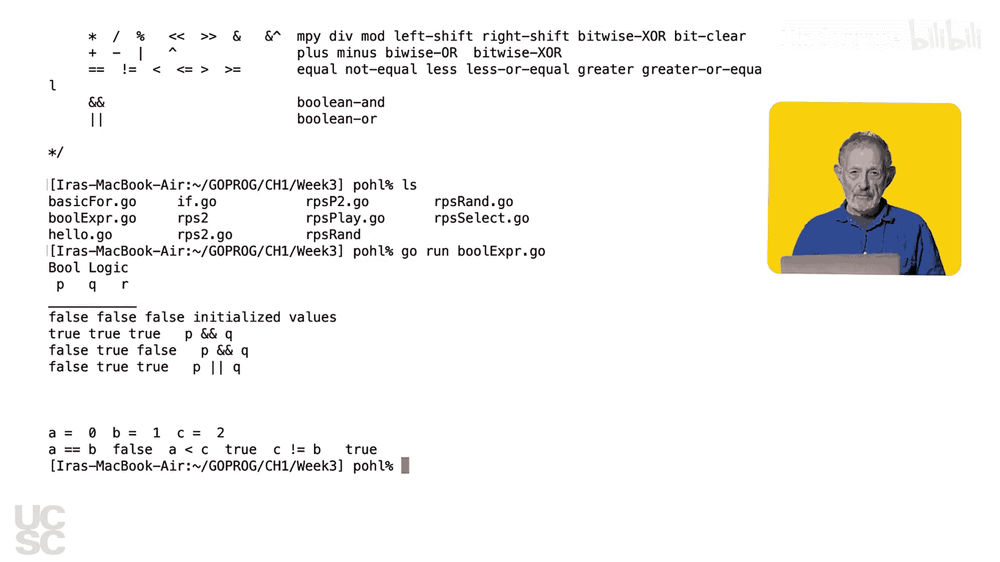

# 【加州大学】Go语言编程-｜-Go-Programming-Everyone-Part-1-p12-P12_布尔_02_01_06--BV1h3e7zBE3U_p12-

In this week's segments， we're going to concentrate on flow of control。

Scope and Booleing expressions。They all fit together。

So many simple programs and some of the ones we've done to date are what I would say are linear。

 Those are easy recipes。 Do step 1， do step2， do step 3 until you end the program。

But interesting programs have non linear flow of control， such as a branch。

 Imagine you're driving up the freeway on the peninsula。

 and you need to turn right to go to Oakland or left to go to San Francisco。

 So you have a branching decision there。 So it's not strictly linear and you do different things based on certain information or based on what you want to achieve。

Those structures are very important statements that alter the flow of control。

The statements were going to look at are the FF L statement may later will look at a switch statement。

 All these effect flow of control based on taking some decision。

And those decisions are typically made by evaluating a boolean expression。

Bullying expressions are among the simplest expressions we deal with because bulloleing expressions evaluate the one of two values。

 true or false。So they're not like the integers where there are a very large number of them。

 at least as represented on the computer。Ordinary int 32 bits can represent between plus and minus 2 billion。

So true and false， just two values。And over the week， in order to use those ideas。

We will develop a program for playing a game at sort of the very well known game， rock， paper。

 scissors。Okay， so let's look at。Bulllion。Variables and how to evaluate them。

 George Bull himself was a very famous。19th century mathematician and。

That the Boolean logic is an Eponym based on his name。So I give you a quote。

 it is not of essence of mathematics to be conversant with the ideas of number and quantity。

You can ponder that。 Okay， so let's look at some fairly simple Booleing expressions and the two that we're going to look at involve。

The and operator and the ore operator。The ant operator in go。

 just like in other in many other languages， like C， is represented by two Ampersand signs。Remember。

1 apers s sign is an address of。So you have to be very careful。 This is two ampersand signs。And。

 similarly。The logical。Bineinary ore operator is represented on the keyboard by two exclamation points。

诶。We'll find out that a single explanation point is what's called the unary negation operator。Okay。

 so。When you have two variables， P and Q in this case。We have four possibilities。 you can have true。

 true， true， false， false， true， false， false。If you have true， true， P and Q are true。

 then P and Q are also true。And P or Q are true。So the result of the operation。

 either operation is true。Now what happens when you have P S true and Q is false？Then。

The and operator results in a false。But the ore operator results in the true。

 So the character of an and operation is any time one of the subters is false。

 the overall operation is false。 Any time for the ore operator， one of the。

Sub operations or sub variables is false。As true， the result is true。

That's a way of trying to remember the result。 So the only time you get both operations ending with false is if you start both as false。

Okay。So that's。A major。Use。Of both the and and the ore operator。

The other thing to keep in mind is when you use ans and or's。In the go language。

 just like in the sea language。We。Have them executed in what's called short circuit evaluation。

Short circuit evaluation means that if the first argument， so in our P And Q。

 the first argument would P P。If the first argument determines the answer。

We strictly don't evaluate the second argument。So， for example， if， for the orar operator。

 the first argument was true， then we know the expression is true， and we wouldn't。

We wouldn't do the second argument。It's true， regardless of the second argument and the the。

A similar idea as if the first argument for an hand was false。

Then we would not evaluate the second argument。So that short circuit evaluation。

 very important in following how to understand your code and it both is more efficient than fully operating。

 but it also can mean that something wouldn't be executed unless。The preexisting thing。

Had had a value that yet didn't determine the full argument。

 which can be important in some computations。Now， let's look at a program we wrote just to play with this。

 The program will be called Bool E X PRR expression do go。

 and we inside that program play around with make sure we follow this。

 So you should also write programs like this until you're very comfortable with understanding how to evaluate Booleing expressions。

So we have a function main， we have。Three variables and all the variables are bo。And by default。

 Boolean variables。Default to false。Think 0。So we always initialize variables and go and the initialization if we don't provide a true or false。

Is going to be false。Another thing to remember is just like Bo is。A predclared variable。

So you should avoid trying to redecclare it。 Fse and true are predclared variables。Okay。

 so we're going to print that out。So that we see that everything is false。

Then we're going to change P And Q to true。 And now we're going to try to see if we understand what。

P and Q。The binary operator and performs。Then we're going to use the unary negation on P。

 So if P was true， the unary operator negation should change it now back to false。

And now if r equals P and Q。We would evaluate that as P being false。 That would short circuit。

 We'd only need to evaluate Q。 So R would end up false。

 and then we'll print it out make sure we understand what we did。

And then we're going to also look at R equals。P or Q。Print that value out。

Just so we see how that works。And now we're also going to look at some relational expression。

 So another way。That。Flow of control gets determined。

 as will turn to things like the if statement and the fores statement is by evaluating things like。

Is a equal to B？Wass A less than B is lay less than C。So we're going to try all those out， too。

 and they will also lead to a Boolean value， right， If a is not equal to B。

 then that boolean value will be false， a is equal to B， that Boolean value will be true。

 If a is less than C， that will be a Boolean value of true。 If a is equal or greater than C。

 then that value will be false。 and finally we'll look at the value of C not equal to B。

 So those are relational operators。And they're also very prominent in when we want to alter flow of control。

 So you have to understand them。The final thing we want you to understand about Booleions and Boolean operators and relationals。

 just like with anything else， they have a precedence。

Some of these operators take precede over others。So the highest precedence involves that first line there。

 which is times divide， modo， less less shift， right shift。

And then those are bit wise operations and a bit wise Xor and a bit wise clear。

And then we have plus and minus。Operators。And， finally。We have a。Are relationals。

 the equals the not equals less than less than or equal greater than greater than or equal。

 So those are below the additive operators。 And then below that is the。Logical and。

 and the lowest precedence is orre。 So what's that going to mean。

 That's going to mean if we combine things like ans with os， the ans get done first。

 just like when we combined， multiply with add。 multiply gets done first。So you have to understand。

The precedence in order to make sure you clearly understand。

In a big expression how things will be evaluated， If you don't understand it or you want it clarified。

 you can always use parentheses。 Okay， so let's turn to my terminal window and run that code just to see that it all works。

 as I said。Okay， so here I am on my terminal window and I want to look at Booleing expressions and I have it in the code。

Cat， let me put it up。Bo。So you can see that。呃。I have all these values and print statements。

 just like we saw。In my discussion on the slide， and we want to see that where P equal Q or sign true。

Remember， they were initialized for false。And now R is going to be evaluated as true here。

 the format print line where we have P and Q will'll see the answer。诶。And finally。呃。

We'll do a negation， the negation will change P from true to false。

 then we'll redo R now since the first term has turned false。

The result of a binary and il logical and。A P And Q will be false。So let's just run that。

And no surprise， if you go back to the program， you'll see false， false。

 false were indeed the initialized values。True， true， true。The result of P And Q is true。 false。

 true， false。 The result of P And Q is false， false， true， true。 The result is a true。

 because one of the arguments is true。 And then if A is 0， B is 1 and C is 2。

 Those with the initialized values of A， B And C， then A is not equal to B。

 So that's going to be false。A less than C， that's true。C， not equal to B。 That's true。 So again。

🎼Do this at home。 Moify that program， Do whatever you like。

 Make sure you understand how all those operations work。

 and especially what the precedentnce of the operations。

🎼Okay。

