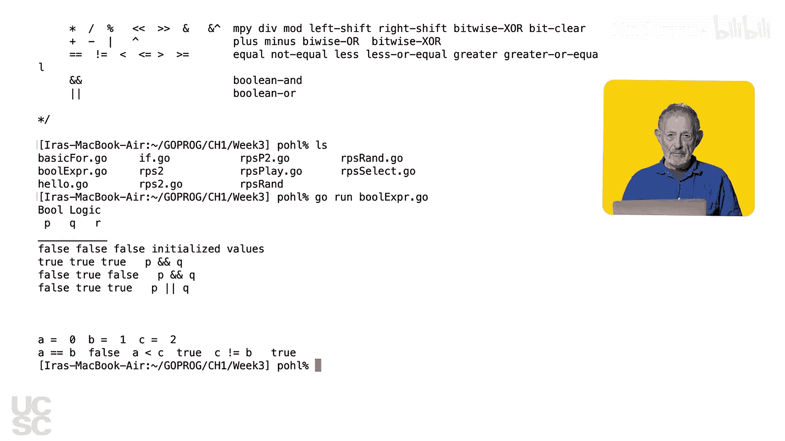

# Go语言编程：P12：布尔表达式与控制流


## 概述

在本节课中，我们将学习Go语言中的布尔表达式与控制流。我们将了解布尔变量的基本概念、逻辑运算符（`&&` 和 `||`）以及关系运算符（如 `==`、`<` 等）。这些知识是编写具有分支决策能力的非线性和有趣程序的基础。课程最后，我们将通过一个简单的程序来实践这些概念。

---

## 布尔表达式与逻辑运算符

上一节我们介绍了控制流的重要性。本节中我们来看看构成决策基础的布尔表达式。

布尔表达式是最简单的表达式之一，因为它们只求值为两个值之一：`true`（真）或 `false`（假）。这与整数类型不同，整数可以表示大量不同的值。

布尔逻辑以19世纪数学家乔治·布尔的名字命名。他有一句名言：“数学的本质不在于熟悉数和量的概念。”

我们将重点学习两个逻辑运算符：`与` 运算符和 `或` 运算符。

*   **逻辑与运算符** 在Go语言中由两个 `&&` 符号表示。请注意，单个 `&` 符号是取地址运算符。
*   **逻辑或运算符** 在键盘上由两个 `||` 符号表示。单个 `!` 符号是单目取反运算符。

以下是逻辑运算的真值表：

| P     | Q     | P && Q | P \|\| Q |
| :---- | :---- | :----- | :------- |
| true  | true  | true   | true     |
| true  | false | false  | true     |
| false | true  | false  | true     |
| false | false | false  | false    |

`与` 运算的特点是：只要有一个子项为 `false`，整个运算结果即为 `false`。
`或` 运算的特点是：只要有一个子项为 `true`，整个运算结果即为 `true`。
只有当两个子项都为 `false` 时，两个运算的结果才都是 `false`。

---

## 短路求值

在Go语言中，逻辑运算符 `&&` 和 `||` 采用 **短路求值**。

短路求值意味着：如果第一个参数已经能决定整个表达式的结果，则不会对第二个参数进行求值。

*   对于 `||` 运算符：如果第一个参数为 `true`，则整个表达式已确定为 `true`，不会计算第二个参数。
*   对于 `&&` 运算符：如果第一个参数为 `false`，则整个表达式已确定为 `false`，不会计算第二个参数。

短路求值不仅提高了效率，在某些情况下还能避免执行不必要的代码，这在编程中非常重要。

---

## 实践程序：BoolExpr.go

为了确保理解布尔表达式的求值方式，我们应该编写程序进行练习。以下是一个示例程序 `BoolExpr.go`：

```go
package main

import "fmt"

func main() {
    // 布尔变量默认初始化为 false
    var p, q, r bool
    fmt.Println(p, q, r)

    // 将 p 和 q 设为 true
    p = true
    q = true
    r = p && q
    fmt.Println(p, q, r) // 输出: true true true

    // 使用单目取反运算符
    p = !p // p 从 true 变为 false
    r = p && q // 由于 p 为 false，短路求值，r 为 false
    fmt.Println(p, q, r) // 输出: false true false

    // 使用或运算符
    r = p || q // p 为 false，但 q 为 true，所以 r 为 true
    fmt.Println(p, q, r) // 输出: false true true

    // 关系运算符示例
    a, b, c := 0, 1, 2
    fmt.Println(a == b) // false
    fmt.Println(a < c)  // true
    fmt.Println(c != b) // true
}
```

在这个程序中：
1.  我们声明了三个布尔变量 `p`、`q`、`r`，它们默认初始化为 `false`。
2.  我们将 `p` 和 `q` 设为 `true`，然后计算 `p && q` 的结果。
3.  我们使用 `!` 运算符对 `p` 取反，然后再次计算 `p && q`，观察短路求值。
4.  我们计算 `p || q` 的结果。
5.  最后，我们使用整数变量演示了关系运算符（`==`、`<`、`!=`），它们的结果也是布尔值。

---

## 关系运算符与运算符优先级

除了逻辑运算符，关系运算符也是改变控制流的关键。它们用于比较值，并返回布尔结果。

常见的关系运算符包括：
*   `==` （等于）
*   `!=` （不等于）
*   `<` （小于）
*   `<=` （小于或等于）
*   `>` （大于）
*   `>=` （大于或等于）

当表达式中包含多个运算符时，需要了解 **运算符优先级**。优先级高的运算符先计算。

以下是部分运算符的优先级顺序（从高到低）：
1.  `*` `/` `%` `<<` `>>` `&` `&^`
2.  `+` `-` `|` `^`
3.  `==` `!=` `<` `<=` `>` `>=`
4.  `&&`
5.  `||`

这意味着，在混合使用 `&&` 和 `||` 的表达式中，`&&` 会先于 `||` 被计算，就像乘法先于加法计算一样。

如果不确定优先级或为了使意图更清晰，可以始终使用括号 `()` 来明确指定计算顺序。

---

## 总结

本节课中我们一起学习了Go语言中布尔表达式与控制流的基础知识。我们了解了：
1.  布尔类型只有 `true` 和 `false` 两个值。
2.  逻辑运算符 `&&`（与）和 `||`（或）的真值表及其 **短路求值** 特性。
3.  关系运算符用于比较并产生布尔结果。
4.  **运算符优先级** 决定了复杂表达式的求值顺序，可以使用括号来明确顺序。




请务必修改并运行示例程序，尝试不同的组合，确保你完全理解这些运算的规则和优先级。这是掌握后续 `if`、`for` 等控制流语句的关键一步。