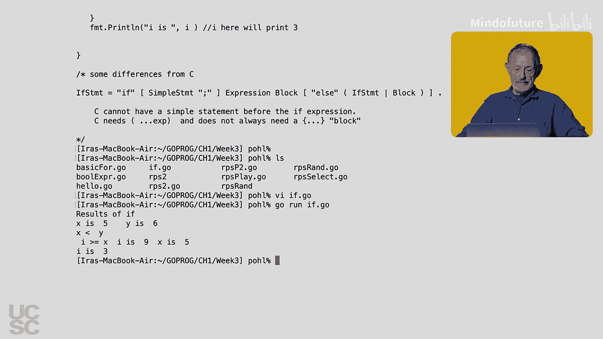

# 【加州大学】Go语言编程-｜-Go-Programming-Everyone-Part-1-p13-P13_if的使用_03_01_01--BV1h3e7zBE3U_p13-

As we said， boiling expressions are typically used to influence flow of control。

 The most elementary flow of control statement is see if。And the more elaborate if L statement。

 these allow you to choose a branch so they avoid， they can give you a linear algorithm。Where you。

Pick based on some logic。 What to do next。Now， let's look at the syntax of the if statement。

The if statement starts with the key word， if。And then it can have a simple statement， semicolon。

And then an expression block。So this is interesting， it's actually different than C。

For those of you already have。See in your background or a similar language。So the if statement。

 the simple statement part is very typically。The declaration using the colon equal operator。

Of a variable and that variable become as assign some initial value and can be used within the block that that if expression controls。

So the if expression。Controls a block。And the block is。Something where you start with a。Curly brace。

And then you end with a curly brace。 and it could have one or more statements in it。 And that part。

 that block， that first block is what we call the true part。

 So if the expression is evaluated to true， that block is executed。 Otherwise， it isn't executed。

 and then we can have。A simple if doesn't have this， but if else has the key word else。

And else would introduce the false part。So if the branch LED to false。

 then the else would be executed and the else itself could have an if statement and a block in it。

Or just the block。Okay， so critical， if you've come from a C background that this is different than C because A。

 you don't parenthesize the controlling expression。And you can have this extra assignment。

So encourage you to use the local variable inside the F。And then you're always controlling a block。

So in an ordinary C program， that could be a simple statement wouldn't be a block。呃。

So we have to avoid being confused by whatever other language we have in our background。So。

 let's go and look。At a simple program I wrote to show off how this might work。So that next program。

 oh。Before we go there， just look in this co example。 If I call equal 5 semicolon。

 that's a simple statement。That's allowed。 You don't have to have that， though。

 but you can have that。 You could just have an expression。

So what that is saying is the variable eye is declared to be within that inner block。

 It exists only there。 If there was something that was declared a eye outside of that。

 that eye would be hidden。So this is now an inner block with I。

 and once you exit the if statement block， that I disappears。

So it's what we call local variable to the if block。And then we have the condition I less than n。

 So if I was 5 and n was 10， that would be true。 But if I was 5 and n was 0， that would be false。

 The first block would be the true execution。And if we didn't， if we didn't have it true。

 we would then skip to either an else part。Whatever was next。And the program。

 either an else or whatever is next。So we're going to write now a simple program that uses these ideas to make sure we understand this logic。

 And again， I encourage you to write your own version of this or elaborate on mine。

So here's a program I'm calling it 3。2， it's the second program I wrote for the third week。

It's called if that go。And。We're going to start it by saying this as results of using the if。

And here we declare some variables， x is of course。Duck typing x is an integer 5， y is an integer 6。

I is an integer 3。And we're going to use that eye to show that I can be hidden。

 That's why it says in the common， test thecope。And then we're going to format the print line x is。

 y is。And then we're going to see a test of an if say， a very simple if statement。

 We're going to see if x less than y printed。Out that x is less than y else print out that x is greater than equal to y。

So that's using a simple F else。 Notice there are two sub blockss in there。

And which block gets executed depends on whether。The true part gets done。

 or the false part gets done。Okay。Now we'll do another if， and here we're going to hide I。

So here we declare an inner block eye。 Think of it this way。

 Think of I as having a prefix name attached to it， saying inner block I。

 as opposed to the eye outside， which is outer block eye。

So it's just like format print line gets us from format outer dot I is different than inner dot I。

So I colon equal 9 to clear sta be an integer now。Within the scope。

Scope's going to be very important。 Spe and blocks talk about the lifetime of variables。

 And when we use these flow of control statements， which will include the fourth statement for looping。

We will also always be declaring things in blocks。 Blocks can have their own nomenclature。

 their own variables that exist。In the time frame in which the block is running。

And then we check to see if I is less than x。And the inner eye hides the L eye。

 and then will produce that set of values。Depending on true or false again。And finally。

 we're going to come out of this。So， we have a。Print。And once we're outside。

 we will see the value of the outside eye， not the internal eye。So that's why when we go outside。

 I will print3 as opposed to what it prints where I was equal to 9 in the inner scope。Okay。

So that's critical。And now we'll run the program to check our understanding。

I want to show you the if program。We'll go into if thatco， we'll use BI， our editor。

We already discussed this， we have some variables， we've used duct typing to declare these three integer variables。

Then we're going to do a print line， x should be5， y should be6。If x is less than y。

 we're going to print X is less than y， which is true。 So we should get that printed out。

 The false part， the else part is is， is only if it was false， which it is。

And then we go down here and we get this local scope for I。In effect， redelared eye。

 And we now have an inner eye， which hides the outer eye。 The outer eye still exists。

 But inside here， it's hidden its mask。And then we also try， and if else。And then。

I will run the program。Lo and behold， it's what we expected。 X is 5 y is 6， and indeed。

5 is less than 6。 and then I greater than x I is 9， x is 5。So I is indeed greater than。X。

And then we say I is three because we had exited the if block。

And we go back to the initial outer value， which was 3。All of what we expect。And again。

 I encourage you to alter the program and play with these ideas because these are fundamental。

