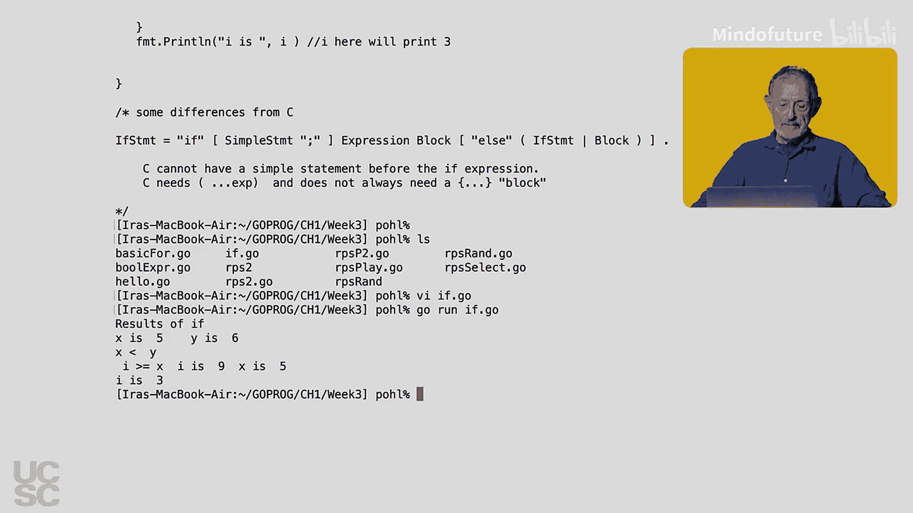

# Go语言编程：P13：if语句的使用


在本节课中，我们将要学习Go语言中最基本的流程控制语句之一：`if`语句。我们将详细探讨它的语法、结构，特别是它与C语言等语言的不同之处，并通过一个示例程序来加深理解。

## 概述

布尔表达式通常用于控制程序流程。最基础的流程控制语句是`if`语句，以及更复杂的`if-else`语句。这些语句允许你根据特定逻辑选择不同的执行路径，从而避免线性算法，实现条件分支。

## if语句的语法

`if`语句以关键字`if`开始。它的语法结构如下：

```go
if 简单语句; 条件表达式 {
    // 条件为真时执行的代码块
}
```

这与C语言有所不同。在Go中，`if`语句可以包含一个可选的**简单语句**，通常用于使用短变量声明（`:=`）初始化一个变量。这个变量的作用域仅限于这个`if`语句块内部。

`if`语句控制一个**代码块**，代码块由一对花括号 `{}` 定义，内部可以包含一条或多条语句。这个代码块被称为“真值部分”。如果条件表达式求值为`true`，则执行该代码块；否则，跳过它。

`if`语句还可以与`else`关键字结合使用，形成`if-else`结构：

```go
if 简单语句; 条件表达式 {
    // 条件为真时执行的代码块
} else {
    // 条件为假时执行的代码块
}
```

`else`部分引入了“假值部分”。如果条件为`false`，则执行`else`后的代码块。`else`后面可以直接跟一个代码块，也可以再跟一个`if`语句。

关键点在于，与C语言不同，Go语言的`if`语句**不需要**用圆括号包裹条件表达式，并且可以包含一个额外的初始化语句。同时，`if`和`else`后面必须跟一个代码块，即使是单条语句。

## 变量作用域与隐藏

在`if`语句的简单语句部分声明的变量是**局部变量**，其作用域仅限于该`if`语句块（包括`else`块）。如果外部存在同名变量，那么在`if`块内部，这个局部变量会**隐藏**外部的同名变量。一旦程序执行离开这个`if`块，局部变量就会消失，外部变量重新可见。

## 示例程序解析

上一节我们介绍了`if`语句的语法和作用域规则，本节中我们来看看一个具体的示例程序，以巩固理解。

以下是演示`if`语句用法的程序 `if.go`：

```go
package main

import "fmt"

func main() {
    // 声明变量
    x := 5
    y := 6
    i := 3 // 外部作用域的 i

    fmt.Printf("x is %d, y is %d\n", x, y)

    // 简单的 if-else 语句
    if x < y {
        fmt.Println("x is less than y")
    } else {
        fmt.Println("x is greater than or equal to y")
    }

    // 测试变量作用域：在if块内声明一个同名的 i
    if i := 9; i > x { // 此处的 i 是内部变量，隐藏了外部的 i
        fmt.Printf("Inner i (%d) is greater than x (%d)\n", i, x)
    } else {
        fmt.Printf("Inner i (%d) is NOT greater than x (%d)\n", i, x)
    }

    // 离开if块后，打印外部作用域的 i
    fmt.Printf("Outer i is %d\n", i)
}
```

程序执行步骤如下：

1.  声明三个整数变量 `x`, `y`, 和 `i`（外部`i`）。
2.  打印 `x` 和 `y` 的值。
3.  执行第一个`if-else`语句：判断 `x < y`。由于5<6为真，因此打印 `"x is less than y"`。
4.  执行第二个`if-else`语句：在条件判断前，使用 `i := 9` 声明并初始化了一个新的局部变量 `i`，它隐藏了外部的 `i`。然后判断 `i > x`（即9>5）。条件为真，因此打印内部 `i` 的值和比较结果。
5.  离开第二个`if`块后，局部变量 `i` 失效。打印语句使用的是外部作用域的 `i`，其值仍为3。

运行该程序，输出结果如下：

```
x is 5, y is 6
x is less than y
Inner i (9) is greater than x (5)
Outer i is 3
```

输出完全符合预期，清晰地展示了条件判断和变量作用域的效果。

## 总结



本节课中我们一起学习了Go语言中`if`语句的核心用法。我们了解到`if`语句的语法允许包含一个初始化语句，并且条件表达式无需括号。我们重点探讨了在`if`块内声明的变量具有局部作用域，可以隐藏外部同名变量的特性。通过编写和运行示例程序，我们实践了如何使用`if-else`进行条件分支，并观察了变量在不同作用域下的行为。理解这些概念对于编写结构清晰、逻辑正确的Go程序至关重要。