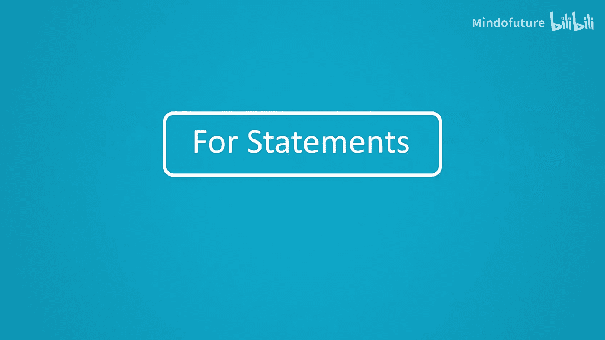
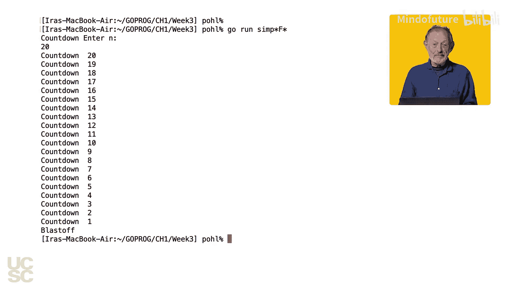

# 【加州大学】Go语言编程-｜-Go-Programming-Everyone-Part-1-p14-P14_for语句_03_01_02--BV1h3e7zBE3U_p14-

Doing competitions repeatedly is what computers are good at。People aren't。

 It's very boring to do the same thing over and over and over again。But computers have a lot of fun。

 They were actually built。To have a looping construct where they just can do this。

They can do roughly a billion things。A minute， readily。And that's why things like， very big。

Databases and flow charts， and。A spreadsheets all can be computed on。

Nearly an instant with a computer。So we want a construct in our language that lets us reflect that flow of control。

And that construct is called the force statement。 It's similar to the same kind of statement in many other language。

 including C。 And it even goes back to the original。Academic programming language， Algul 60。

 which was sought out in the9 because was called Algor 60， was 1960。

 So the idea behind this statement。Is。To get the computer to repeat things as many times as you want。

 And the thing is。How do you get it。2。Specify how often to repeat。

 So we already saw in our rock paper scissors what I consider idiomaticically to be the most important。

Foundational force statementment where you have three parts after the keyword4。So those three parts。

And will include what we see in the force statement is it will be called the。The condition part。

And there's also a force statement which involves something called a range clause。 So for。

Something that controls the fore， and then a block。

And what controls look for could either be a condition or a for clause or a range clause。

 The range clause， we will wait until we get a new data type called a slice before we actually show it。

 It doesn't。 It isn't。呃。Useful until we get slices。

But we will show the condition or forec claws style of foresstate。Okay。

 and then a condition is just an expression， namely a boolean expression。

That lets you decide on whether to go on so that expression will be evaluated to true or false。

And we saw in that last program that it was。When I was less than rounds， that was the expression。

So now let's look at the for statement with a for clauses。It's controlled by its condition。

But additionally， it can specialize an initial part and a post statement。

The initial statement may be a short variable declaration。 That's what we just saw。

 We saw I colon equals0。 So that's very common。 That means that within the within the block。

 the clauses that's being controlled。啊。I is a local variable。

Its declared specially to be used to iterate over。That piece of code。

The post statement was the I plus plus。And that was also very typical。 If we have an eye in front。

 we typically want the index that we're iterating over to increase or。Frequently。

 it's a decrement if we want to count down， and that's， again， highly en。

So here's our four claws where we have the three parts。

 the three parts are separated by two semicoons。And the initial statement， as I said。

 the I call equal is some kind of simple statement。 and the post statement is a simple statement。

 And the thing in the middle is always going to be that expression， the Boolean expression。

And here's a very simple example for I don't forget this is a declaration for I。

Declared and initialized zero。I， less than 5 is the bullolean expression to be evaluated。

 So I starts off at 0。 So that's going to start off as true。

 And then the post statement is I plus plus。 So after the whole loop is executed， that's inside a。

The block starting with the curly brackets。 In this case， we're going to do format I is I。

And then I times I times I is I cubed in effect。 So we're going to print。0 cubed，1 cubed，2 cubed。

3 cubed，4 cubed and then we'll be out of the loop。And the answers are going to be 1，0，1。Eight。

8 is 2 Q， 27 is3q。And。For cube is 64。The second form of the for loop。

Is in other languages what would be called a while loop。 And that's where we only use a condition。

We throw out the initial and post statement， and we just leave the condition in there。

 And when we leave the condition in there， we don't need to have any semicolants。

So an simple example of this is 4， I less than 5。 We're doing exactly what we just did。But notice。

I put the post statement。As I plus plus。And。Theres an assumption that I was already declared as ver I。

Iitialized to 0。So， in some sense。The two parts， the initialized simple statement and the post statement。

Got put outside the in one case the I plus plus as the post statement ends up being the last statement of what's in effect。

 what we're calling a while loop。And I must have already been declared。

 And this will print exactly as above。And for those of you who have come from a programming language with a lot while loop。

 a while loop is a very simple， essential form of looping as well， and very useful。

The last form of that we will discuss is the infinite loop。

And a very simple example of this is a four where there's no condition。When no condition。

And the four just starts with the。Controlling block， the block's controlling。

 The assumption is that it's always true。 That means it's going to run forever。

When something is running forever on your computer， there has to be a way to stop it。

 While there are a number of ways you can pull the plug on the computer。 and that's a little。Messy。

 you don't really want to do that。 but most control systems， most operating systems like Unix。

 have some way to send a signal to the machine， to the operating system to override the program that's running and stop it。

And for those of you that use Unix， that's what's called the control C。

 So you can always stop the code。But let's say you have。If you want to think about it here。 Well。

 let's look at this Again， we're going to have a four。 That's an infinite loop。

 But then we're going to check in the infinite loop after， just like with the while。

 we have I plus plus。But then we're going to see if I is greater than4， we want to stop。

The way we can stop is we can jump out of a loop by a break。 Remember， in our previous discussion。

 we use continue。 continue， jumps to the top of the loop and continues from wherever。

The next looping occurs。Break completely stops the looping and just jumps to the next executable statement。

 So if you do have an infinite loop and you have some fancy condition you want to test。

 you can put a if an if statement with a break， and that will get you out of the loop。

If you don't have that in there， as I said， it's messy， but you can use an interrupt。

To the operating system。And you can see that's what I'm just saying here in the absence of a break。

 we can use control C in the UniX operating system and that will stop the program。Let me。Demo。

 a fairly simple force。Simple forest statement program for you now。

So on the screen on my terminal here， we have a very simple four， we call the simple4。go。

And you can look at mainine。And we can see。That。We have。Some variable N that we're going to input。

And we're going to do what I'm calling the countdown， so we're going to。Imagine we're at Cap Canaval。

 we're running a big space flight， and we want our robot to have a countdown。

 So we're going to ask the user。To enter what we're counting down from。 And here's our conventional。

 very idiomatic forstatement where we have the three parts to it。 So say this is。

Probably what you will use the most。Highly enliiomatic， it's important to learn。

 that's why we're repeating it。呃呃。Of course， if you've seen this in other programming languages。

 all you really need to do， I mean， because you've used something like this is just make sure you understand。

The syntax。So we get this initial statement， which is local declaration of I assigned to the initial value of n。

 whatever was inputted。And now we test to see if I is greater than or equal to zero if it is。

A countdown works down， right， till we reach 0。And then we do a decrement rather than incrment。

 So we have a decrement statement as the statement。And again。

 think about how you could rewrite this with the kind of for statement that mimics a while or the kind of fores statement that mimics。

An infinite loop where you'd have to use a break， but you could do it in each case。

 and that should become very familiar to you。So here we're going to check and we're going to。A。

Either countdown， print the countdown， or at the end of the countdown， we're going to do a blast off。

Let me run that program。I'm going to enter in。All right， why don't I enter 20。Okay。

So we count down 20， 191817， as expected， all the way down to one blast off。No problem， very simple。

 just make sure you understand all that。

