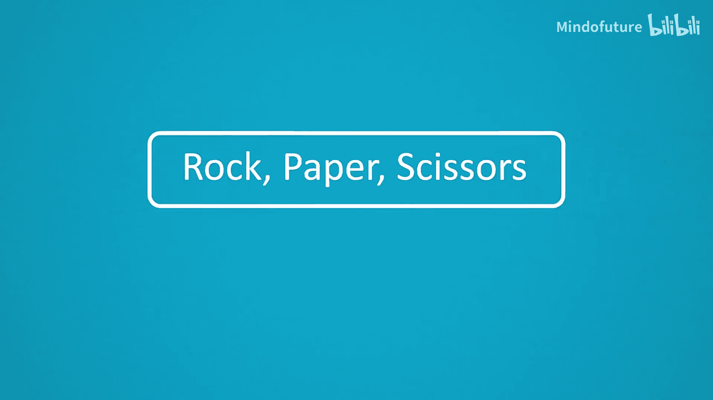
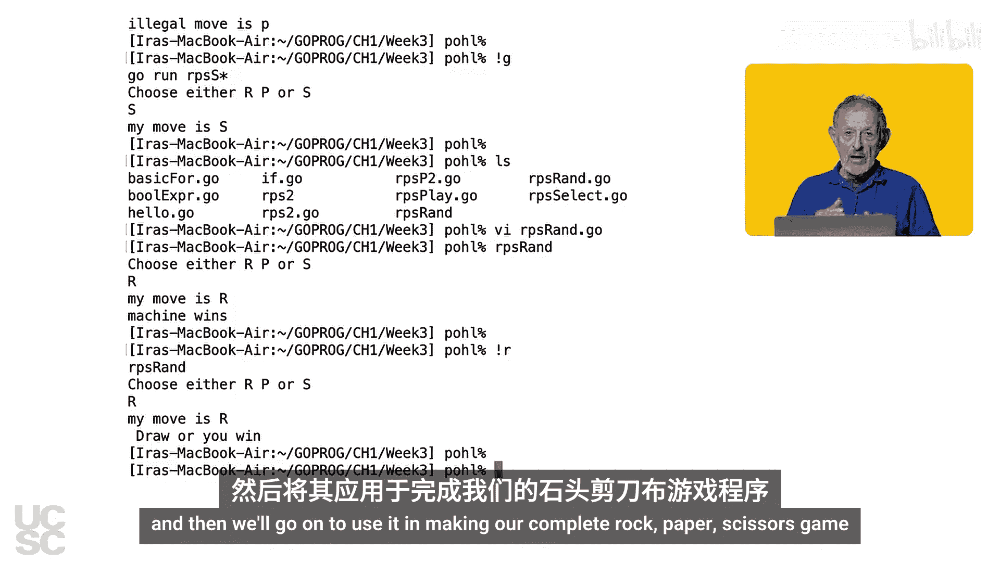

# 【加州大学】Go语言编程-｜-Go-Programming-Everyone-Part-1-p15-P15_剪刀石头布_03_01_03--BV1h3e7zBE3U_p15-

Okay， so now we have some of the basic ideas and how flow of control can work。

And how it makes for more interesting programs。And we're going to use it to program a game。

The rest of the week， we are going to develop。A rock paper， scissors。

Programming game that we can play against the machine。 The machine will be our opponent。And。At first。

 we'll use the if statement to create branches。And later。

 as we have a more elaborate version of the program。

 we will use a force statement to create a loop so that we can play the game over and over again。

Now rock paper sciss is a classic game， if you recall。

 you have three choices you gave to choose a rock。You can choose paper or you can choose scissors。

 and that was little childhood game。 And that's how you represent it。

 You count the three and you say1，2，3。 And then you put out one of those three signals。

And your opponent does it at the same time。Of course， if you wanted to cheat。

 you could be a little slower than your opponent。But。We're considering this fair game。

And who wins dependenceds on。呃。What the results are， and the results can be。

 you both get the same the same choice。 Let's say you both have paper。

 any time you both have the same choice。 that's considered a tie。But if you have paper。

Paper gets cut by scissors， so scissors beats paper。But scissors get smashed by rock。

 So if you have scissors rock。The rock wins。 Now paper rock， the paper covers the rock。

 So paper winds。 So those are our choices， and those are the results。 And you can see why you need。

An if statement to decide on these things。So now we're going to write the basics。For。

Installing your move， so let's look at this program。呃。Inside the program in the funk。

We're going to want to read in your move。So let's look down at the code in mainine。

So let's start with， we haven't been using Roe R U and E is a data type。

And it's the data type that's intended to mean a character。And again。

 rune like int or F 32 is a predeclared identifier。It's actually what is called a synonym for N32。

 but using Roe implies in the program that we're going to use it to store character values。

So now we're going to say to the to the。Person playing a game is your choice， choose either R。

 P or S。Rock paper or scissors。 And then we'll do a format scan F， and we'll use the format Pre C。

 Pre C gets us the interpretation of move as a rune or character。And now。Depending on what we see。

 we do the if statement。 if the move is。Equal to a character R， capital R， then。And internally。

 I I store that。As my move else， if the move is a is a P， we have that value for move。

 We can print it out。 else， if it's an S， we can also print it out else。We've made an illegal move。

 So I'm also allowing。The program at this point to check to see that you've。

Inputted one of the three legal。Moves。And here's one place where you could make a more elaborate program。

 You can， there are a couple of things you could do here。

You could either decide if the move was illegal to ask the player to play the move again。

 That would be normal。And we'll see how to do that later。 That will involve looping。啊。

Or you could also as a choice。诶。Have more than one way to enter something like R。

 You might allow both Capelar and lowercase R。诶。And finally。

 you might have something else that if it's an illegal move， you could choose a default option。

 like an legal move is always intended to be paper。

 So there are different ways to make the program more robust and we'll use one of those methods later on。

And we can see there's some differences as said before in the syntax from C。

 since many of you are coming from a C background。The condition and statement is how you do the if。

 you don't。 I just have a simple condition inside parentheses， and then you always have a block。Okay。

So that's our program。And let's see what is critical in the program is a very minor program。

 it's only the input part。And here， format that scanf。 remember， single ampersand。

 double ampersand is logical and。 S ampersand is address of。

 and that's what you need when you do a scanf。And you need the percent C because we want it to be a character。

And here we have what you might call a complicated if else。

 because our choices are going to be either are。Or P。Or S。

And we want to check that we have the right one of those。

And then tell echo what our choice was to the user。Otherwise。

 we're going to show that we inputed something wrong and will write out that an error has occurred。

So it's a fairly simple program。 It's only demonstrating how to do the input from the user in playing the game。

 as I say， as we go on。I will elaborate on this program so that it'll actually let you play against the computer。

So that this is our first。Part of the programming。And we want to test it out。

And there will be more to do。 What will we do， We'll add a machine opponent。

 How will the machine opponent decide on a move。We're going to use this other idea we've used in the past。

 and that's a random number generator。And that's a really good choice， because it's very。

 if I was playing against somebody that always used rock， what would I do， I would start to learn。

 Oh， rock。 Well， I always beat rock with paper。 So if I had a really dumb kid， I was playing against。

 and they always like to use rock， as I think that smashes everything。

 I would always come up with paper。So I don't want the machine to be that simple minded。

 And how can I avoid that， I randomize its choice。And then。

The programme will keep track of who I who， who has won。

 So we'll ultimately end up playing a large number of games or even decide。 O。

 let me play the machine 10 times and we'll see who's better After 10 times。

 there'll be a certain number of ties。 There'll be a certain number of wins by the machine。

 A certain number of wins by the user and we'll print out。Those statistics。And。

We'll go on to use those ideas。In our next segment。

So let's try out that code we just talked about very straightforward。 Again。

 we're going to turn this into a more elaborate program。

 but this is just going to show how to use the input。

So I have my move that's going to be a tight broon。I do a scan F。

That means I'm prompted to either enter a capital RPp or S。Then I have the program echo my move。

Unless there's an error in which case it reports the error， but。呃。哎哎。

I don't have a mechanism yet for correcting the error I will later on。So let's go and run that。Okay。

 so up comes the prompt， choose either RP P or S。诶。Let me choose P。And it says my move is speed。

 fine and dandy， let me redo that。Why don't I choose lowercase P and see what happens。

 I choose lowercase P， and it says， wait a minute。 It does echo my move。

 but then it says it's an illegal move。So。U。I'll do one more time。Let me do an S。

And now it says my move is S， okay， so it all seems to work。

If you want to think about it before I move on to show you how to do some。

A loop that supports getting a correct move。 You might want to think about that。

 And we're also going to use a loop。 We're going to go on to how you use four loops to not only do the correction。

 but also play the game multiple times。 So now we're going to go on and。

Develop our program for rock paper scissors。Further。

And here we're going to have the machine opponent。And we're going to， in some sense。

 have a very simple AI artificial intelligence。Where the machine decides based on using a random。

 a pseudo random number to make its move。 It turns out that's very smart， actually， because。

That shows that there isn't any pattern in what the machine will be doing。

 and so doesn't allow a smart human。To。Guess what the machine is doing， where it's not so smart。Is。

What if the human is stupid。The human starts always saying paper。What should the machine do。

 The machine should recognize that and say， oh， that human really likes paper。

 I'm going to start liking scissors。So maybe somewhere in the future。

We will try and do what's called learning， where we can learn from our opponent's behavior。

 how to improve on our strategy。 But that's。Yet， for another day。

So we're just going to come up with the machine opponent， basically。

Adding a random number generator to pick a move by the machine and then play it against what the human has decided。

So you have to read in your decision。Make your move。Weve already seen how to do that。

 And now we need to import mat out R and time。 Remember why we import time。

 We import time so that the random number generator doesn't always start in the same position。So。

It's called a seed。 The seed determines where a random number sequence that's generated by these means is really just a very large sequence of numbers that appears to be random。

Where random is some probabilistic notion。But if we were to start a random sequence at the same place。

 we'd always get the same sequence。 And we don't want that。 And the way to avoid that is to use。

Un next time。Function to get us a different starting point。And now。

We again have for our move the run， and then we have a machine move。Will let the machine move be 0。

1 or 2， where 0 is rock。One is paper。And two is scissors。Again， just like we did in the last program。

We'll ask for will' prompt the user for their move。And then we'll， as I say。

 we'll just repeat what we've done to show that we indeed got an appropriate move。And then otherwise。

We check for the illegal move。 Now， notice here in the block where their legal move happens。

 I have a return。So far， I haven't talked about that。

 but return is another way to affect flow of control。Return。An essence stops the program。It says。

 go back to the operating system。 Now， why do I want to stop it， Because I haven' an legal move。 Now。

 later， I'm going to show how to ask for it again。 so I don't have to stop the program。

But for this point， I'm going to stop the program， it'll exit。From this block。And so。

 returns very important。Now I start what we've done before to get a random number。And notice。

 I want 0，1 or 2。 And the way to do that is to use the function R int n with3。 So 3 is the upper end。

 And that lets me get 0，1 or 2。 Remember， we did this with die。 and we wanted。呃。One to six。

 and we use。呃。We did six。And because that got us zero to five， we added one。In this case。

 we're just using0，1 or2。 and then as we noted before， if the machine move is 0 and our move is S。

 the machine wins Y because the machine move being0 is a rock。And a rock beats a scissors。

 If the machine move is one and our move is a rock。Then the machine wins。

 So these are all the ways the machine wins when the machine chooses。Those moves。

 it wins over scissors rock and paper。Else。You either win or draw。 Now， later。

 I'm going to discriminate between draw a win。 But if the machine wins， you didn't win。

 And if the machine doesn't win。 if that whole series of if else's is false。

 then the last else must be。The correct alternative。 And that means you drew or won。So。

That's our program。 Let's look in more detail。 and the next slide will dissect the program。 again。

 Rand dot seed， very important。 This lets us start a different position every time we run the program so we don't get the same behavior。

Then R int N 3， the argument 3 tells us 0 up to 3，0，1 or 2。 If we had 0， if we had 10 there。

 it would be 0 up to 9， but we only have three possibilities。

 So the machine is choosing equally among the three possibilities。

And then we check where we know the machine move， so zero means paper and no excuse me。

 zero means rock。And Rockbe scissors。So that's how we decide。And otherwise。

 we go on to the next branch the next branch， we get one， one means paper and paper covers rock。

 So that's so we've enumerating here。 the last one is。Cciissors beats paper。 scissors cuts paper。

 So those are the three ways the machine wins。 If the machine didn't win， it's a draw。

And we're done with the program。And we're going to add more， as I say， we're going to make this。

Code that lets us play the game multiple times by adding a for loopop。But let's see how this works。

 and now we'll go and run this code。Okay， here's the code we。Talked about。呃。

We've added to our initial program。This random number generator。

 and we've created a way for the machine to make a move。We've tested it。

And we can decide the machino print out whether we've。

Whether the machine won or whether it was a drawer or you won。And。

I will show you how to do this in detail。And a more elaborate program where you can discriminate between。

Youre winning or youre drawing。But you might want to think about that before viewing the next segment。

 so let's see how this works。I've already compiled this code。

So all I need to do is call it RPS RA is the executable。And it says it's before， choose a move。

 so I'll choose rock。I chose Rock。 My move is Zc。 The machine wins。Let me do it again。

I'll choose rock again。Said I drew or you won， so the machine didn't win。

So notice the random number generator didn't start at the same sequence。 And this time。

 it didn't assign。What must have been paper if the machine had won before。

 and now it must be either rock。呃。Since my move is rock， it must have either been scissors or rock。

And it doesn't discriminate。Okay， so it looks like everything is working。

 And the next thing we'll have to understand。 I'll talk about in detail is how to write loops。

 What machines are really good at is doing things over and over again。Tens of times。

 hundreds of times， millions of times。 And so that's why you really want computers and。

How to get it done in a high level language like O is to use the forlo。

 And so we'll first discuss the forlo， and then we'll go on to use it in making our。

A complete Rock Pa scissors Game plan program。

