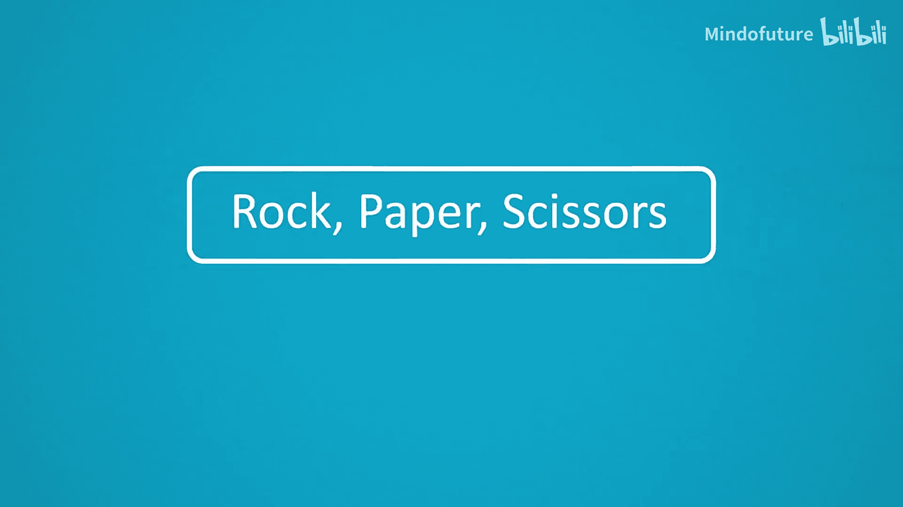
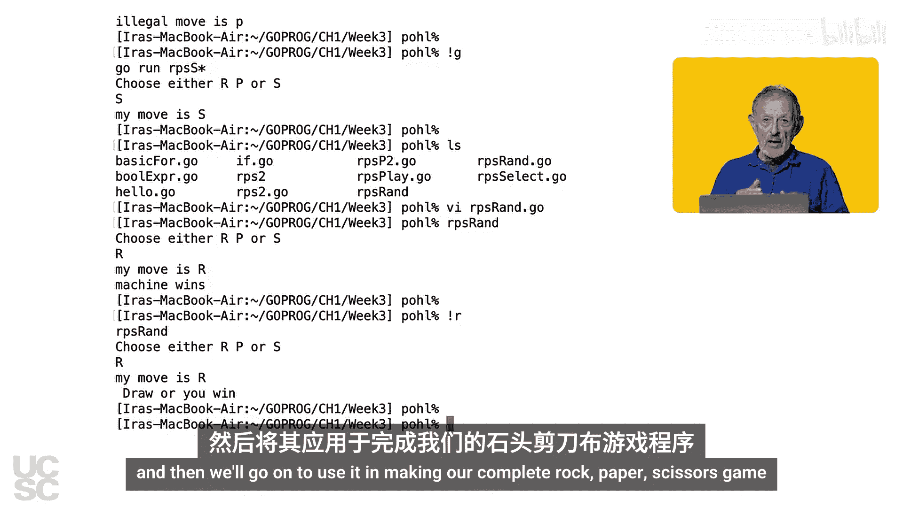

# Go语言编程：P15：剪刀石头布游戏开发教程




## 概述

在本节课中，我们将学习如何使用Go语言开发一个完整的“剪刀石头布”游戏。我们将从基础的用户输入处理开始，逐步引入随机数生成器来模拟机器对手，并最终使用循环结构让游戏可以反复进行。通过这个项目，你将掌握条件判断、随机数生成以及循环控制等核心编程概念。

---

## 章节1：游戏基础与用户输入处理

上一节我们介绍了控制流的基本概念。本节中，我们来看看如何利用这些概念编写一个有趣的程序——剪刀石头布游戏。

剪刀石头布是一个经典游戏。玩家有三个选择：石头（R）、布（P）或剪刀（S）。游戏规则如下：
*   平局：双方选择相同。
*   剪刀赢布，布赢石头，石头赢剪刀。

我们需要使用 `if` 语句来判断游戏结果。现在，我们先编写处理用户输入的基础部分。

以下是处理用户输入的核心代码步骤：

1.  **声明变量**：使用 `rune` 类型变量存储用户的选择。`rune` 是Go语言中用于表示字符的类型。
    ```go
    var playerMove rune
    ```
2.  **提示并读取输入**：提示用户输入，并使用 `fmt.Scanf` 读取一个字符。
    ```go
    fmt.Print("Choose either R, P or S: ")
    fmt.Scanf("%c", &playerMove)
    ```
3.  **验证并处理输入**：使用 `if-else` 语句检查输入是否为合法的 R、P 或 S，并回显用户的选择。对于非法输入，报告错误。
    ```go
    if playerMove == 'R' {
        fmt.Println("My move is R")
    } else if playerMove == 'P' {
        fmt.Println("My move is P")
    } else if playerMove == 'S' {
        fmt.Println("My move is S")
    } else {
        fmt.Println("Illegal move")
    }
    ```

这个程序演示了如何从用户那里获取输入并进行基本的验证。目前，如果输入非法，程序只会报告错误并结束。在后续章节，我们将学习如何通过循环让用户重新输入。

---

## 章节2：引入机器对手

现在我们已经能够处理用户的输入。本节中，我们将为游戏添加一个机器对手，让它能够随机出拳，从而使游戏变得可玩。

为了让游戏公平且有趣，我们不希望机器总是出同样的拳。因此，我们将使用随机数生成器来让机器在石头、布和剪刀中随机选择。这模拟了一个没有固定模式的对手。

以下是引入机器对手的关键步骤：

1.  **导入包并初始化随机数种子**：导入 `math/rand` 和 `time` 包。使用当前时间作为随机数生成器的种子，确保每次运行程序时序列都不同。
    ```go
    import (
        "fmt"
        "math/rand"
        "time"
    )
    func main() {
        rand.Seed(time.Now().UnixNano())
        // ... 其他代码
    }
    ```
2.  **生成机器的出拳**：使用 `rand.Intn(3)` 生成一个 0 到 2 之间的随机整数，分别代表石头（0）、布（1）和剪刀（2）。
    ```go
    machineMove := rand.Intn(3) // 0=Rock, 1=Paper, 2=Scissors
    ```
3.  **判断胜负**：在获取用户合法输入后，根据游戏规则，使用一系列 `if` 语句判断机器是否获胜。
    ```go
    // 假设 playerMove 已正确读取为 'R', 'P', 或 'S'
    // machineMove 为 0, 1, 2
    if machineMove == 0 && playerMove == 'S' { // 石头赢剪刀
        fmt.Println("The machine wins")
    } else if machineMove == 1 && playerMove == 'R' { // 布赢石头
        fmt.Println("The machine wins")
    } else if machineMove == 2 && playerMove == 'P' { // 剪刀赢布
        fmt.Println("The machine wins")
    } else {
        // 如果不是机器赢，则可能是玩家赢或平局
        fmt.Println("You drew or won")
    }
    ```
4.  **处理非法输入**：如果用户输入非法，我们使用 `return` 语句提前结束程序。后续我们将改进这一点。
    ```go
    if playerMove != 'R' && playerMove != 'P' && playerMove != 'S' {
        fmt.Println("Illegal move")
        return // 退出程序
    }
    ```

现在，程序已经能够实现用户与机器进行一轮游戏。机器会随机出拳，并根据规则判断本轮是机器获胜，还是玩家获胜/平局。

---

## 章节3：使用循环完善游戏体验

目前我们的游戏只能进行一轮。本节中，我们将利用 `for` 循环来完善游戏体验，实现两个关键功能：允许玩家多次游戏，以及在输入错误时提供重新输入的机会。

计算机非常擅长重复执行任务。在Go语言中，我们使用 `for` 循环来实现这一功能。我们将用循环包裹游戏的主要逻辑。

以下是使用循环完善游戏的两个主要改进方向：

1.  **允许重复游戏**：通过循环，让玩家可以连续进行多轮游戏，例如10轮，并最终统计胜负和平局的次数。
2.  **验证输入直至合法**：当用户输入非法字符时，不直接退出程序，而是提示错误并再次请求输入，直到获得合法输入为止。

一个简单的 `for` 循环示例，用于重复游戏10次：
```go
for gameCount := 0; gameCount < 10; gameCount++ {
    // 这里是单轮游戏的完整逻辑
    // 包括：提示输入、读取并验证输入、机器出拳、判断胜负、记录结果
}
```

在循环体内，我们可以嵌入另一个循环来处理输入验证：
```go
for {
    fmt.Print("Choose either R, P or S: ")
    fmt.Scanf("%c", &playerMove)
    // 清除输入缓冲区中的换行符（如果需要）
    // fmt.Scanf("%c", &dummy)

    if playerMove == 'R' || playerMove == 'P' || playerMove == 'S' {
        break // 输入合法，跳出这个输入循环
    } else {
        fmt.Println("Illegal move. Please try again.")
    }
}
```

通过结合这两种循环，我们可以构建一个健壮且用户友好的完整游戏程序。在后续的扩展中，还可以在循环外添加变量来累计胜负平局数，并在10轮结束后打印统计信息。

---

## 总结




本节课中我们一起学习了如何使用Go语言逐步构建一个“剪刀石头布”游戏。我们从处理基础的用户输入和条件判断开始，然后引入了随机数生成器来创建机器对手，最后探讨了如何利用 `for` 循环来实现游戏的重复进行和输入验证。通过这些步骤，你不仅学会了控制流语句的实际应用，还掌握了如何将小功能模块组合成一个完整的小项目。