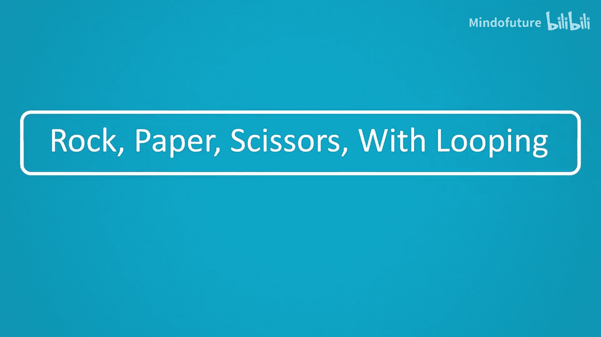
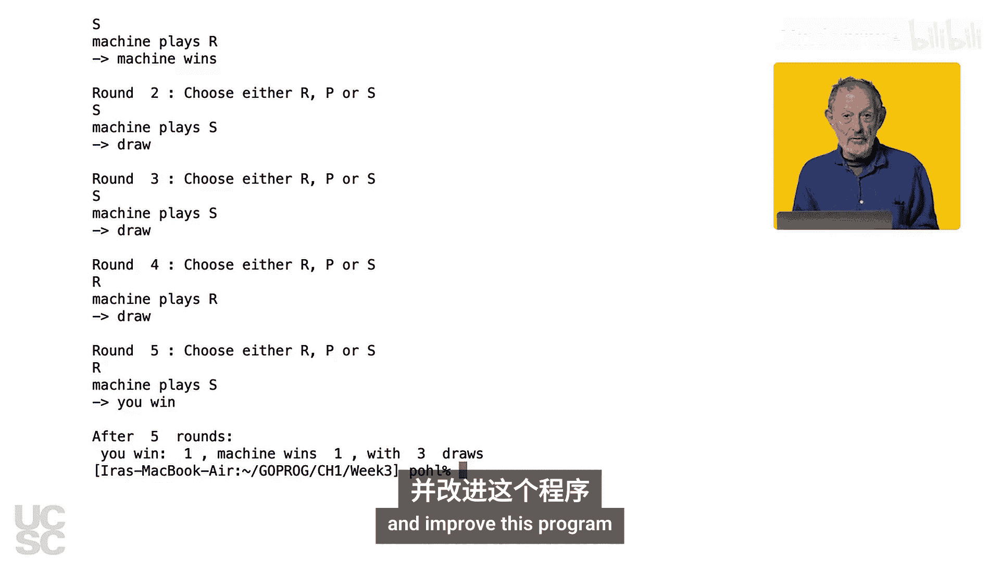

# 【加州大学】Go语言编程-｜-Go-Programming-Everyone-Part-1-p16-P16_带循环的剪刀石头布_03_01_04--BV1h3e7zBE3U_p16-

So now we're going to build our final version of the Rock Paper scissors game。And in this version。

 we're going to allow the user to specify the number of games to play against the machine。

So typically， when you're playing with a friend， you say。

 let's play 10 games and we'll count up who wins the most games and of course。

 you can draw on at the end。That's。The result of the contest。Now。

One of the things when you enter your move to the machine with RPP and S。

 you can often make a mistake。And we're going to show you how you can recover from a mistaken entry。

And one of the ways you'll be able to recover。Is。We will introduce the looping force statement。

And that'll be。Among the most useful statements we have available in the go language。

So looking at our main function， we have what we had before。

 we have a representation of the game where rock is zero， paper is one， scissors is two。

And we have also the ability to input the single characters of what we call runs。

A P and S capitalized。For the user moves， the user is going to be prompted。To decide on。

What move to make。And we're also going to decide on how many rounds to play。

 Are we going to play 5 rounds，10 rounds，1 round，100 rounds。

And that's all going to involve using looping。 again， machines are very good at looping。

 That's why we built the machine so they can do very large numbers of things very quickly。

So the machine prompts you and says。How many rounds do you want to play And you can put it a number 10 and notice again that you're always using this ampiand rounds。

When you're inputting something to scan F。Because。You need to know the address where you put the integer result in and percent D is the format for integer。

Okay。Then， the user。We'll be entering the R S or P。 And now we see how the for loop checks on that。

 First off， the for loop。诶。Has。The number of rounds and here's the structure。We use the key word for。

 and in this case， we have a statement， I。Colon equals0， and that means that I is initialized with 0。

 and through duct typing， I becomes a local integer value。

 So several things are going on with that I colon equals 0 that's very important to understand。

 We've already used this in declaring variables。 We have an initialization to 0。

 we have the declaration of I， and we know that I is local to the brace and closed block。

 So once we leave that four statement that I disappears。And then we have the test。

 So there are going to be three parts。 You'll see it this two semi colonons。

 And they separate three parts。 The first part， you can consider the statement or initialization part。

 The second part is the test。 It's a boolean。 and you。Evaluate to see if it's true or false。

 If it's true， the loop continues。 So as long as that second statement stays true。

 it's an expression。 As long as that expression stays true in the for statementment。

 the for statementment loop， the the block。 That's the for statementment as executed。And finally。

We have the increment statement， I plus plus。Why do we need that？ Well。

 we want to stop at some point。 If we didn't have that in there， I would stay 0。

 and the loop would just keep going。 So by incrementing。

 this is the very most common idiom in a for statement。In a fourth statement， you start， and then。

 of course， with go， as with C and other languages， you start at 0， you could start another value。

 You go a certain number of rounds， and you increment each time so that finally。

 you'll get out of the loop。So if you had installed， inputted for rounds。The integer 10。

The loop would occur 10 times。 And now we go inside the block and you can see further code。

 and it tells you， choose either R， P or S。And。It prints the round number。

 And then we scan in the move。 And remember， C move is we get percent C。

 Per C is the format for character。And that is C move was a run type。

 So we're going to get the R S or P。 and then。We do a further check。To see。

We're going to convert internally from the。The character that we've gotten to a number。

 So C move equals equals C rock， then move equals rock else of C move equals C paper that move equals paper。

 So paper again， remember is one。 So that will assign one。 And then if C move equals。See scissors。

 then move equal scissors。And else， if we had inputted anything else。

We would have inputted in a legal move。And since we've inputted a meagle move。

 we don't want the increment of the loop to continue。 So we decrement the loop here。

And then we use a special flow of control statement called the continue。

And the continuum means jump outside the loop。 Go back to the top of the loop。

So by using continue here， we avoid the rest of the forstate。 We go back to the loop。

 What's at the top of the loop at the top of the loop， we ask。The user ta put a move again。

 So if you made a mistake in your typing， let's say you type lowercase R and you wanted upper case R。

You would just see the prompt again。 It would tell you you made an illegal move。

 put in your put in your move again。 And then everything would continue。

 Were going to use as our AI for the machine， just a random number generator。

 It's actually a very good choice。 Why are we choosing a random number generator， Because。

We don't want the opponent to guess our pattern。 If all the time we use paper。

 the opponent's going to start understanding， oh， that person is stuck with paper。

 I will just keep using scissors， and your opponent will win。

But when your opponent is just randomly picking out what to choose next， you don't have an ability。

wo。Choose an oppositional strategy， there's nothing you can do about that。

Probably the best thing for you is just again， for you to do a random thing。

 Or if you really knew they were random， you could choose to do anything because it isn't going to matter。

Okay， so here we're doing the traditional RAand do seed so that each time we run the code we'll get a different starting point。

The machine move is going to be either 0，1 or 2。 That's what RA dot in1 of 3 gets us。

 And then the if statement， which is a fairly straightforward if statement。

 converts the integer machine move because we got an integer out of the ran into the character move。

 So we just get a conversion and we。Can。Go on from there to determine who will win。In the next slide。

 we'll see how we determine the result。We're going to check to see if the move is equal to the machine move。

So move is your move。 Ma moves the machine move。 If they're equal， that means。

 let's say you both did paper Any time they're equal， That's a draw。

 If you do scissors and they do scissors。 That's a draw。So all that that's a very simple outcome。

 You both made the same move。 A draw occurs。 That's the end of the if statement。

The next case is they're not equal。 So if they're not equal， then we take a look and see。If。

One move is equal to the paper， and the machine move is equal to。Cciissors。

Then the machine is going to win， scissors cuts paper。So that logical expression， the and expression。

AndRemember， it short circuited and expression checks to see if paper is beaten by scissors。

And we'll also print out the result that the machine wins， and then we'll skip to the end。 Else。

 we'll check to see if the move is rock and the machine will win， if the move is rock。

 if the machine has chosen paper。 So that's what the next。A logical expression did。 again。

 we increment at the machine one。 And then finally， we check on whether the machine wins if the move。

 we make is scissors and the machine made the move rock， in which case， rock breaks scissors。

 the machine wins。And。We're done with deciding whether the machine won。

If none of those condition had held。So it hadn't been a draw， and the machine hadn't won。What's left？

You have to win。 So we'll just increment your wins。And that's the little package for producing。

Who will have won。And then we can just conclude we're out of the loop format after the number of rounds。

Winds have now the accumulated number of wins for the user， machine wins。

 the accumulated wins for the machine and otherwise draws， and we know the result。Okay。

 so that's the program。 That's now the complete package。 and let's turn to。

Running this on my terminal。 All right， so I have this up on my terminal。

 Let's just quickly go through the whole program because we did a piecemeal just now。 Remember。

 math thoughtt ran imports the random number programs。 Time is because we want to use Unix time。

For a seed。And here's our two representations。I want you to notice something about the dual representation。

 you don't need that。We could just play the game with 0，1 and 2。 We could make the user enter 0。

1 or2。 That would probably simplify things， though in order to show runs and this nice version of Kt。

I included in this program， but I would probably， if you want to improve on the program。

 I would probably simplify this and choose to only use the integer representation of rock paper and scissors and that'll cut out a lot of stuff in there。

Okay， again， we have all these variables because we want to know the number of rounds。

We have to keep track of who wins the machine wins， our wins。We first asked for how many rounds。

 and then we have this big first fourth statement， and I've already explained it。

 The I assign 0 means that I is local to that big block。 The block starts with that。Open brace。

It's very much like sea code， except that in sea code。

It would have to be a slightly different syntax in that you would use Parends around the three parts of what the four statement uses。

So， we start off。And the first thing we do is。We check to see if we have。A move。We've then it a move。

 And here's the crucial point。 This is one point I want to go over again。

We struck and continue with an I minus minus in there。 If there was an illegal move。 Why is that。

If there had been。An a legal move。I don't want the whole thing to blow up。

 I want you to get another opportunity to enter。The result。So。

I allow you to go back to the top of the loop， which would again， ask for the next result。

 But since we don't have a current value， correct value for what the user entered。

 I don't want to go ahead and execute the rest of the loop。

 Coninue allows me to jump out of the loop at this point。And go back to the top of the loop。

And do whatever we do when we start to loop again。So continues very important when I have to have。

A special kind of。Flow of control。Now， here， we're doing what the machine did。 We said that again。

 I didn't。 I don't need to repeat it。And this determines the result and you can see。Clearly， how。

I have these three parallel bulloleing expressions。 Now。

 an interesting thing you could also try to do。 I encourage you to do is to change that if。

To one big expression for when the machine wents， you could combine all these expressions。

 And the way you would do it is。A big set of ans ord together。

 so the three kinds of things that win would be ore conditions， and then that could all change。

And then you would have the same logic， but you'd only have this one massive bulloleying expression。

And finally， you get to。The result。I've already compiled that。

 so I'll just run it to see that we can actually do this。嗯。me just。It was R PS2。

So here's the machine asking you for your choice， let's choose paper。Let's see what happened， oh。

 I did。Excuse me。 I don't think I。This is not the right code here。

 What I needed was I need to compile that code， so。That's the code for just running it once。

So let's do this， let's actually run。R as。Rps。All right。 That's Now this is right。

 The first thing you expect from the prompt is， how many rounds do you want to play。

Let's say I want to play five rounds。Now it says choose for round one your move， now I'll choose。

 let's choose scissors。The machine， the random number generator。

 chose rock and the machine wins because rock smashes scissors。What if I choose scissors again。

 round two？This time it was a draw。 Don't forget the machine is playing at random。

I'm going to choose scissors again。A draw again。Now I'll change the rock。Another draw。

 and now I'll change the rock again。I won that last round。 So I won once。 the machine won once。

 There were three draws。No biggie。An interesting thing that。

I'm going to assign you is to think about sticking。A。

Further a piece of intelligence into this program。Where the programme in a long game keeps track of how the opponent is picking moves。

 And if the machine sees a trend in how the opponent is picking moves。The machine attempts to。

Counter that strategy。So rather than randomly at random， if I were going to do something at random。

 I would expect to have an equal number of wins and losses。But if it isn't random， and。

I'm smarter than my opponent。 I should be able to do better。And how can I tell that， Well。

 I can just see if。My opponent has some preferences。

So that's going to be the nature of your next assignment to think out how you can add that。

And improve this program。

🎼Okayッケ。

