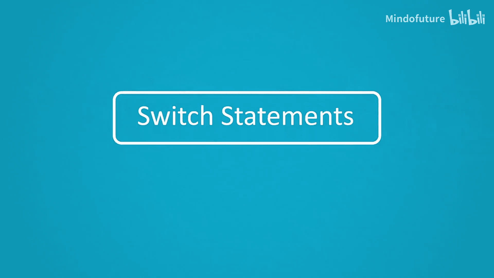
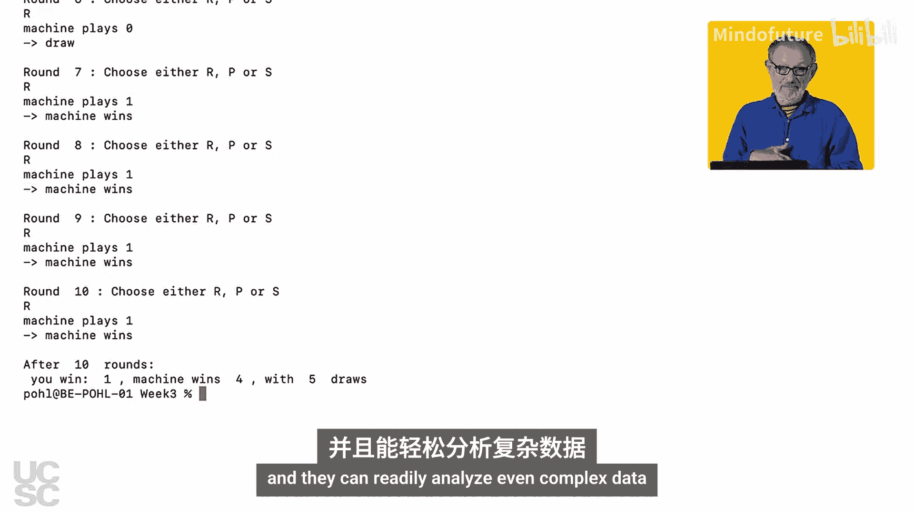

# 【加州大学】Go语言编程-｜-Go-Programming-Everyone-Part-1-p17-P17_switch语句_03_01_05--BV1h3e7zBE3U_p17-

The switch is a multiway branch statement。And we can use it to replace complicated FL statements。

And we saw that we used such a statement in a rock paper scissors program。

To decide whether we won or the machine won。 So let's look at how we did that with the F else。

So there we would check on whether the move was the same as the machine move。

 Move represents the user's move。And the machine move， if you remember， was generated randomly。

 And then if they're the same， it's a draw。 So we increment the number of draws。Else。

 we check on the conditions that let the machine win。 And the first condition is， well。

 what if our move is paper and the machine move was scissors。

Then the machine wins because scissors caught paper。 So we increment at the machine wins。

 We print that out and continue。 The continuous statement jumps to the next part of the loop。

 meaning the next game。And then further on， we're checking， for example， if the move is scissors。

 that's our move， the user move and machine move is rock。Rock smashes scissors。 Again。

 The machine wins。 Again， we print that out， and we continue to the next round of the game。Now。

 when we've checked the three conditions under which the machine has one。

If none of those has existed and the machine and I did not draw。

 well the only thing remaining is the else condition where we win。

 So we increment our wins and print out that we win。 And that's the end of the loop。

 So we don't need to continue there。Now。We want to use the switch syntax again。

 the switch syntax gives us a way to provide a multi way execution statement， again。

 it's an interesting way to change flow of control。

So an expression or a type is compared to the cases inside the switch。

 The switch statement can be of those two types， an expression switch statement or a type switch statement。

Synactically， but we will not be talking here about the type switch statement。

 because that's way more advanced。 So we may see that in a later course， but not here。

 So we'll talk about the expression。A switch statement。In the expression switch statement。

Switch expression is evaluated。And then we look for which case is satisfied by the switch expression。

 So， for example， if we had a switch expression that was an integer and we had the integer 3 as the value of the switch expression。

 if there was a case that was3， that would be the case that was executed。And we look top to bottom。

 The cases get evaluated in order， top to bottom and then left to right。 So you can have multiple。

Cases。Labelling。A shapement。Or statements that would be executed。

 If we need a several statements executed， don't forget。 it will be inside a。ABson closed。

What we sometimes call block or compound statement。

A missing switch expression is equivalent to the Boolean value， true。So， if we。

Don't have the expression in the case list。 Then it's as if we evaluate it to true。

 And here is a more explicit syntax。So expression switch statement starts with the keyword switch。

 that's one of our keywords just like if this。And you can have a simple statement followed by a comma。

 Remember， we can do that with a fourth statement or an if statement。

 And that's very useful because sometimes we want a local variable established for everything inside the switch statement。

So that's typical， that simple statement。 Then there's the expression。 That's what gets evaluated。

 Then there is the。Open bracket， and we get an expression clause， case clause。And those case clauses。

 you can see， start with a keyword case。And also， the expression list can have the special keyword default。

So case is followed by a value， some kind of value。But default doesn't have a value。

 defaultult is what happens if none of your cases are the correct ones。So if， for example。

 you've made a mistake in the case list， you can go to default。

 that's a very common use of the default and also even though it's not required。

Default is typically the last of your cases。 That's just a common。Way to write your code。So。

Let's see how we would determine things using a switch。So here we're doing switch on move。And。

 as you might expect。So move is evaluated。 That was the user move。 And then we have the case rock。

 If the case is rock and the machine move is rock， then we have a draw。

 And what the case would be is。We would print out that it was a draw， and we'd increment a draw else。

 if the machine move was paper。Then paper covers rock， the machine winds。

 We'd increment machine winds。 We'd print out the machine winds。And otherwise。We win。

And we would print out that we had one。 And that's the end of that particular case。

 And so nothing else would be executed inside the switch。Then the same would go with the case paper。

 you could imagine how that would be written and et ce， in the case scissors。

So here's the case paper， was showing it on new slide because it was too long。

Machine move is equal to paper。Then there's a draw machine move is equal to scissors。

 then machine scissors cut user paper， machine wins。And then again， else。The thing left is you one。

And you increment your wins and you go on to the next case。The next case in the final case。

 the case scissors， if the machine move with scissors it to draw。

If the machine move was rocked and rock。Cres。Sisensors， so the machine wins。And then finally。

 you win。And。The argument here is， unlike the F else， this is a little simpler logic。

 and it's easier to follow。And it conforms to the fact that in paper says rock。

 there are three choices， so it's easy to see what the three basic cases should be。And if you wanted。

 you could have added to the default case to check if the user made an incorrect move。

 but that's unnecessary here。So as I say that the fault case is frequently used to detect terrorists。

啊。Now。We also have the ability to fall through to a next clause。 That's not normal in。

This kind of switch statement。 So it requires that you have。A fall through keyword there。

In order to announce that you want to execute the next clause as well。

That is different if you recall， that is a difference from how C works。诶。And as we said before。

 there can be an initial statement before the switch expression。

Which we've seen as well in the F statement and the for statement。

 and we've seen the most useful thing there is to declare a variable that is of importance within that particular statement block。

Okay。So let's quickly run that program， we'll see it。In a sec。Okay。

 let's look on my terminal at that program that we just discussed。And。Again， we've seen how。

We select a move。That's the variable move， that's an integer variable， it will be between zero。

1 and 2 for rock， paper and scissors。And then we have the four statement where we do a whole bunch of rounds。

 we ask the user how many rounds he wants to play against the machine。And finally。

 we get to what we were just talking about the switch statement。Show it in。

One piece here on the machine。So the machine has。Selected its move by random。

 that's actually a pretty decent strategy。And then it then。We decide who's one so again。

Switch is a keyword， move is what gets evaluated， it's going to be zero，1 or two。呃。And。If it's rock。

 which would be the case at zero， then we do this test that we've seen before。 I won't repeat it。

And we have our three cases and I think。It should be apparent that this is。A clearer。

Flow of control than a complicated if else expression。 Of course， we have if else inside。

 but it's a much simpler if else than we used before。

And then we just run it that many times and get the results， so let's just go a exit。And let me。

Run this。Okay， so the first thing it asks is how many rounds did I want to play？Let me do it quickly。

 I'll do 10 rounds。And then it says choose R， P or S， remember if I make a mistake。

 it'll ask me again so I can't really make a mistake because it won't go on。

 so I'll choose R each time。Just to get through this demonstration， that's a very simple strategy。

We'll see how well that does。I know it shouldn't matter because the machine is just working at random。

 We're up to ran。 and then we see how it ended up。The machine won four times。I won only once。

 and there were five drawers。So。That's pretty much it on the switch statement。あ。

One of the possible homeworks I'm going to give you is to try and improve this program by having the machine。

Look at your moves and see if it can detect a pattern and use that pattern to do better than random。

So here。Obviously， if you were a human and you saw me stuck on always using rock。

You would start always using paper and you would win the majority of cases。And that's， in some sense。

 what machine learning is all about and why machines are getting better than people at games like this。

 because。They don't make mistakes and they can readily analyze even complex data， okay？

