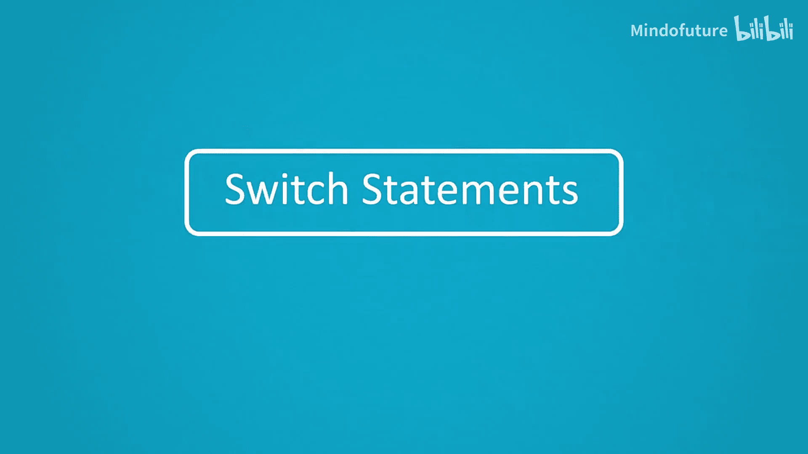
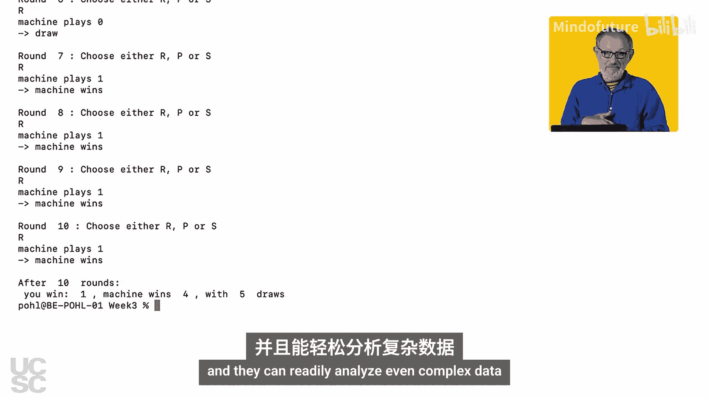

# Go语言编程：P17：switch语句




## 概述
在本节课中，我们将要学习Go语言中的`switch`语句。`switch`是一种多路分支语句，可以用来替代复杂的`if-else`语句。我们将通过一个“石头剪刀布”游戏的例子，来理解`switch`语句的语法、工作原理以及它如何使代码逻辑更清晰。

---

## 从`if-else`到`switch`的演变
上一节我们介绍了使用`if-else`语句来判断游戏胜负的逻辑。本节中我们来看看如何使用`switch`语句来重构它。

在之前的“石头剪刀布”程序中，我们使用`if-else`来判断用户和机器的出招。`move`代表用户的出招，`machineMove`是随机生成的机器出招。如果两者相同，则为平局。否则，我们需要检查所有能让机器获胜的条件。

以下是使用`if-else`的代码逻辑片段：
```go
if move == machineMove {
    // 平局，增加平局计数
} else if move == paper && machineMove == scissors {
    // 机器获胜（剪刀剪布）
} else if move == scissors && machineMove == rock {
    // 机器获胜（石头砸剪刀）
}
// ... 其他条件
else {
    // 用户获胜
}
```
这种写法在条件较多时会变得冗长且难以维护。

---

## `switch`语句基础
`switch`语句提供了一种多路执行的方式，可以改变程序的控制流。它主要分为两种类型：**表达式switch语句**和**类型switch语句**。本节课我们只讨论表达式switch语句。

在表达式switch语句中，会先计算`switch`后面的表达式，然后从上到下、从左到右依次与各个`case`子句进行比较。第一个匹配的`case`块会被执行。

一个`case`可以包含多个用逗号分隔的值。如果`case`后面需要执行多条语句，必须将它们放在一个由花括号`{}`组成的代码块中。

如果省略`switch`后面的表达式，则默认为布尔值`true`。

以下是`switch`语句的显式语法结构：
```go
switch [简单语句;] 表达式 {
    case 值1, 值2:
        // 执行的语句块
    case 值3:
        // 执行的语句块
    default:
        // 当所有case都不匹配时执行
}
```
*   `switch`是关键字。
*   可选的`简单语句`（如定义一个局部变量）后跟一个分号。
*   `表达式`是被求值并用于比较的对象。
*   `case`关键字后跟一个或多个值。
*   `default`关键字是可选的，用于处理所有`case`都不匹配的情况，通常放在最后。

---

## 使用`switch`重构游戏逻辑
现在，让我们看看如何用`switch`语句来重构“石头剪刀布”的判断逻辑。这样逻辑会更简单，也更容易理解，因为它更贴合游戏只有三种基本选择的事实。

我们根据用户的出招`move`进行`switch`。对于每一种用户出招（石头、布、剪刀），我们再使用`if-else`来判断与机器出招的比较结果。

以下是核心逻辑的示意：

**当用户出石头 (`case rock`)**：
```go
case rock:
    if machineMove == rock {
        // 平局
    } else if machineMove == paper {
        // 机器获胜（布包石头）
    } else {
        // 用户获胜
    }
```
**当用户出布 (`case paper`)**：
如果机器出布，则为平局；如果机器出剪刀，则机器获胜（剪刀剪布）；否则用户获胜。

**当用户出剪刀 (`case scissors`)**：
如果机器出剪刀，则为平局；如果机器出石头，则机器获胜（石头砸剪刀）；否则用户获胜。

与之前复杂的`if-else`链相比，这种结构将问题分解为三个清晰的路径，每条路径内部再进行简单的胜负判断，使得代码的流程控制更加清晰。

如果你想，还可以添加一个`default`分支来检查用户是否输入了无效的移动，但在这个例子中并非必需。`default`分支常被用来检测错误。

---

## `switch`语句的其他特性
除了基本用法，`switch`语句还有一些需要注意的特性。

**穿透执行 (`fallthrough`)**
在Go语言的`switch`中，默认情况下，执行完一个匹配的`case`后就会跳出整个`switch`语句，不会自动执行下一个`case`。这与C语言不同。如果你需要执行下一个`case`的代码，必须显式使用`fallthrough`关键字。

**初始语句**
和`if`语句、`for`循环一样，`switch`语句也可以在表达式之前包含一个简单的初始语句（通常用于声明一个在该`switch`块内重要的局部变量），两者之间用分号隔开。

---

## 程序演示与运行
让我们快速运行一下这个使用`switch`语句的程序。程序会询问用户想要进行多少轮游戏，然后每一轮中，用户选择出招（R、P、S），机器随机出招，最后通过我们刚才讨论的`switch`逻辑来判断胜负并统计结果。

运行示例（用户始终出石头）：
```
How many rounds? 10
Choose R, P or S: R
... (进行10轮)
结果：机器获胜4次，用户获胜1次，平局5次。
```
由于机器是随机出招，所以结果具有随机性。

---

## 总结与拓展
本节课中我们一起学习了Go语言的`switch`语句。我们了解了它的基本语法，如何用它来替代复杂的`if-else`判断，并通过“石头剪刀布”游戏实例看到了它如何让代码结构更清晰。




一个可能的课后练习是尝试改进这个程序：让机器能够分析用户的出招模式，而不是完全随机出招。例如，如果机器发现用户总是出石头，它就可以开始总是出布来赢得大多数对局。这在一定程度上体现了机器学习的思想，也是机器能在这类游戏中胜过人类的原因之一——它们能高效分析数据并避免犯错。