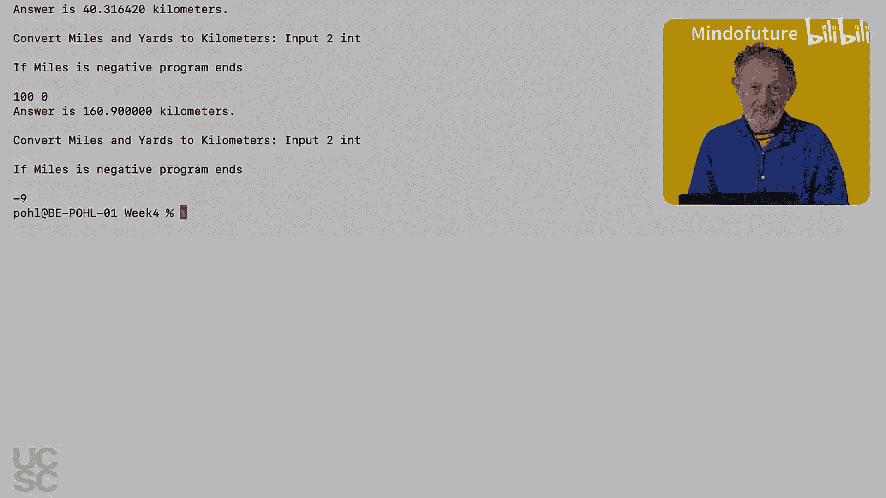

# 【加州大学】Go语言编程-｜-Go-Programming-Everyone-Part-1-p18-P18_函数-切片_04_01_01--BV1h3e7zBE3U_p18-

And this week。We're going to deal with two very important topics， functions and slices。

Functions are like paragraphs and writing essays， but more important when you're coding。

If you can write a function， you can master coding anything。

Large coding projects are broken down into pieces。Each piece then addresses a particular， largely。

 hopefully simple task that can be turned into a function， in fact。

A rule of thumb that I use as no function should be larger than the screen size。

 which may is something like 20 lines。 So if your functions are starting to run more than 20 lines。

You want to think about breaking it into smaller functions。

And this allows for complexity to be managed。Just like in writing。

 if you can write a really good paragraph， then you can write an essay。 Again， organizationally。

 this is where you complete your thought。 The paragraph and function is where。

You complete your thought in programming Also， function allows you to reuse。Your code。

 So it's also important。As a software tool， because once you write that function and you can see that in your like print line functions provided by the go system。

They're constantly and continually reused。 And when they're universal， like things like。

Print line or print F。There would be a terrible result if the whole community was writing its own print line。

So anytime you can manage to use something。That is in common use。You're saving yourself。

 You're avoiding having to test for errors， and you're saving yourself a lot of additional effort。

Now。Recall in week one that we wrote code to compute a marathon distance in kilometers。

 so we converted from yards and miles which were in integers over to kilometers。

 which were a floating point number。Now we're going to turn that into a function。Here's our function。

 it's very simple。We have two parameters。 We use the key word funk。 We've already seen that for Ma。

 We use the key word F U N C。 We give it a name again， very important。 That's a name you choose。

And here we again， use camel case。 It's an identifier。

 And I'm saying convert to capital the T because that's a new word。

 capitalize the K M for kilometers。 That's a new word。 And then I have arguments。

 And miles is an int and yards is an int。 And then there right after the arguments which are inside a parenthesized list。

We have what's called the return type。 The return value of that function is going to be a float 64。

And it's unnamed， though we could name it。 And then we begin the actual。

Code that that function represents。 And it's a very simple function。

 It's just the mathematical statement where we're doing the conversion。 So we return。

The conversion factor from miles and yards。To kilometers。Now， how do we use that？Again。

 we have a funk main。 We always have funk main。 Remember， main is very special。

 It's always where our coat starts。And we have those two variables， the miles and yards。

And then we're going to use the loop so that we can use the convert program multiple times。

 and we're going to ask， unlike our very simple initial week one program。

 we're can ask the user what to convert so the user is going to input two integer values。诶。

If the miles is negative， we end the program。We're going to scan。

And there we need the address of miles， the address of yards， we've already explained why。If miles。

Is less than 0。We skip things。Otherwise。We have inside our print F statement。A percent F。

Recall that percent F is what we use for floating point numbers， we can also use percent g there。

So that's a preference， it depends how many。呃。Digits。Of accuracy you want in your answer。

 Pre she is generally a little more readable。And then you call， this is called function call。

 you just use the name， convert to Km with the current parameters， miles and yards。

And then it does the computation， we're done。So the function syntax for a simple function。

Is a function？Followed by parameter list。Followed by potentially a result。

 not all functions need to have results。And then a code block。

The result can be a value or a list of values returned by the function so a function can return multiple values。

And that's quite interesting because that， for example。

 is not in the C language where you have to return a single value if you're returning multiple values。

In the sea world， you have to use some kind of specialized type。

 which lets you return to multiple values and go， you can readily return multiple values。

So here's a simple example， let's imagine we want to function。That's going to square an integer。

 Again， we pick a name that's meaningful。 We call it square。 and then we have。A variable。

 an argument。 we have a return type。And we say return n times n。 And that's what gets returned。

 So whatever number we throw in there， like 3， we would get 9 back。Okay。

 so quickly we will actually try our convert to kilometer function。

And see if it works on my terminal。So here's a simple function on the terminal。

And it's pretty much as we already talked about， let's just look again。

So it's very crucial to be able to readily write little pieces of code as funk because then you can just。

 as I say， assemble any sized program you want。And here， we have。Two variables， miles and yards。

 and of course they have to be declared with a type。And we have the return type。 The return type。

 by the way， could be named。 I could have named a return type。

 Like I could have said the return type is。Convert C O and V， R， E T。 And then I would say I would。

 I would assign this to convert。And then do a return of convert。

So since I'm just going to return a value here。It's simpler to leave off a named。To name the return。

 it's unnecessary here。Sometimes when you do a series of values that you're going to return。

 it is useful to have a list of named returns。But this is only one thing to be returned。

 And there is our formula，1。609 times aloat。 We have to do those conversions。

 recall that Go is very strict about typing。 So we're doing a conversion from int to float。Twice。

 and then everything is being done in the float domain， and we get the converted value。

Very straightforward。Again， going into the program， I'm asking for 10 values。

If a value is less than 0， it won't do a conversion。 It'll just end the program。

 That's what happens with this return when we， if it sees a negative value， which just says stop。

 Otherwise， we write an answer and we do the conversion and notice this is where the function gets called。

And。😊，It was just convenient。To use the same。Local variables， miles and yards。

 even though those are the same names I chose， those are different contexts。

 So I could have had that as M and Y。 And then I could have had in there M and Y。

And I could have had over here miles and yards here。 I have to use the local variables。

 They do not have to match a name。 That's just convenient that saves me from thinking about what the variable names are。

 But theyre really two different context。 The last thing I want to say about this。

 is those variables are what are called call by value variables。

 So if you're used to other programming languages like C， C uses called by value variables。

C plus plus has call by value unless you have a reference type。 So these are always called by value。

 just like in C。And now let's run the program。So it was。Simple function was his name。 So go go。Run。

Let's see if it behaves。It says to me if miles are negative， I'm going to end。

 so let me put in two integers。I'll put in。25。And 100。And then it'll give me an answer。

 says 25 miles in 100 yards。I can do something else。 I can do 100 miles。And 0 yards。

 Let's see what that is。And that's 160。9， which makes sense because that was the conversion number on。

In our function。And I will do minus9 and we'll see what happens so it ends the program as expected。

 so I didn't input all 10 values。Notice I could have written that for statement as an infinite loop。

And then。I would have been forced to end the program with a negative value， or by。For example。

 in my UniX operating system here， I would use a control C。

 so that would have worked to it could have just come up， asked me to do it over and over again。

Until I was tired of it。Okay， so that's our simple function。

