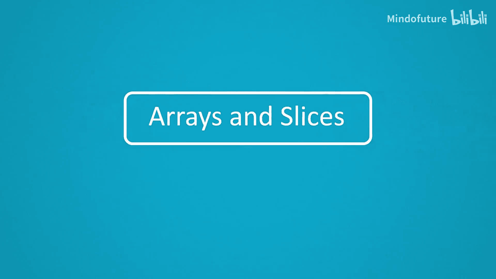

# 【加州大学】Go语言编程-｜-Go-Programming-Everyone-Part-1-p19-P19_数组-切片_04_01_02--BV1h3e7zBE3U_p19-

So another big topic for a week four is arrays and slices。And we'll see that an array。

 just like in the sea language and many other languages。

 is a homogeneous data structure that lets you store elements of the same type。

 So think about some very big set of values that you're trying to analyze like here at UC Se。

 we have a big project on elephant seals。 And you might want to try and get the average weight of an elephant seal。

 and you can go out to。The beach where they all come in from the Pacific to mate and mating season and try to weigh them whatever way you can。

 And you get a whole bunch of data。 you have， you know，500 sitting around on the beach。

 and you come up with 500 values that you would store in this array type。Now， in go。

 the way we create an array， as we say there， just like a normal variable， we get a name like data。

 and then we have an open bracket square brackets， and we put the number of elements we want。

 like if we had wanted 500。 We would had 500 here。 In that case， we had five。

And then we say what type it is。 So typically it would be a float 64 or an int or it could be something like a Boolean then it would be Boolean data。

 it could be string data， whatever we want， but everything is going to be the same kind of data。

And if we don't initialize it， everything just like any variable in go is initialized to 0。

 And in this case， it's the floating point 0。 So this would end up with five elements。

And they could be what are called index with our index being just like in C。

 our indexes started at 0。So we have the five elements being data 0， data 1， data 2。

 data 3 and data 4。Now， another way to declare an array is to give an initializer list。

 the initializer list。Follows the declaration of the array with a。

Curly bracket lists of value of appropriate value。 So here we see that the five elements were initialized to 02。

81。32。56。9。So that's another way to get a non zero array initialized。Now， in go。

 arrays like this are what I call static。Where their length is part of their type。

And once their length is part of their type， it makes them somewhat difficult to use because。

An integer array of length 10 is different than an integer array of length 5。

 So it would be very difficult to mix them。 There are different types。

 you might have to do type conversion。And that's a bother。 There's no reason for that。 So instead。

 Go uses something that's just similar to a structure。Which is more dynamic， more flexible。

 and generally is what you will use。 So arrays don't get used too much because of that fact that they're rigid and they have a type associated with them that's based on their length。

 Instead， we use things that don't have associated length called slices。They are dynamic。

 so slice is declared without a length inside the brackets。 So it's very similar to an array。

 except you don't leave a length。But you can still initialize them。 So here。

 if I wanted those same five values to be used， I would just throw them in that list。

 and that automatically creates a five elements slice。Now。

 the length of the slice is dynamic and we'll see that in some programs。

 but let's use our convert to kilometer program with a slice to show how some of this could work。

Again， we have a function， we have miles。And we use the same conversion function， again， reuse。So。

Once we have that function。We can just save it somewhere and reuse it in a following program。

Now Maine will call that function， but we're going to use a slice to have multiple values。

So we have a slice here。That has three values of miles。And notice my comment。

 My comment says slice L is equal to 3， and cap is equal to 3。 L and cap are predclared。Identifiers。

 so you should stay away from them because they have special use。Lent tells us how long the slice is。

Kap tells us。What the capacity of the slices？Frequently， there's same number。

But the capacity can exceed the length of the array。So it turns out there are reasons for that。

 but we can decide because these structures are dynamic。

That we might need to know what the current size is。

 So these will start off as length 3 and capacity 3。And it'll have those values as well。Yards。

 yards will also be a length three and a capacity3。And there's our yard's value。

And now we can use a four。With what's called range and we talked about this。

 but we didn't show it at first， so this is another kind of loop。

 it's different than our other loops。And this is sometimes called an iterator， this kind of loop。

 because iterates。Over。The range of the slice called miles。

 So miles is this elaborate data structure， and range can be used with。Data structures like miles。

And it'll just automatically go over。The number of elements that you need to process。

And notice that I have an eye comma。Underbar， colon equal。

That means two things are going to be assigned from range。 Ra gets us two values from miles。

 What are the two values it gets。 It gets us the index。 recall Mil will have three elements。

 If it has three elements。 It's going to be 0，1 and 2。So I will increment over zero，1。

 and  two automatically。The underbar is going to be value of those elements， so whatever。

milesles of zero is that will go to this disregarded underbar。

 we could put in a name variable there like a V， and then it would be locally assigned to V。

But since we're not going to use it in this for loop， we throw it away。

 So you will frequently with these range parameters。Throw away one or the other of the values。

 And then you can see our conversion format print line， convert miles and yards。

 And there's miles of eye。And yards of I。We printed it out。And then we print out the answer。

 the percent F conversion， where we use miles and yards。

So that's how the for range works with a slice so this is a very very important idiom if you're going to be using slices。

 you're largely going to be using loops because you want to process the slice。And it could be as。

Large as you want。And。In that case， we had two slices of that needed to be processed。

 So we use the fact that we get the looping index I and can use it internally。

In our compound statement that the for is repeating on。And we get our conversion。

So very important to understand what we just did。And understand this little funny thing that goes on with the undeclared special variable underbar。

 That should be its only use。 Underbar gets used throughout the go language when you want to throw away values。

Again， that's not something you've seen if youre coming from another language like C。

So there are other key ideas for slices。 Ss， as we said， are dynamic。So we can increase their size。

One way to increase their size or to decide on their size is to use a special function called the make。

 Again， make is predclared。 It's not a key word， so。呃。There are many pre declaredclared identifiers。

 just like things like Ent are predclared。That you should avoid using in your own work。

 You should just leave them be what the community is used to。So make being one of them。And there。

 it says。Make a slice be an integer slice with 100 elements。

So there are two things that go into the make。 One is the type。 That's your first argument。

 and the other is your size。 That's your second argument。Again， it's a built in。放式。Now。

 going on to the other built in functions。And by the way。

 MA can be used with other structure types later on。So it has other uses。We have L。

 We already mentioned L。 L would look at data and would say， oh， the current L is 100。Len， again。

 is a built in function， which allows us to check on or make use of the length of the given array。

 We can use it in an ordinary force statement to be part of the range that we try to。Compute over。

 We can go over the length of that array。And then。Here's the other thing that's critical。

 We can extend in existing slice。 We couldn't do that with。A rigid array， but in a slice。

 we could say data。Equal aend。And then we tell it what to append to。 So this is very important。

 You have to say data assigned， append。You repeat。The slice。That you're going to expand。

And then you give it the values you want to add on to the end。

 so that will add four values on to the end。 so at this point the length of data is 104 if we tried to do length of data initially it was 100。

Capacity is the size of the data， and it can be larger for length， because if we extend。

An existing slice。We may not want to extend it by a small number that turns out to require a fair amount of effort on the part of the。

Storage allocator inside the go system。 So Go is building this for you。 You're not seeing it。

 That's why it's so useful。But it might decide that， instead of making the capacity。

1 hundred04 will make it 200。 We double the capacity。 Why would it do that， It would do that。

 Because if I'm going to append on to that function， I don't always want to do。The work that I need。

To make that that slice larger。 So it gets me away from always having to enlarge the slice。

 If I build the capacity to be larger than what I currently need。Okay。

 let's see how all that works and now we'll run our program。

So let's look again at this code for the slice。 We have our convert program。

 So we know how that works。 Now we have our two slices。 Remember， they're not as。So。

 they're more dynamic。And because there's nothing， no length inside the braces their slices。

 But we know that they are created with length 3。And capacity 3。

 And that's because there were three initial values。 If no official values were given。

 the slice would have length 0。 Capity 0 would be the empty slice。And then critically。

 we have to learn how to use the range。And that's a very good loop。 That's an iterator。

 It avoids mistakes， when you have range。You don't have to worry about indexing mistakes。

Or what sometimes are called off by one mistakes when you're always incrementing I in a range and missing。

 maybe making the wrong。呃。Stopping point in， in your ordinary foresstatement。And then。

 we're calling it here。With the conversion。 And so we're getting all the values done through the conversion。

So。The four range provides an iterator of a slice。 It avoids making off by one errors。

 and it provides a pair of values here。That you can use， if you want。

 And then critically in that range， we have the underbar。

 which is a way of throwing away one of the two values that we obtain from range。So let's。

Go and run this quickly。We'll see it all work。I call the program simpleple slice。And again。

 like with all of my programs， you should mess with them If there's something you don't understand or you're not 100 per cent sure。

 you'll understand。Just。Why don't， for example， with this。

 why don't just see if you can make a larger slice or even aendda slice？

With other data and then run it again。Okay， and we see how it worked。 it gave us all three values。

And indeed， the second one was。The marathon value， 26 miles， 385 yards。And that converts to 42。

185 kilometers。

Okay。

