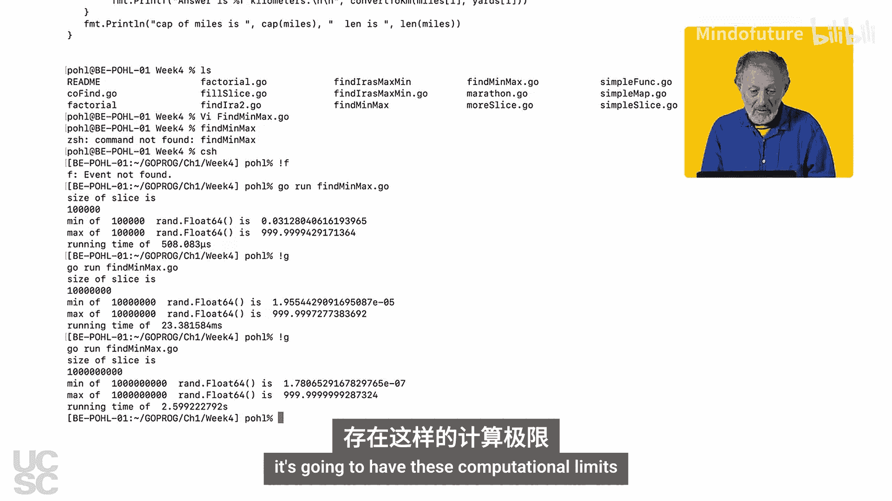

# 【加州大学】Go语言编程-｜-Go-Programming-Everyone-Part-1-p20-P20_查找最小值_04_01_03--BV1h3e7zBE3U_p20-

So we want to now combine some of the ideas we've been learning to look at a very simple form of what might be called a sorting problem。

Sorting very important as it's a large part of what computers do in this case。

We want to find the minimum of a set of floating point numbers。The numbers， the data。

 because that's very useful to us， rather have to enter a million numbers。

 We will generate them at random。 Now， consider a real world situation。

 like the people who run the Social Security administration， they have。

Hundreds of millions of such numbers。And they use them。To try and look up things。

 And they have to do that very efficiently。 So sorting is enormously important in the real world。

Use real world data but。I'll just use that random number generator to simulate it。So we'll first off。

 compute。The minimum of a slice。And for arbitrary reasons。

 I will choose the values to show up between a zero and a thousand。They could be anything。

 but that's just。A way for us to easily understand what the answers are。

And then I'm going to use a slice。And the way I pass a slice into a function is。Variable name。

Ds for data。Empty brackets， because empty brackets， unlike brackets with a length。

Mean a slice and not an array， and then the type in this case float。

And then the minimum of the slice will be returning a float 64。

 So we'll look through however big the slice is。And will return whatever the minimum value is。Again。

 we will use this powerful idea of an iterator for we'll throw away now the indexing value。 Remember。

 range produces two values。 One is the indexing value in the previous piece of work。

 we had that as an I。 This time， we don't need it。 But we want to look at the values in turn。

So what we do is for each value， the value stored in the slice in turn。

We check to see if it's smaller than the existing minimum。 Consider it a contest。

 We start out with the minimum being some large value。

 No we know that the original min is larger than anything in the slice， and then。

As a new minimum shows up， we replace the old minimum。

 and then at the end of running through how large the slices， we return that minimum value。

And that's returned， as again， afloat。So。Our program is going to first off in Maine。

 generate the data we need， so let's see how that works。Of course， we have a function main。

Recall R do C time， that's a way to seed it， so we don't always get the same answers。

We're going to start。With a slice size that the user will pick out。

 so you have to implement what you want do you want。To see something that。Is size 10，100， a million。

10 million， whatever。So you'll be able to see how fast this works on a modern Mac too。Then， data。

We're using a make。 Why are we using a make。 We're using a make because we didn't know what size we had。

 So we make something to be a floating point array， not array slice。

That's of the size that the user provided。And now， inside that。Up to that size。

 And we could do this with a range。 But I just chose to do it with an ordinary iteration。I produce。

The Ithe data as being ran times float 64 times 1000。Float 64。

 R dot float 64 comes from the ranand package。And that produces weve used before an in then。

 In this case， F 64 produces a random number between 0 and 1。

 So since I wanted numbers to be between 0 and 1000， I have to multiply them by 1000。

And since it's a floating point number， I use a thousand times I use the floating point notation for a thousand。

And then I'm going to call。My men slice function on data。And that'll print out the answer。

 So that's my routine。Okay。Take away from this key is that this is an idiom。

For creating a funk that processes the size of whatever。Weth。呃。You want it to be。

 So you only have to write this routine for slices as opposed to as which have a particular type。

 Again， the flexibility is very important， so you should be able to use slices as arguments of functions and loops and easily process them。

So， for example， you should be able to change this program to find the maximum element that should be something you should try on your own。

 and now we'll run this program。Okay， so recall that I asked you on your own to try and figure out how to write。

A fine max routine。And I've written one for you here。

 so we're going to look at doing both the men and the max simultaneously。

And I'm going to ask you for the size， and I'm going to do one more interesting thing just to show you on my contemporary machine here。

 it'll be different on your machine。How to time， how to get a time back。

From the machine and just seeing how long it would take to。Process。Different sizes。

 different batches of data。Okay。So。Remember， here is min slice。And we see how to call。呃。The slice。

 it's a D open bracket， closed bracket。 That's empty。 And that means a slice of type float 64。

 We're returning the minimum value as float 64。 Men is sitting in here。In the contest。

And we're doing a four where we're obtaining the value of each element V。 And in turn。

 testing each element against the current minimum。We're doing the same thing here with Max。

So the only difference is the if statement and the if statement says， if he is greater than Max。

Then choose max， and there's one other thing to notice here。We start the max value at 0。

 We know that that's not going to be the maximum。 maximumimum is going to be greater than0 less than 1 thousand00。

So0 will be immediately replaced。Another way to do this， by the way。

Is to replace whatever the max is by the very first element of the slice so you could do it that way。

As well。And then we return to max， and that's our two routines， so again， critical。Learn this at。

 you can process any slice using these ideas， using the iterators， passing in the slices。

 and then obtaining whatever result you need。Now we call the random number generator to fill up our data。

And we use make。So here's the use of that special function make。Whatever size you decided to use。

Here we actually fill it with the data that's random。Times a thousand。

 we could change that if we wanted。And now here I'm using something called start time。

 and I'm getting an internal clock from my computer that says。Where am I now on the computer clock。

 Time that now。And then， I run the code。And then I get the duration。

 which is time since the start time。And then I print out that duration。 And that's the running time。

 So this is just a way to see how efficient my code is。

 and I could decide how useful the program would be based on its running time。So， several new ideas。

Notice。I needed to use time in there， and he needed time for two things。 Remember。

 I'm also using time。Here， when I start。My seating of the random number generator。

 So we used the package time before。 but now it gets us these ways of timing our computer。

So now let me run this。Ive precompiled it， so I'm just going to run it。Okay。

 so here's where I want a size of a slice。Let's do a slice that's 100， so we're getting 100。

000 elements。How fast is that going to work almost instantly。And look what it says， running time is。

呃。508。I think that's milliseconds。Though that's very， very fast。Let's redo that。

And do something much bigger。So we did 100000。 Why don't I jack that up by 100。So instead of 100。

000 we get 10 million。Still very fast， but now it's 23 microseconds。But again。

 almost right when I hit the。The Control button to execute the code。

It just ran faster than we could imagine。 So I'm going to do something even larger。

I think I can do a billion。 Now， if I I'm not going to be able to do。Much bigger than a billion。

Because。If you recall， I have to get memory。Makeake has to get memory。

It starts running into the capacity of my computer。So that's a billion， I believe。

Let me make sure I got the right number zeros。 I got。就。Three， six， nine， I think that's right。

And now all of a sudden， it looks like the computer is stalled out。So。It actually took some time。

You could actually see it paused， so you can't use a computer for infinitely large problems。

They actually take real time， look what that took 2。6 seconds， approximately。

And this kind of operation is what's called linear in the size of the array。

So that's what's going on。 Each time you make the array 10 times。

 You're going to increase the running time roughly 10 times。

 And you should see that in your processing time。 So that's also something to。

 as we go on to more complex kinds of processing， including ones that are non nonlinear。

 like exponential。We're going to see that。The computer will really start we can't just do everything。

It's going to have these computational limits。

Okay。

