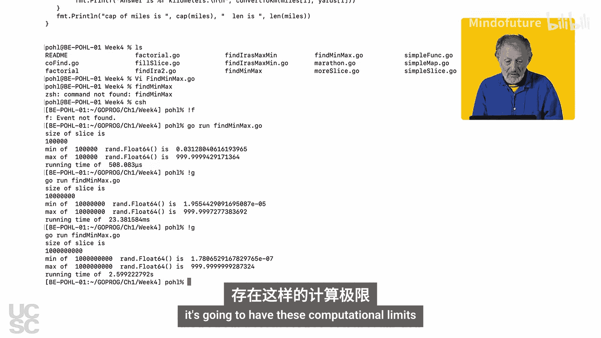

# Go语言编程：P20：查找最小值


## 概述
在本节课中，我们将学习如何结合之前学到的知识，解决一个简单的“排序”类问题——查找一组浮点数中的最小值。我们将学习如何创建和处理切片，如何编写函数来查找切片中的最小值和最大值，以及如何测量代码的运行时间。

---

## 切片与函数参数

上一节我们介绍了循环和迭代器，本节中我们来看看如何将切片作为参数传递给函数。

在Go语言中，我们可以将切片传递给函数，这样函数就能处理任意大小的数据集合。传递切片时，使用空方括号 `[]` 来表示，这与指定长度的数组不同。

以下是定义接收切片参数的函数语法：
```go
func functionName(variableName []type) returnType {
    // 函数体
}
```
例如，一个接收浮点数切片并返回最小值的函数可以这样定义：
```go
func minSlice(ds []float64) float64 {
    // 查找最小值的逻辑
}
```

---

## 实现查找最小值的函数

现在，我们来实现查找切片中最小值的函数。其核心思想是遍历切片中的每个元素，并通过比较来更新当前找到的最小值。

我们将使用 `for range` 循环进行遍历。这次我们不需要索引值，所以使用下划线 `_` 将其忽略，只获取元素值 `v`。

以下是查找最小值的完整函数实现：
```go
func minSlice(ds []float64) float64 {
    // 将初始最小值设为一个非常大的数
    min := math.MaxFloat64
    // 遍历切片中的每个值
    for _, v := range ds {
        // 如果当前值小于已知的最小值，则更新最小值
        if v < min {
            min = v
        }
    }
    // 返回找到的最小值
    return min
}
```
这个函数模拟了一个“竞赛”：我们从一个非常大的初始值开始，然后遍历整个切片，每当发现更小的值，就更新最小值。遍历结束后，返回最终的最小值。

---

## 生成随机测试数据

为了测试我们的函数，我们需要一些数据。我们将使用随机数生成器来模拟真实世界的数据集。

以下是生成随机数据切片的主要步骤：
1.  使用 `make` 函数根据用户指定的大小创建一个切片。
2.  使用循环为切片的每个位置生成一个介于0到1000之间的随机浮点数。

以下是 `main` 函数中生成数据的代码：
```go
func main() {
    // 初始化随机数种子，确保每次运行结果不同
    rand.Seed(time.Now().UnixNano())

    // 假设从用户输入获取切片大小
    sliceSize := 100000

    // 使用make创建指定大小的切片
    data := make([]float64, sliceSize)

    // 用随机数填充切片
    for i := 0; i < sliceSize; i++ {
        // rand.Float64() 生成 [0.0, 1.0) 的随机数，乘以1000得到 [0, 1000) 的数
        data[i] = rand.Float64() * 1000.0
    }

    // 调用函数并打印结果
    result := minSlice(data)
    fmt.Println("最小值是：", result)
}
```
使用 `make` 函数是因为我们在编写代码时并不知道切片的具体大小，它允许我们在运行时动态创建指定大小的切片。

---

## 扩展：同时查找最小值和最大值

基于查找最小值的逻辑，我们可以轻松地扩展代码来同时查找最大值。其原理与查找最小值完全相同，只是比较的方向相反。

以下是查找最大值的函数实现：
```go
func maxSlice(ds []float64) float64 {
    // 将初始最大值设为一个非常小的数（或0）
    max := 0.0
    // 遍历切片中的每个值
    for _, v := range ds {
        // 如果当前值大于已知的最大值，则更新最大值
        if v > max {
            max = v
        }
    }
    // 返回找到的最大值
    return max
}
```
**注意**：这里我们将初始 `max` 设为 `0.0`。因为我们知道随机数范围在0到1000之间，所以0肯定会被第一个元素替换掉。另一种常见的做法是将初始值设为切片的第一个元素 `ds[0]`。

这两个函数展示了处理切片的通用模式：**使用迭代器遍历，传递切片作为参数，然后返回所需的结果**。你应该掌握这种方法，以便处理任何类型的切片。

---

## 测量代码运行时间

在处理大量数据时，了解代码的运行效率非常重要。Go语言的 `time` 包可以帮助我们测量一段代码的执行耗时。

以下是测量函数运行时间的方法：
1.  在代码段开始前记录当前时间（`start := time.Now()`）。
2.  执行需要测量的代码。
3.  代码段结束后，计算当前时间与开始时间的差值（`duration := time.Since(start)`）。

我们将这个逻辑应用到查找最小值和最大值的调用中：
```go
func main() {
    // ... (数据准备代码与之前相同)

    // 开始计时
    startTime := time.Now()

    // 执行查找操作
    minValue := minSlice(data)
    maxValue := maxSlice(data)

    // 计算耗时
    runningTime := time.Since(startTime)

    fmt.Printf("最小值: %f\n", minValue)
    fmt.Printf("最大值: %f\n", maxValue)
    fmt.Printf("运行时间: %v\n", runningTime)
}
```
通过这种方式，我们可以直观地看到，处理更大规模的数据集（例如从10万增加到1000万）会线性地增加运行时间。这引出了算法复杂度中“线性时间”的概念，即运行时间与输入数据规模成正比。

---

## 总结
本节课中我们一起学习了几个重要的Go语言概念和编程技巧：
1.  **传递切片给函数**：学会了如何使用 `[]type` 语法将切片作为函数参数传递，使函数能处理动态大小的数据。
2.  **实现查找算法**：编写了 `minSlice` 和 `maxSlice` 函数，通过遍历和比较来查找切片中的最小值和最大值。
3.  **生成随机数据**：使用 `make` 函数和 `math/rand` 包创建并填充用于测试的随机数据切片。
4.  **测量性能**：利用 `time` 包测量代码执行时间，并观察了算法运行时间与数据规模之间的线性关系。




这些是构建更复杂程序的基础。你可以尝试修改程序，例如查找平均值或中位数，来进一步巩固对这些概念的理解。