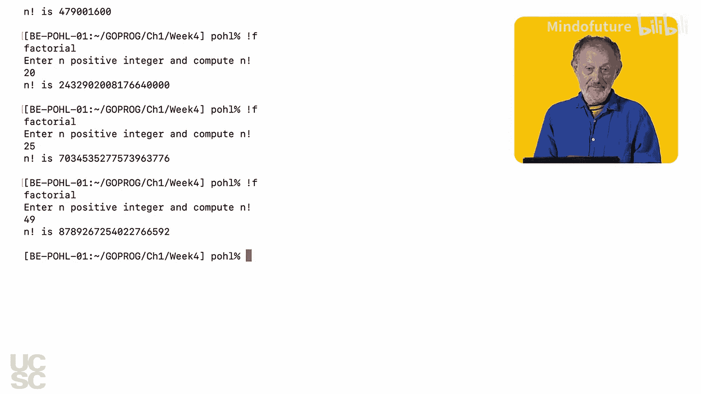

# 【加州大学】Go语言编程-｜-Go-Programming-Everyone-Part-1-p21-P21_简单递归_04_01_04--BV1h3e7zBE3U_p21-

So function again is this critical way of packaging a routine。And one of the。

Very nice features of modern programming is a function can be called recursively。

That means it can call itself。And if you come from some kind of mathematical background。

You're used to certain kinds of definitions that are called induction definitions where something like factorial is defined in terms of itself。

 So if you think of factorial， factorial is of n， iss the same as factorial of n -1 times n。

So if we were to compute factorial and factorial。Something like factorial of3 is one times 2 times 3。

 which is 6， or。It's one times 2 factorial of two times 3。So， recursive definition。Is n-1 times n。

And we define the base case。As。When N is one， then we don't。 We say if n is one， factorial is one。

 Otherwise， it's this。Recursion， or in mathematical terms， it might be。

Also thought of as some kind of inductive argument。We can capture this in go。

 go allows recursive functions。Just a historical note in the very early days of programming。

 where you had languages like Fortrann。In invented by IBM in the 1950s。

 it did not allow recursive calls to function。 So that came in later when international teams of computer scientists put recursion into Algal 60。

 and after that， recursion was。Typically found in computer languages。

 So here's how we would define the funk factorial。It's going to be an integer argument。

 We're going to use a very large size of integer because factorial grows really quickly。

And will return a 64 B integer。And。The definition follows the， if you want。

 think of the induction and equals one。 It returns one。 Otherwise， it calls itself。

N times factorial n -1。 And， look， that's not going to run forever because。We keep subtracting one。

 And when it gets to one， when the argument gets to one， we stop， we have a return。

If we made a mistake there and we said return end times factorial event， it would run forever。

 It would blow up。So。This terminates when n equals 1， we normally call it with a positive integer。

A negative venture will also yield one because of。The test。And the program。

Could be written as a simple for loop。 So many recursions could be rewritten。

Almost always as some kind of forloop。And in some cases。

 that's very important because recursion involves function call and function call is typically a little more expensive on a computer on the running time of a computer than an iteration。

Though。Compilrs will frequently optimize a recursion to be the equivalent。To aniteration。

So you should do what you feel gives you the simplest expression of the function。And as we said。

Factial is readily defined that way now， because factorial blows up。It turns out。

We don't want to go past the number 20。Because we go past number 20。

 we're going to have what's called integer overflow。

 Our result will not be correct because even an integer with 64 Bs can't hold that number properly。

So we can allow the user。To put in a positive in in compute。

And we're just asking for what do you want to compute。

 and then we have a format and then we compute the factorial。And as they say， note to warning。

 it just grows too fast。And would overflow。And would overflow even faster for a normal N 32 and 32。

 it overflows after 13。Now let's actually try and use this， let's see what happens。So factorial。

 I've already compile it， so he won't go over the code。 I just want to run it。In CAs mood。Okay。

So I don't want to go over the code again， I've already precompiled it into execut aable called factorial。

And now it's asking me， enter and a positive number in compute and factorial。 Well。

 let's try3 because we know the result。And factorial was 6。

 That would be part of our debugging process， making sure on。Cases were aware of。呃。

I'm asking again for it。And let's do something a little more sophisticated。12。

Now we get a fairly large number。 So it goes very quickly。 It grows what's called exponentially。

 an n factorial of 12 is。From reading the number right， 479 million。16，000。Okay。Let me try 20。

And I said for 20， we still are O。And there's this very large number。

 That's about as large as you can represent。 I don't want to read it off。Got a lot of digits in it。

 And that's where it's in factorial。 But what if we tried something larger。And now， we get a number。

That isn't right。Even though it's 25， think about that， that's。

20 times 21 times 22 times 23 times 24 times 25。 So that's going to be a much larger number， but。

Look how many digits are on the screen。 It's the same number of digits as before。 So clearly。

 that's a wrong result。That's called integer overflow。 It couldn't do that result correctly。

Let's even try something much larger。Again， we see。We're getting these very large numbers。

 but they are not at all corresponding。We should have had a number that's。

Almost the length of the line there。 It should be。Over twice those that number。

 twice or three times the number of digits， and it wasn't。So。Again， for things like。

Fixed computation， you got to remember your machine。

Isn't mathematics that you can write on the page Because we on page。

 you can just use more space if you could work out the number。 Now。

 this would be very tedious for a human。 But you could get that in order to calculate numbers of this kind。

 you need to be able to represent。Quai。Infinite integers。 And there are packages to do that。

 If you wanted， you could have a series of digits kept in a slice。And you could。

And there are specialists to do this。You could make up a package that gets you the correct answer for a very large。

And factorial， though be complicated。To write and explain， okay。

