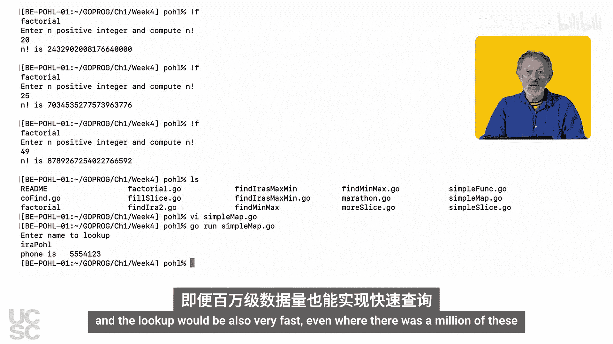
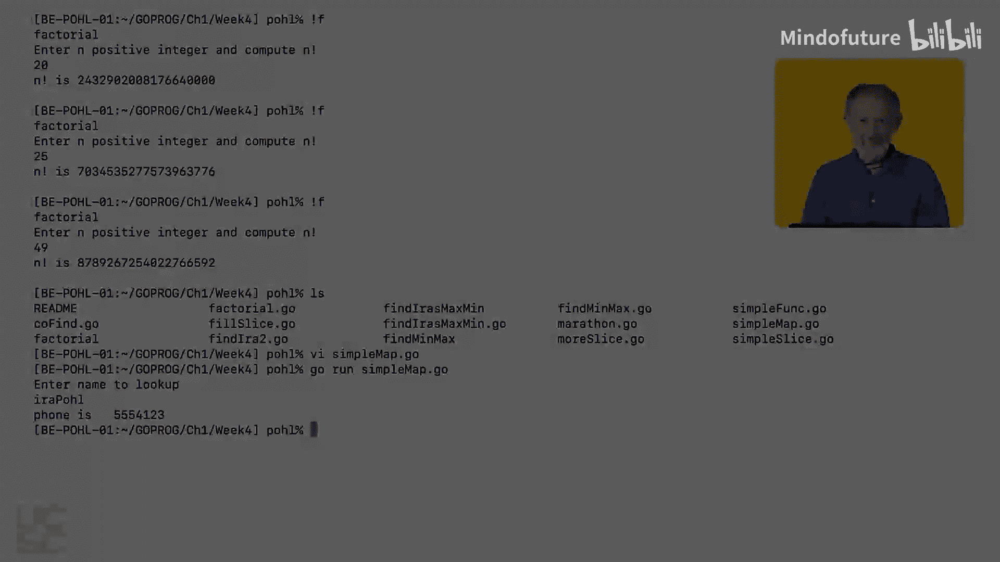

# 【加州大学】Go语言编程-｜-Go-Programming-Everyone-Part-1-p22-P22_映射-字符串_04_01_05--BV1h3e7zBE3U_p22-

So we've talked some about slices。But I want to let you in on on other advanced topics。

 We're going to need them。 So you can start thinking about them。

 maybe even use them in some of your own work。 And the two that we're going to look at in this segment are maps and strings。

 Now， strings we've already used。 We've used string literals， for example。In our very first program。

 when we printed out hello world that's a string。 It has certain number of characters in it。

 If I'm counting right it as Let's see。 hello is 5。 World is 5， and that blank space is one。

 So it's an 11 character string。😊，So you could think of it as in a way。

 its own form of slice where each character is an element of the slice。

But strings are their own special， predclared type。And it's very useful。

 And as a pre declaredclared type， it also may look at as a series of characters or ruins。

 So ruins is a type in go。Which gets used。To store。Character values as integers。

There's also a way to store character values as bitetes。

 Btes is another type that can be used to store characters， if you're not using。The universal。

 large character setAT near it。Going to be just dealing with ASi， basically the American keyboard。

Then bites is probably the more appropriate way to store a strength。Now， strings。

Have a number of packages that let you work on them。 As I say， I'm not going to go into them。

 but they let you do many， many complex tasks where there are any programme。

To do things like comparing them， seeing if two strings are equal。

Map is the other data structure we want to talk about， it's again， a complex data structure。

It's somewhat related to what's called an Associative array or dictionary。

 it's that those are other terms。For a map， map is the term that Go uses。

And a map is a way to associate a name。With a key。So we'll show you something where。

 we're looking up telephone numbers。 And no， how would you look up a telephone number， You might say。

 oh， my friend Billy over there。 I want to look up Billy Bob's telephone number。

Telephone book lets you go in。And。Search for the name。 And then next to the name is the value。

So the search， you search with what we call a key。 And in this case， the key is a string。

And then you produce a result that's stored there， which in this case。

You can think of as an unsigned large number， which is the telephone number。So that's a map。

Has a lot of uses， and it's a very efficient kind of data structure。So。

I'm going to show you the code。For doing this with a telephone number now。

A map is a very important data structure， it's based on something in computer science called a hash table。

A ash table is a very efficient way to look up something based on a general key。

 as opposed to looking up things in a slice where using an integer index。So， you need some kind of。

What's called hashing function that gets you to look into the what typically is some kind of internal slice that's storing the data。

 The hash function takes you from the key type over to the index type。

And let you find this thing in a very。Efficient way。

And we'll demonstrate this by having an online phone book where we'll pair a person's name with a telephone number。

Now， there are many places where this could be used。

 A company might pair an employee's name with other information like。What their pay is。

 what their social security number is， maybe several slices。

 or maybe what we'll soon find out is something called a struck where we can put a number of pieces of data together。

 But the map lets us associate some key。With the values。We want to search for。In this case。

 it's the simple phonebook case。So here is。Our phone numbers， so it's a slice。

And we're using unsigned N 64 so we can have these large numbers。

And I have four telephone numbers in my local phone book。You can imagine that there'd be a million。

 I mean， in a big city like San Francisco， it might be a million in the form book。

And then we have all these names。So we have my name， Iipold， Rand pillll， Bettydodo， Daniel Euclid。

 Those are our four names for a phone book， and they're going to be associated。With。The phone book。

 now。Phone is going to be。The variable name for our map。So here's another use of make。 Remember。

 we use make with slices， and here we can use it with maps。

 And what's going to happen is we're going to make。And make。Of a map needs two arguments。

It needs the type that's going to be the key。In this case， it's going to be string。

And it needs the type that's going to be the value returned。 In this case。

 it's the unsigned integer of 64 B length。And then。We're going to。Let the user。Ask for a name。

And then。Our， our code will do a look up and print out the phone number of that name。So。Willll say。

Okay， now here's a fourth statement。 This loop。 What is it for。Very important。

 This for loop goes over the length。 Remember， this is our first time that we've actually used length so we can。

We could also probably do this with a range， but I've chosen to do it with Lent。

And each place in the map， notice what I'm assigning。 Phone is a map。I'm taking name of I。

 What's name of 0， Na of 0， as I rapold。What's that going to be assigned。

 It's going to be assigned the phone number at0。So I a poll is going to be signed 5，5，5，4，1，2，3。

And each， in turn， is going to be the name， the key。With their phone number。

 So you can imagine you built up a big phone number list yourself。

You have it and you could actually put this in a file， your own personal file。

 and you could make this arrangement for yourself， and then you could run this program asking the program to look up。

For that name， the phone number， and that's in fact。

 how people who are providing phone number services on a computer are doing something of this sort。

So here again， we're asking for the name and here we're printing it out。

 and now I'm going to go run that。So that was called simple map。So。Enterter name to look up。

I'd better spell my name， right， So I'll use my name。So I'm asking it to look up my phone number。

And there it says phone number is 5，5，5，4，1，2，3。It works。 And that could be for an arbitrarily large。

Set of names。And。The lookup would be。🎼Also， very fast， even where there was。

🎼A million of these names。Okay。

