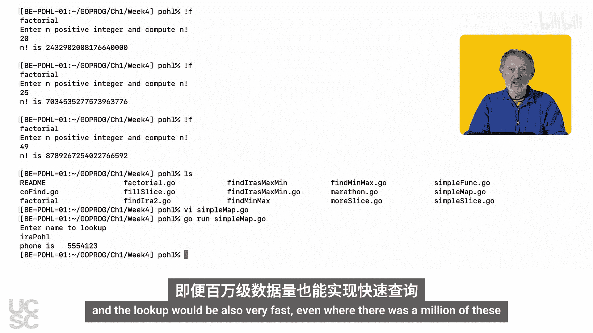
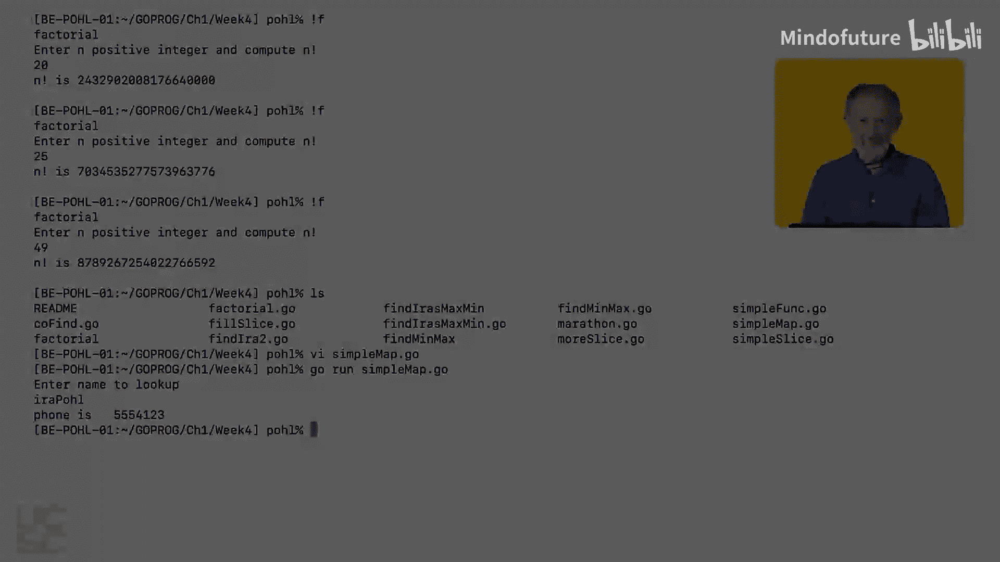

# Go语言编程：P22：映射与字符串


## 概述

在本节课中，我们将要学习Go语言中的两个重要概念：**映射**和**字符串**。映射是一种高效的数据结构，用于存储键值对；字符串则是我们编程中处理文本的基础。我们将通过一个电话簿的例子来理解映射的工作原理，并简要介绍字符串的特性。

## 映射：高效的键值查找

上一节我们介绍了切片，本节中我们来看看另一种复杂的数据结构：**映射**。映射在Go语言中用于关联一个键和一个值，类似于其他语言中的关联数组或字典。它的核心思想是，你可以通过一个“键”来快速查找对应的“值”。

### 映射的基本概念

映射基于计算机科学中的**哈希表**实现。哈希表提供了一种非常高效的方式，让你能根据一个通用的键（而不仅仅是整数索引）来查找数据。其核心是一个哈希函数，该函数将键的类型转换为索引类型，从而在内部存储数据的切片中快速定位。

以下是创建一个映射的基本语法：
```go
phoneBook := make(map[string]uint64)
```
在这个例子中，键的类型是`string`，值的类型是`uint64`。

### 构建一个电话簿示例

让我们通过一个简单的电话簿程序来理解映射的用法。我们将人名（字符串）与电话号码（无符号64位整数）关联起来。

以下是构建和填充映射的步骤：

1.  **定义数据**：首先，我们准备好姓名和电话号码的切片。
2.  **创建映射**：使用`make`函数创建一个空的映射。
3.  **填充映射**：通过循环，将每个姓名作为键，对应的电话号码作为值，存入映射中。
4.  **查询映射**：根据用户输入的姓名，从映射中查找并输出对应的电话号码。

以下是实现上述逻辑的代码示例：
```go
package main

import "fmt"

func main() {
    // 1. 定义数据
    names := []string{"Iipold", "Rand pillll", "Bettydodo", "Daniel Euclid"}
    numbers := []uint64{5554123, 5559876, 5551111, 5559999}

    // 2. 创建映射
    phone := make(map[string]uint64)

    // 3. 填充映射
    for i := 0; i < len(names); i++ {
        phone[names[i]] = numbers[i]
    }

    // 4. 查询映射
    var lookupName string
    fmt.Print("Enter name to look up: ")
    fmt.Scanln(&lookupName)

    if number, exists := phone[lookupName]; exists {
        fmt.Printf("Phone number is %d\n", number)
    } else {
        fmt.Println("Name not found in phone book.")
    }
}
```
运行此程序，输入一个姓名（如“Iipold”），程序会输出对应的电话号码。即使电话簿中有海量条目，这种查找也非常快速。

## 字符串：文本处理的基础

现在，让我们转向另一个预定义类型：**字符串**。我们已经在第一个“Hello, World”程序中使用了字符串字面量。字符串可以看作是一系列字符的集合。

### 字符串的特性

在Go语言中，字符串有以下几个要点：
*   字符串是**不可变**的。
*   字符串中的字符可以用`rune`类型（表示Unicode码点）或`byte`类型（表示ASCII字符）来存储和处理。
*   Go标准库提供了丰富的`strings`包，用于执行比较、搜索、替换等复杂字符串操作。

例如，比较两个字符串是否相等：
```go
str1 := "hello"
str2 := "world"
if str1 == str2 {
    fmt.Println("Strings are equal")
} else {
    fmt.Println("Strings are not equal")
}
```

## 总结

本节课中我们一起学习了Go语言中的映射和字符串。
*   **映射**是一种强大的键值对数据结构，基于哈希表实现，能提供高效的查找功能。我们通过构建一个电话簿程序，实践了如何创建、填充和查询映射。
*   **字符串**是用于处理文本的基本类型，具有不可变性，并可以通过标准库进行各种操作。





理解这两个概念对于编写实用的Go程序至关重要。在接下来的学习中，你会看到它们被广泛应用在各种场景中。