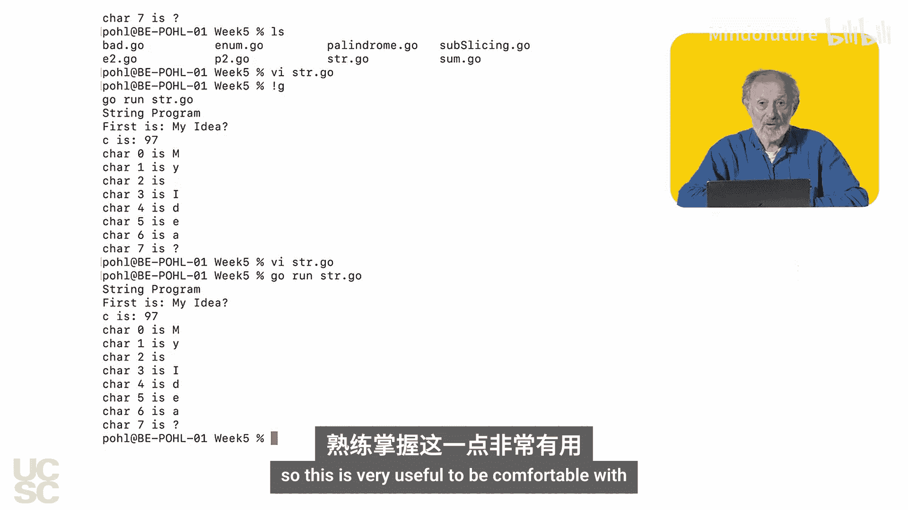

# 【加州大学】Go语言编程-｜-Go-Programming-Everyone-Part-1-p23-P23_字符串类型_05_01_01--BV1h3e7zBE3U_p23-

So we're going to look at the string type in more detail。

The string type is an interesting type in go。Again， string is one of those predlared。Names。

So it's not technically a key word， but mostly you should treat it as a key word。Now。

 we've already used string literals。 literals， of course， are constant。

 So we've used a lot of them in our。Prince statements。 So， for example， in the earliest program。

 we used something like， quote， hello world。And that's a string。

 the characters between the two quotes are the string。And even the blank in that string。

 literal is part of the string。The representation of a string is similar to a slice。So remember。

 a slice is an indexable。Set of elements。You start with the zero， that's conventional。

 that's the convention borrowed from C， and you go to the end at incrementing by one。

 and so we'll see that it'll be very useful in manipulating strings to be able to use their underlying representation which is typically a slice of bytes。

Remember， a bite is an eight bit。Data type。And a eight bit data type is suitable for all of the standard characters you find。

In your keyboard， so you can have lowercase， uppercase alphabet。

 certain kinds of special characters like new lines。

Ringing the bell and then things like punctuation and numbers。

 and they can all be expressed as a bite。But if you want to use more extensive。Character sets， like。

Japanese characters， Chinese characters， Hebrew characters。All of those are available。

 but that requires you use something in what's called UniIcode。

So all of this can be manipulated and indeed strings have some additional packages that get you a standard kind of functionality and。

 for example， you will find and we'll make use of it in a further program。

 the strings package itself or the Unicode package。All right， so let's do a very。

 very simple string program。Really。As elementary as it gets。And in our function main， we have。A bite。

So again， byte is a predclared variable name。Something to avoid， don't redelarare it。

Make believe it's really a key word。And so there we're initializing it to the single character lowercase A。

And we want to demonstrate that。A string itself can be seen as a sequence of bites。

 so that's something to think about yourself when you start playing with this stuff。

 and I again always encourage you to modify these programs and make up your own just to test your understanding。

The string itself is going to be put in a variable string under bar one。And notice。呃。

When I was doing this， I was falling into the old Sea style convention。And I shouldn't have。

I should use STR， capital O and E。 I should use camel case， not snake case。 Of course that that's。

Either one will work for the。The compiler， the compiler doesn't really care， but it's not。

Correct ghost style。 The community will care。So why don't you fix that？

It doesn't have any effect on the program。That variable will be assigned。The string， my idea。

 And let's count the characters in there。 It's a string literal iss a capital M as the first character or the zero oth byte。

Then my， why？Third characters blank， fourth character is capital I，5 characters of D。

6 characters and E，7 characters of A。8th character to last character is a question mark。

So all of those things can be in a string。Okay， let's continue the program。

And now we'll just run that program and show how it works we'll print out again。

 here's the use of a little string which you've done before。

 so you'll see on your screen string program and then。Will print string 1。And in using print line。

 we don't have to use a format， so it just says， oh print ones a string variable。

 we print it as a string。Next， we will print out the first character。

So we'll see how the bike prints and。I believe that was lowercase A。And then we're going to。

Drew a for loop。And the for loop。Is going to run the length of the string。

 So notice here that we can use that built in。A function L。Which we've used before with slices。

 because it tells us how big the slice is。 We can also use it with this kind of data type。

 showing its similarity to a slice。And that will retrieve the size of the length of。

The length of the string， and then we'll do the for loop。

 and we'll go marching through each character and printing each character as both。

Its position in the string， and。It's the value。So we'll see what the string looks like character by character。

Now， if you've come from a sea background。You're used to processing strings more primitively。

 so the difference with a C background is C always looks a string as if it's a cha star。

 a pointer to character。So it's way more prim here。This is more modern。 Again。

 one of the improvements you get out of go， where string itself。Is a fully supported type。Okay。

 so now let's just briefly go and actually run the program。So I'm here sitting at my terminal。

 I have the program we just talked about， string。go。

 actually you see it I'm in my editor and I have a couple of funky things in there that I've commented out because。

呃。Later we're going to deal with things called pointers。

 so here there was a variable P star byte equals am percentand of C。That's a pointer type。

We're not yet at the point where I'm going to try to explain that that'll be very important at the end of this class and crucial to part of the next course that we'll be giving。

嗯。So it's all pretty much what was said before。Again， if you've done this and C。

 you'll understand it logically things are very similar， except in C， things are more primitive。

So imagine。Let's run it。And we see。At the bottom of my screen。The string program。

It prints out string program， it says。First。Which was the first string we were using it actually the only string in this particular program。

Was my idea。And then it prints out that C is 97。Now。If you recall。C。Was the byte variable。

 and it was assigned lowercase A 97 is its value as an integer， basically。

 if you look up the ASI values of the characters on your keyboard。

 they all have values and 97 is just an alternate representation。

 the integer representation of lowercase A。And then we look at each character in turn。

 and we see character 0 is capital M。 character 1 is lowercase Y。

 characterer 2 is a blank and so on until you get the character 7， which is a question mark。

 So don't forget， we started at character 0。 So this particular string has8 characters。

 And we march through it using。A for loop。 And again。

 when we're processing strings in general and we have to manipulate them or。

Try and understand what's inside the string。We will frequently use this kind of idiom。

 so this is very useful to be comfortable with。

Okay。

