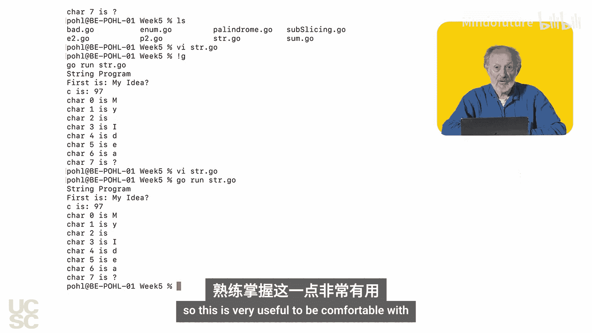

# Go语言编程：P23：字符串类型详解


## 概述

在本节课中，我们将深入学习Go语言中的字符串类型。我们将探讨字符串的基本概念、其底层表示、如何创建和操作字符串，并通过一个简单的示例程序来演示字符串的遍历和字符访问。

## 字符串类型简介

上一节我们介绍了Go语言的基本类型，本节中我们来看看字符串类型。字符串类型是Go语言中一个有趣且重要的类型。`string`是一个预声明的标识符，虽然技术上不是关键字，但在实践中应将其视为关键字。

我们已经使用过字符串字面量。字面量是常量，我们在之前的`Print`语句中已经大量使用过。例如，在最早的程序中，我们使用了类似`"hello world"`的字符串。两个引号之间的字符就是字符串的内容，即使是其中的空格也是字符串的一部分。

## 字符串的底层表示

字符串的表示方式与切片类似。切片是一个可索引的元素集合，索引从0开始（这是从C语言借鉴的惯例），然后逐个递增。在操作字符串时，能够利用其底层表示（通常是一个字节切片）将非常有用。

记住，`byte`是一个8位的数据类型。8位数据类型足以表示键盘上的所有标准字符，包括小写字母、大写字母、某些特殊字符（如换行符、响铃符）、标点符号和数字，这些都可以用一个字节表示。但是，如果你想使用更广泛的字符集，如日文、中文或希伯来文字符，则需要使用所谓的Unicode编码。所有这些都可以被操作，实际上，字符串还有一些额外的包提供了标准功能，例如`strings`包或`unicode`包，我们将在后续的程序中使用它们。

## 一个简单的字符串程序

以下是创建一个非常简单的字符串程序的步骤。

```go
package main

import "fmt"

func main() {
    var c byte = 'a'
    var strOne string = "My idea?"
    fmt.Println("String program")
    fmt.Println(strOne)
    fmt.Println(c)
    for i := 0; i < len(strOne); i++ {
        fmt.Printf("Character %d is %c\n", i, strOne[i])
    }
}
```

在这个`main`函数中，我们首先声明了一个`byte`类型的变量`c`，并将其初始化为单个字符`'a'`。请注意，`byte`是一个预声明的变量名，应避免重新声明它，最好将其视为关键字。

我们想演示字符串本身可以被视为一个字节序列。变量`strOne`将被赋值为字符串`"My idea?"`。让我们数一下其中的字符：第一个字符（第0个字节）是大写字母`M`，第二个字符是`y`，第三个字符是空格，第四个字符是大写字母`I`，第五个字符是`d`，第六个字符是`e`，第七个字符是`a`，最后一个字符是问号`?`。所有这些都可以包含在一个字符串中。

程序首先打印出`"String program"`，然后打印`strOne`变量。使用`Println`时，我们不需要格式化，它会自动将字符串变量作为字符串打印。接下来，我们打印第一个字符`c`，它将显示为整数`97`，这是小写字母`a`的ASCII码值。

然后，我们使用一个`for`循环遍历字符串。循环将运行字符串的长度次。这里我们使用了内置函数`len`，我们之前对切片使用过它，因为它能告诉我们切片的大小。我们也可以在这种数据类型上使用它，这显示了字符串与切片的相似性。`len`函数将返回字符串的长度，然后循环将逐个遍历每个字符，并打印每个字符在字符串中的位置及其值。

如果你有C语言背景，你可能习惯于更原始地处理字符串。与C语言的区别在于，C语言总是将字符串视为`char*`（指向字符的指针），因此更加原始。而Go语言更加现代，这是Go语言的改进之一，字符串本身是一个完全支持的类型。

## 程序运行结果

运行上述程序，我们会在屏幕上看到以下输出：

```
String program
My idea?
97
Character 0 is M
Character 1 is y
Character 2 is  
Character 3 is I
Character 4 is d
Character 5 is e
Character 6 is a
Character 7 is ?
```

程序首先打印`"String program"`，然后打印字符串`"My idea?"`。接着打印变量`c`的值`97`，这是小写字母`a`的整数表示（ASCII码值）。然后，我们逐个查看字符串中的每个字符：字符0是大写字母`M`，字符1是小写字母`y`，字符2是空格，依此类推，直到字符7是问号`?`。请注意，我们从字符0开始计数，因此这个字符串共有8个字符。我们使用`for`循环遍历了它。

在一般情况下处理字符串时，如果我们需要操作它们或尝试理解字符串内部的内容，经常会使用这种惯用法，因此熟悉这种方法非常有用。

## 总结




本节课中我们一起学习了Go语言中字符串类型的详细知识。我们了解了字符串的基本概念、底层表示（类似于字节切片），以及如何通过字面量创建字符串。我们编写并分析了一个简单的Go程序，演示了如何声明字符串变量、访问单个字符以及使用`for`循环和`len`函数遍历字符串中的每个字符。理解字符串的这些基本操作是进行更复杂文本处理的基础。