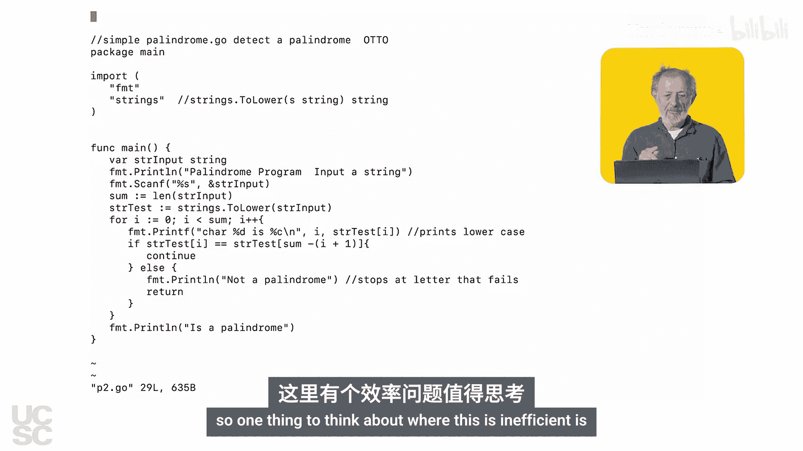
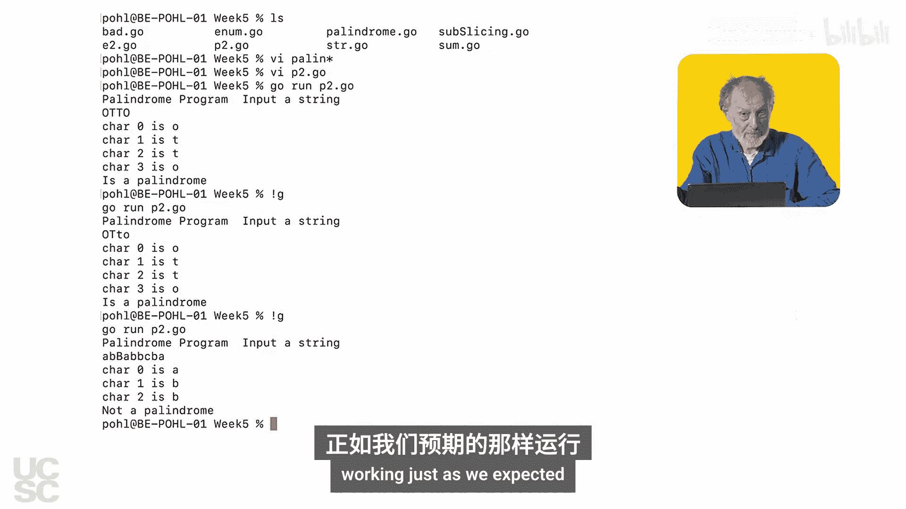

# 【加州大学】Go语言编程-｜-Go-Programming-Everyone-Part-1-p24-P24_回文_05_01_02--BV1h3e7zBE3U_p24-

So our second example of a string program is going to be whether you can decide on。

Whether a string you input is a palindrome or not， a palindrome is just a fun thing。

So a simple form of a palindrome is auto， palindrome is just some sequence that reads forward and backward the same。

Okay， so Oto and Ada are palindromes。But add is not a palindrome。 You could also， by the way。

 have palindromes that are sequences of anything else like numbers。 So 1，2，2，1 is a palindro。 Also 1。

2，1 is a palindro。 So if it's an odd number of characters or letters。The middle character is unique。

So we don't have to worry about it。Now our program is going to look at the string and decide if the string is a palloro。

So it's an easy exercise in using strings， you might want to think about this before I explain how one of the simple ways I'm going to do it。

呃。So。Pinrome。go。We have a。A function。诶。In this particular version。

 I am not going to use the string package。But we do need to import the format package。

 So we're also going to。啊。I think that if this is the right version。

We're going to consider upper case and lower case to not matter。

And in order for us to not worry about uppercase versus lowercase。We have to。

Reduce everything to the same case。 So something like lower case O， capital T， lower case T。

 capital O。If we were uniquely examining them。They would not be a palinrome。

 lowercase O and uppercase law or different characters have different integer values。

But if we convert everything to lowercase。We would get lowercase O T T O。

 and it would just be any version of uppercase and lowercase of Otto would remain a palloro。

 so you want everything to be independent of case。And the way we're going to do that is we're going to use something in the strings package。

 which allows us to。Take all of the characters in the string and turn them into lowercase。

 so that's why strings have a lot of useful in their package。

 a lot of useful functions to manipulate strings。Now。Here we go。 We're going to input a string。

 So let's call a string capital input。 In this case， I am using camel case in that。Identifier。And。

I'm asking the user to input a palindrome as a string。And look in the scanf that we're using。

The format percent S makes sense， percent S means string。And then as as usual as Sf。

 we have to import it as an ampersand string input。诶。Now。

 because we're going to examine the string using an idiom like we used in our first simple string thing。

 we're going to examine it character by character。 we want the length of the string。

And then we turn the string into strings to lower。String input。So。

Stringing input gets changed into it， the string we're going to actually test。

String test where everything will be lowercase， so again。

 what I said at the beginning about if autot has letters in different cases。

 that isn't going to matter when we decide whether it's a palinro。And now。呃。Well， this is not。

This slide is a little messed up， so we'll see it when I go to the actual main program。

 but there's a fourth statement。And we don't have the proper。Layout for that fourth statement。

 but we're going to go across the sum， and then we're going to compare characters at either end by looking at characters。

I， and then looking at characters that are。At the end of the string， like some minus I。

 And if those are the same character， we continue。 And if they're not the same character。

Then we know we don't have a palintro。So by comparing ends of the string。We can decide whether。

The string still meets the palindme test。If we end up。Covering the whole string。And finding that。

Palinrome never got a。Falsified， that we know it is a palindrome。

 and we can print out at the end of the loop that， yes， we went through it。 We never saw it be。

A non palindrome， a non palindrome would have forced us to stop with not a palindrome and then a return to exit the loop and exit the program。

 but otherwise we go through the whole loop and we say， ah， we've got a palindrome and we're done。

All right， okay， in this slide， we can see that the fourth statement is properly。Formatted。So。

Just quickly， let's review this because it's a lot clearer on this slide than on the previous one。呃。

Moura was a bit mashed up。Again， here's a four statement that runs across the whole string and。呃。It。

Well there it's checking to see that Prince lowercase。And。Then it's doing this comparison to see if。

Character。The appropriate character is。A match。And if it's not a match， there's where it says， okay。

 it failed。We can print out as failed， not a palinro， and we can return。 And otherwise。

 we keep going。 And then if we。Run to the end of the loop， where done。All right。

So that's how this is going to work， what are the main ideas。

 the main ideas are each letter is tested against the letter at the other end。Continue。

 I don't know if reviews continue， but continue is very useful inside loops。

And it means that at this point， go to the next iteration of the loop。

 So if there's some reason to continue， we jump to the next iteration of loop。 In this case。

 it was because that particular letter positions passed the palindrome test。

If it hadn't passed a palinro test， we would have done the else part of the F statement。

And we would have ended with not a balance room and returned from the program。

So we have kept going until the whole thing is Te and success。 Okay， so we're going to try it。

 And I'm also going to show you that this is not。There are several places where this program could be improved。

Okay， so here I am back at the terminal with the program I just discussed。

 I think here we're properly formatted and we can see it a little bit better。

And I'm also going to discuss where you can get an improvement。

 So this program is going to detect palinromes， strength palloromes。

And it's not going to worry about the case of an alphabetic palindrome。

 so all the variations on auto can be detected as a palindrome。And why is that。

 Because in the import， we're going to import a package called strings。 And within strings， there is。

Too lower， and it takes everything in the string。And if there's an uppercase character。

 it makes it a lowercase character and it outputs a string。

 though that's what we're going to make use of， if you've used other languages like C。

 you will find functions like two lower available as well for。Character processing。And go as very。

Good set of libraries for。Processing characters， including Unicode characters。

 So there are several packages available to where you don't have to try to do this from scratch like too lower。

 You could do it from scratch yourself。 You could write。Simple function to do to lower。

Not a bad idea， so。呃。For those of you who are trying to really。Get a very good feel for the language。

I suggest you write your own version of two Lower。 and to some extent。

 that means understanding what the ASque values are of the characters。ok。

So let's look at function main， again， we're letting the user input a function。

 so we're going to call that variable string input。

And the first thing we do is we ask the user the palinrome program and put a string。

And then as before we said use。The format for strings， which is percent S。

We get it into string input。We need to know the length of the string in order to do processing properly。

And then。We get the version of the string that we're going to test。

 it's going to be called string test。Again， we're using Caml case。So。That。Notice we use。

Colon equal both for length and for string， that means that we don't need to declare those variables that means。

The variables like some are known to be an inger， it's just taken from what the value that's being produced on the right hand side is。

And string test is going to be a variable of type string。And now we have our four statement。

 and we go from 0 to the sum， which would be essentially the length。The total number of characters。

And the test， the crucial test is if string test I is equal to string test some minus I plus1。

And you can figure out that。 first characters at 0。The string length。For autotto is going to be four。

So the first character is going to be the sum 4。us0 plus one。 so it's going to actually be three。

 And if you think about the layout of a slice。You want to compare。

Element string of0 to element string of  three。 That's correct。

 That's why I need to use that minus1 plus I。And then that'll just march across。

And if that test is met， that means those characters do reflect the palindrome property so we can continue otherwise。

 as fails。We can fail immediately。So if we had a string like ABC， A would be compared to C。

 failed immediately。And we'd jump out of the routine。Otherwise。

 we go to the end and then we print thats a pallet rule。So one thing。To think about。

Where this is inefficient。Is。

呃。I'm actually doing twice the work I need to do， Why is that？

NowI'm going to give you a second to think about it。What's going on where there's twice the work？

Well， think about it this way， if， indeed。I'm not doing twice the work if it's not a palinro。

 but if it's a palindro。I'm marching across the whole string。😡。

And I'm going to end up comparing in the if statement string of sum。To string test of。呃。0。So。

I'm going to do two tests on that position， in effect。

So I'm doing double the work anytime I have a palintro。And this could be avoided。

And think about how to write this code， so I'm not wasting。

That extra computation Now let's actually run the program。We'll get out of the editor。呃。

So it's asking me to input a string， let's input the string we know， auto。

And if you remember inside my。Lop， I also have decided to show all the characters。

 and the characters were all converted to lower case。So the test string is actually lowercase OTTO。

But it is indeed a palinrome， and that is all correct。Let me run it again。

So let's try and do something just to make sure。That it works。

 So here is a string that wouldn't be a palinrome if it was case sensitive。But again。

 it's a palindrome because of the conversion to lowercase。Okay。

 let's make sure we know that this could fail。So I'm going to run it one more time。Okay。

 here's sort of a random collection of letters of A's and B's and C's。And。

It does exactly what we expect。 Character 0 is a。But a matches the final character。 Char 1 is a B。

 but B matches the final character。 Charer 2 is a lower case B， because we convert it to lower case。

But， it doesn't match。The character on the other， and which is a sea。Therefore。

 it's not a palindrome working just as we expected it。

Okay。

