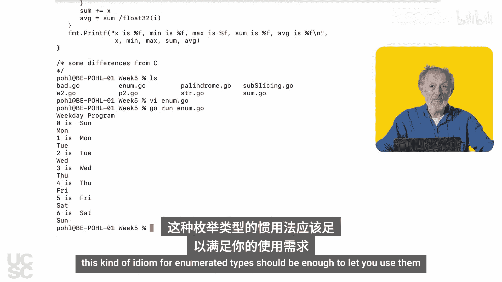

# 【加州大学】Go语言编程-｜-Go-Programming-Everyone-Part-1-p25-P25_iota枚举_05_01_03--BV1h3e7zBE3U_p25-

Okay， we're going to look at yet another type。We're not going to take a lot of time with this type。

Partly because it's a very simple type。啊。And。In many languages。

 it's not available because you can use other ideas to do what we're doing with。

What I'm calling enumerated types， so。We are going to use。あ。A predclared identifier， IOda。And that。

A way to automatically generate a series of named constants。So， an enumerated type。

In a modern programming language is a way to declare。

A special it's a way to declare a user defined type where for your application， you want something。呃。

Special that isn't available in the ordinary types of the language。And you want to name it， you know。

 by being able to name it。You get。Both some clarity in the readability of the program。

 And you also get some type safety out of it。 So it is quite useful。And let's see a simple example。

Declare a type color。And type itself。Gives us the ability to have。User defined types。

So color becomes a type in a program that uses this。However， it's secretly an int。

 So type color says make int the underlying form of what a color is。And now。

The way we do that is we say a con。We have。An open parenthesis。And then we name the colors。

 look at the names， green， yellow， blue， red， four colors。And in the very first line。

 we say green color。 So color is。呃。Well， that should have been uppercase。So， color。

Is going to be equal to iota。 And the meaning of that is。Iioda is going to start at zero。

And the less of the colors are going to get values generated。One at a time， starting at zero。So。

While you're not seeing any of that， the result of it is green is secretly a 0。

Yellow is secretly a one blue is secretly a2， and red is secretly a3， and we don't have to assign。

 and there could be more colors。 We don't have to assign each separately， as we would。

 if we just had an ordinary con declaration。Where we wanted these things to be con green。Equal。

A zero。We could do this all as separate， but。In this case， it's a shorthand， and it gives us a type。

 okay。So。The declaration tells the compiler that color is the type。However。

 it's not the same type as it。 The underlying value， isn't it， But if you tried to mix them。

 you would have to do something like a conversion。So you get what's called type safety out of it。

 You can't just inadvertently mix them up。And then Iioda is a shorthand for sequencing through。

The integer values and Iiota can be used in more complicated ways。

 but since this is a beginning course。呃。We we don't， we don't really， this is the。95% usage of Iiota。

 If you're using it in more elaborate ways。呃。There are very sophisticated ways to use Iiota to generate other values。

 but they're largely unnecessary。So we're going to do a whole program that's uses an en numerator type and conceptually the program will be simple。

And the program will be a program in which we declare a type days。So。Here's how iota gets used。

 Again， we have a type declaration。 D is an int， as well。We again， have ks open paren。

And then we list the days of the week， Sunday through Saturday， and。We say days equal iota。

 and that means that everything marches through sequentially。So。Underlying value of Sunday is zero。

 underlying value of Saturday is。Okay， I'm listening at six， right， Mondays one， Tuesdays two。

 etc cea。Okay。So。Here's what we're going to do。 We're going to not only use that。Specation。

We've declared a new user defined type days。Imagine we're writing a complicated program that deals with calendars。

And we want to know about the next day。So we're going to declare a function that gets us the next day。

So today， days。So if we put in Sunday， we want to return Monday， if we put in Tuesday。

 we want to return Wednesday， et cea。Now。If you look at the function heading， says next day。

It declares a variable， the input variable today day。

 And then it shows that the outputs going to also be a day， or days， the type days。

And what's going to be returned。 Look at that fancy expression。 We returned days。Where we convert。

 what does in parentta Day do， that's a conversion。It says， okay， treat this as an integer。

So if to day was Sunday， we would get the integer value 0。 We would add one to it。

 So now it would be one。 and then we would do moduleo 7，1 moduleo 7 is 1。 So the return value。

By the way， we also have to take that integer and。Use days around it。

To turn the integer value 1 back into， in this case， Monday。So that's why that expression。Now。

 why is there the percent seven？Well， think about what happens when you get to Saturday。

If you got to Saturday and you wanted the next day， you would get Saturday would be add1。

 So that's 6 plus 1。 Well，6 plus 1 is 7。Sevens outside the range of are named Constance。

So we don't want that， so we want seven to change over to zero， right？So that's why。Now。

Instead of next day， you could write previous day。 If you want to think about how to use this and think that you have it done right。

 you could have a function previous day or yesterday and think about what that would require would have to be a little different than。

What we just。Talked about。Same ideas。 Okay， so we have this conversion。

And we also want to be able to print out the name of the function， so we want the name。

To go from days to a string。So， don't forget though。Days are a bunch of named constants。

 so if we printed them out。Depending on。How we printed it， we would probably get an integer。

And instead， we want a string like we want for。0， we want Sunday for one。 we want Monday。

 and there is a natural use of something like a switch。 So switch will come in quite a bit。With。

These kind of small sets， enumerated types， where each case has a different kind of treatment。Okay。

 so。That gets us a conversion if we want to print it out so we understand it。

Then let's try and use the whole package。 Let's see the next slide。Let's see how it works。

 we got to function main。We want to print a weekday program， we'll see how it works， we'll say。

Let's go from Sunday through Saturday。Incrementing。

And then we'll print each day and we'll print it using our name function。

And then we'll also print the next day。All right， so let's see if all this works。

 let me go to the terminal and run the program。So here's our program that we just discussed。

And we're using in effect what's called an enumerated type。In old C， there was no such thing。

 so old C didn't have this。But in modern sea， in the latest versions of fancy sea， you indeed have。呃。

A key word in nom that allows you to do a very similar thing。

So most modern languages do have some form of numerative type。 Again。

 it's a useful way to package related constants。 Things like days are related。

 Cols are related on and off for switches are related。

 So all of that stuff can be used and give you additional readability， and additional type safety。

 And here we again， just。Make sure you and you're used to it。

 We used this iota this very special way to do this in a language like Ansy， C。

 you would have to actually specify the value， and then。You would get something similar。

 but this iota lets you is a more powerful way to do the same thing。

And here's our next day program that we've already described， and here's our program to do naming。

And then here's our little program that tests all of this。So， again。

 you should be able to extend this program with other ideas on calendar management。

 like you can do a yesterday。 you may even be able to do something that。

Deals with full days of the week and， you know， says something like today is January 23。2023。

 and what will tomorrow be and what day will it be。

 So you can imagine having some kind of calendar package。And augment this。

 but we will just try this now。So we'll run it。Make sure。It works as advertised。And indeed。

 here we see it， we say。Okay， if we just printed out what Sunday was， it would have been a zero。

 but by using the name function that we invented， that was a big case again。

 case comes in very useful switch in case get be very useful for managing programs with the numerator types。

Zero is Sunday， what's the next day from Sunday Monday？And there， when we get down to 6，6 a Saturday。

 because of the percent 7， the modo， we get the next day for Saturday is Sunday。Worked。

 Everything's fine。And this is all that you need this kind of idiom for enumerator types。

Should be enough to let you use them。

Whenever you want。

