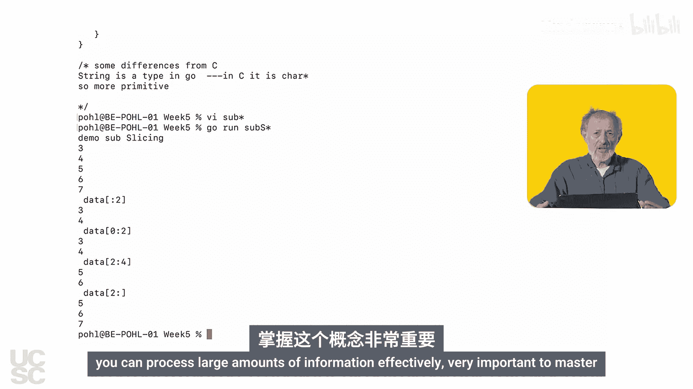

# 【加州大学】Go语言编程-｜-Go-Programming-Everyone-Part-1-p26-P26_子切片_05_01_04--BV1h3e7zBE3U_p26-

So we've already explored using slices。And we've seen why， slicing。

Is a very powerful idea and go much extended from the idea of a sea array。So it's another。

Very important reason to switch over your basic language for doing whatever was C。

Go is a strong improvement overea。 And a large part of it is that the notion of。A slice。

Which generalizes or makes a dynamic array is built into the language。

 So you don't have to manipulate it， as you would in see with things like cac。

 You don't have to do your own。Memory management。 and memory management。If you're a C programmer。

 it's one of the more sophisticated things and one of the places where it's very easy to go wrong and go wrong。

In a bad way， many famous bugs that involve memory management pointers。So this avoids all that。

 because， as we saw with ordinary slices， not only can you declare them to be of any size。

 but they're extendable as well。Very useful。And they have a lot of。Basically， built in functionality。

 such as finding their length or capacity。And using iterators over them where you use something like range。

So all very useful， all powerful ideas， all strong improvements over the sea language。Now。

Another thing we haven't yet tried is we have the ability to take a slice and use only a part of the slice。

And that's what we're going to look at， we call it a subslice。So， very powerful idea。

You might have some huge amount of data， like think of this。Social Security system。

 Social Security system in the United States。Probably has at least。Well， over 100 million。

Items in its database。Of there are 340 million。People in the country and probably at least half of them or more have social security numbers and they have to maintain all that。

 But not everything that the Social Security administration needs to do requires that goes through。

All of its information。 It may have information stored in different parts of some。

What might be thought of as a very large slice。 And instead， you could just go into a part of that。

And do this more efficiently。So how does sub slicing， how do you get it a part of an array and this？

为炉。ASple program shows。So let's first off start with an ordinary slice and in the first declaration。

It says data colon equal。 So that means it's going to be a declaration。 and we see the。Blank。呃。

Square brackets。So no size is given。 If we give a size， we have a fixed array， a fixed array。And go。

It's not that useful because it's too rigid。So and then we give it what the underlying element type is。

 so it's a slice of ins。And then we give initial values which are inside a parenthesized list。So 3，4。

5，6， and 7 are the five elements of this slice。 So we've initialized data to a slice。

 It's a slice whose length is 5， probably its capacity is 5。And that's what we now want to work with。

So， let's。呃。Get our。 let's， let's go back and let's get to our first sub slice。

 The first sub slice is data 2。And look how we've done that。 That's， again， a declaration。

 So we're using。Colon equals。And。We're taking data。

And think of data as having a lower bound than an upper bound。

And the lower bound and upper bound are going to be separated by the colon。

And here we only see nothing on the left side， but a two on the right side。When we do that。

Implicitly， the left side is 0。So this would be the same as。呃。The next declaration date of  three。

 where we're saying0， colon 2。 It gives us exactly the same thing， but。We didn't need to write the 0。

 because that's。Andmplicitly understood as the lower bound， when we only give。Something passed。

Of the cola。Now look at data of four， data of  four gives two both lower bound and upper bound。2。

 colon4。So that means look at the element in position 2。And we have position2。呃。

And it's a sub slice of elements。That basically give us the upper bound is 4。

 We get the two elements sub slice2 and 3。 and then8 of 5， we left off。The implicit upper bound。

And there。We're going to use the final index of four。So that's going to give us element two， three。

 and four。So all of those。We can leave off either the light or the left。

And the sub slicing syntax is。Lower bound， colon， upper bound。

And either lower bound or upper bound can be implicit， not both。All right， now let's try it out。

We're going to demo it。 So first， we're going to remember how we can。Use an iterator。

 the for expression that basically is an iterator。And。We don't need the first value。

 the four where we use the range idea。 So we're。Executing range data， that means iterate over data。

Normally， that would take all five elements of data in turn。And were saying。

 throw away what would otherwise be the first element returned by range。

 The first element would be an index。 We're not using it。

 The second element is a value at that position。So in turn， format print line of V。

Just print each element in turn， so it would print all five elements。Now we're going to try this on。

呃。The subslice， quote， data。Colon2。We can write the exact same force statement。

 but now it's going over a subse。 So it's not going over the entire original slice data。

 but it's going over the subslice data too。And it'll only print the elements that are specified by that subslice。

 And then we do the same for data 3 and so on。 data 4， data of 5。 So that's what we're going to do。呃。

And now， let's try and run that program。So here we are at my terminal and we're going to run the subse program。

And everything as I said before。呃。Reiteerate， here's your ordinary slice。Your five elements sliced。

 and here are three subss we give each of its own declaration。And then we're going to show how using。

Iterator statement 4， where we're using a range over in first case data and the second case data 2。

 third case data 3， fourth case data 4， and fifth case data 5。

We'll see what we get out of this again， I recommend this very simple。

 just for demonstrating the idea。 we're not doing any useful work here。But。

You should try out your own ideas。Using this concept。So this is idiomatic， very useful。

And will now run the program。Okay， so initially。Our complete slice had five elements，3，4，5，6。

Then data Col，2， had。Just the elements， the first two elements，3 and 4。

Data colon 0 to 2 is the same as。Colon 2， because it's just explicit。 So we see 3 and 4 data of 2。

 colon 4 starts at the position that is the second position。 The second position is。Element， value 5。

And it gets the second position。 and this position， which is 5 and 6。 And then datata of 2。

 which would be colon to 5。So the slice would have five elements。And this gets us three elements。

 five， six， and seven。It's exactly what we can expect。Shows you how to use sub slices。

 shows you again， how to use iterators。It's a central idiom and since slicing or as。

 you might call her a dynamic arrays。Are probably the single most critical type because it's a way you can process large amounts of information effectively。

Very important。

To master this concept。

