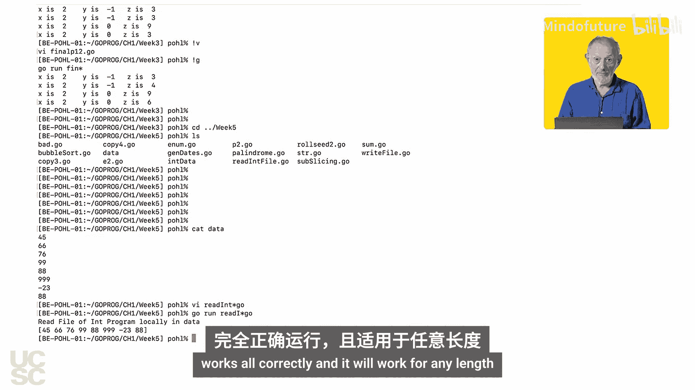

# 【加州大学】Go语言编程-｜-Go-Programming-Everyone-Part-1-p27-P27_读取文件_05_01_05--BV1h3e7zBE3U_p27-

Our next topic is the topic of using files for input and output。

So the first thing we're going to learn to do is to read from the file。Now。

 files are an incredibly important way to store data in computer memory。啊。

Most of the reason you're using computers is because you have a large amount of data to crunch and you frequently need to keep that data permanently available。

So even after your program runs， that data needs to be around such as。

All the Social Security information that the Social Security Administration needs to keep track of everybody in the country。

So that needs to be stored on something where it can be permanently there。

 or sometimes you need a file。啊。Semi permanently， you're doing an experiment。

 you're keeping that file around for a while until you no longer need it。So to do this。

 we need to know how to read from the file， how to access data in the file。

 and this is another form of input output。And some of the functions will be standard。

Go functions that we can use in packages， one of the most important packages we've been using constantly for input output is format。

 but we'll also find useful programs in the OS package and in the IO package。

So those would be very similar to functions you would have found in other languages such as。

Standard IO in the sea world。Now。The example we're going to deal with is we want to read from an existing file。

The first thing we need to do is we need to be able to open that file for reading。

And this is done with the standard function OS。That's the package we get it from Capitald open。

 And then we give it the file name， the file that we。Expect to be there。

 The file name can be directly stored in the directory where the programme is executed。

 or it can include a path that lets you find the file somewhere in your typically auxiliary memory。

Now。Once you attempt to open the file and the file we'll be using for the program that I'll show you later is going to be called data so data。

Is going to be sitting in my local directory。And I'm going to attempt to open it。Now。

We might not be able to open the file。 There are various reasons why we could not open the file。 One。

 the simple one is it doesn't exist in the location we're looking at。

Another reason might be that the file is protected。So if we don't open the file。

 we are going to get some error information， if we can open the file。

 we'll get what's called the file descriptor information。So when we use Open。

 we want to check to see if there's an error。And if there's an error。

 it'll be specified by testing it against nil。So if error is not nil。

 there's an error and we must try to recover from the error or。Frequently。

 the only thing we can do is terminate the program。Now， if it passes that test， if error is nil。

 then we can use。The file descriptor in in the for IO for reading。So how will we do that。

 So let's look at a function main， which we will also demonstrate in a second。

 that'll attempt to read an integer file of data。 Data is going to be a file where I stored a whole bunch of integers。

 And I want to process it。 So here again， is what we just talked about file that gets the file descriptor。

An error。 So this is something open returns to values。 By the way。

 many of the I O programs return an error。Because IO is frequently error prone if we get the wrong thing。

So it's always useful to do something like if error not equal nil。Then。

We're going to print the error that'll give us an error message。

 and then we're going to in this case exit， OS has an exit routine that stops the program and leaves a numeric code for the operating system。

Next， we'll look at the idiomatic code for opening a file for reading。And here we're going to use。

The format dot F scanf。 Now we've already used scanf。

And scanf is a program we've used to read from our keyboard where we've entered things through the keyboard。

 F scanf is just scanf using a file descriptor as its first argument。So it's very analogous to scanf。

 except we have this additional first argument。So after we've obtained the file descriptor。

We stored it in our variable name file。We're going to try and read the integer data and we're going to read it item by item into in this case。

 a variable which you name item。And now we're going to again。呃。

Throw away one of the arguments F scanf returns and and the other argument is the error argument。

 Again， we can test for an error。 and we see the three arguments， F scanf， the file。

And we've assumed that we've opened that file。And now what we're reading， which will be percent D。

 which is an integer and a new line。And then we're going to store it。

And we need to use am percent item， remember。All arguments。Just like in the sea language in the。

Go language are called by value， and so you need to read it into an address of item。

And that sets the item value to what was found。On the current place in the file that's being read。

 And then we do a test。And this is again， very idiomatic。

 so just try and understand everything because you'll use this time and again。If the error is not n。

 that means we've read the item。So if the error。Is nil， If error code is nil。

 it means we fail to read the item。 Why would we have failed， Well。

 we might have come to what's called the end of file。And the end of file is a special code。

 and error can test for the end of file， and if we're at the end of file， we can just break。

 that means we can jump out of the loop。 we have no more items to read。Otherwise。

 if it wasn't an end of file， then we've gotten some kind of print error。And we exit the routine。

So we keep reading until we get an end of file in the normal case， if everything's working right。

And we'll use a for loop and a pen to store all of our interteger data items in a slice。

 So that's how we're going to read it in。 And we can read in however long a file we need。

 So go is very flexible because go using a pen can have an arbitrarily long。😊。

Slice to store the data。All right， so let's look at how we're going to do that。

 There's our slice there data slice， empty brackets in。 so that declares a slice。

 which doesn't yet have a capacity or length。And now we start sticking items into that slice。

So we do that as an infinite loop。We keep checking for the format F scan F testing for IOF as we talked about it before。

The IOF test will be。And the file and there's where we're going to break。And otherwise。

 if we continue down in the program。We'll see that if we have some other error， we just have the。

We've made a mistake and we exit。呃。Otherwise， we keep going。

 and now we put a data slice equals a pen of data slice comma item。

So append expands the slice as necessary to store the next item。Okay。

So this was a very simple program to read any length into your file and store the data as a slice so we could further process it。

So now let's go to my terminal， we'll actually run the program and you'll see that hopefully it all works。

Okay， so sitting in front of my terminal， if you look at the directory I'm in now。

 which is week five for the class。It has a file called data。Let's look at the internals of that file。

 I'll just cat the file， which is a command that lets me。Examine the file。

And there's a bunch of integers， as you can see， 45， 66， 76。And then up to 88。

So a number of vintages are in that file unspecified。

And then I'm going to go to the program that's in that file called read and file that go。

 so let's do that。Let's first take a quick look at it， to be sure that。It acts as I just discussed。

Okay， so again， just as a reminder， we're getting special functions from format。

 we're getting functions from I O and from the package OS。And we're going to read into a slice。呃。

And we first checked to see if we can open data， and it is in our local directory。

 So we didn't need to look for it anywhere else。 So we don't have a path name to it。We then。

 as I said before， test to see that it's available and can be opened。

 And then we declare a slice called data slice。 And then we do the F scan F item by item for the data slice in an infinite loop。

 And the way out of the loop is to break。When we see。The era。I O E O F。 So in a way。

 it's not really an error。 We're just using that special clothes saying you can't read any more when you've identified the end of file。

 And this is just again。The go idiom for reading。And finally。

 because slices are so useful and they can be expanded another。Big plus over what you can do and see。

 or you can， of course， do this and see， but you have to do some other stuff like。If you remember。

 you have to use something like cac or mallc to allocate yourself a storage。 So see。

 it's messier and frequently leads to errors because memory management is left to the individual programmer to work on rather than leave it to the system。

 as we can do here with a pen。And then finally， I'll print the slice just to make sure we've gotten the right。

The program is run correctly， so let's try to run it。And lo and behold。

You can see at the bottom that the print out。And the reason the print out is on one line is I don't bother with the new lines。

 I didn't。I didn't print with new lines there， but you can see that it was 44，66，76， et cetera to 88。

Works all correctly and it will work for any length。

🎼Okay。

