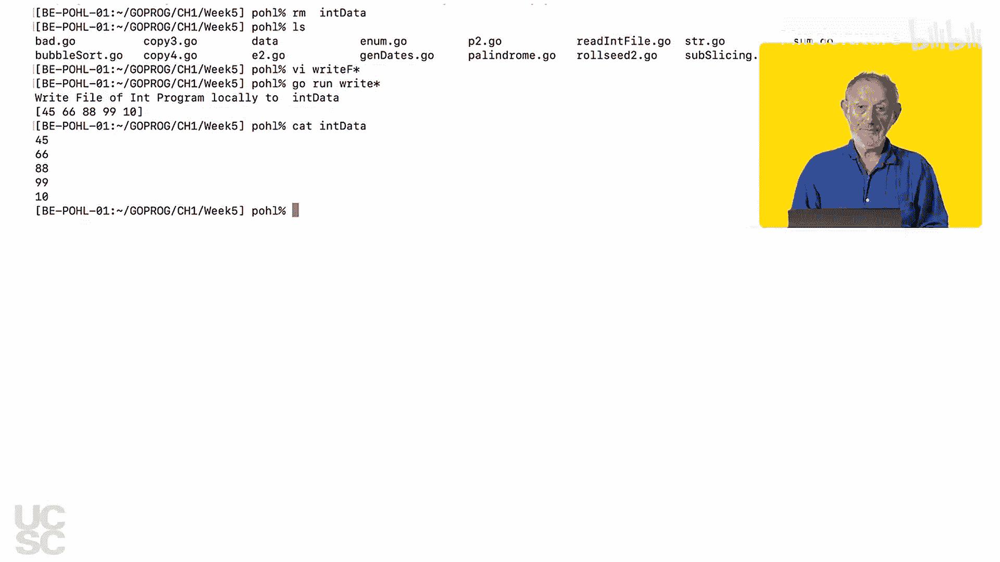

# 【加州大学】Go语言编程-｜-Go-Programming-Everyone-Part-1-p28-P28_写入文件_05_01_06--BV1h3e7zBE3U_p28-

As with reading files， there are also simple idioms in go for writing to files。Again。

 very important for serious computation， since we will need to permanently or semi permanently store our results。

啊。That we need to reuse。Again， in doing this， we have various packages that make the opening and writing to files easy。

 those packages as we've seen。For reading files include things like format and I and OS。Now。

 when we write to a file。We often want to create it。 We could also write to an existing file。

 and we will save that for another day。And so in the simple example。

 we are going to also be in effect creating the file。Besides， in effect， opening it。

And then we'll see in this example that we want to properly return。

The the file when we no longer need it any more to the system。 it turns out in some systems。

 how many files can be kept open at any one time is limited。

 And so you want to not only open files but close them。 So in this case。

 So generally a decent principle that any time you open a file。

 we're going to do its customary and go well see it now to use a defer Defer as a keyword and we'll call the close function on the file。

 And that means defer will close the file at the end of the computation。

So we'll also see defer later on。呃。When we start to study things like。Parallel computation。

 the fur becomes more important。By pairing open and closed nearby。In a language like C。

 we also have a close and generally see people put the clothes at the end of the program and that could be done here too。

 but by doing it immediately we don't forget to do this。Makes it easier， and it's idiomatic。

 It makes it easier to pair our opens with our clothess。 So let's show how to do this。Again。

 we will have a file thescript is stored in the variable name file。

 We'll check for an error and we'll do OS do create。 And in this case。

 we're going to create a file we'll call int theta。 We have to give it a name。

So we'll call it int datata because we're going to write integers to it。And in this case。

 rather in immediately testing the error， I'm going to write a function that I can use to test the error。

 I'll call a check file。 The function's purpose will be， if there's an error in opening， I will。

Terminate the program， giving an appropriate message。And then here again， I do a defer。

 So you can think of。The three things you want to do， you want to create。

 You want to check on an error， make sure everything has happened properly。

 and then you want to defer a close so that you're managing this resource。Properly。Now。

 it is important in fileileo to do error checking and handling。

 It's very frequent that you get errors like you can't， for some strange reason。

Write to a file or read from a file or properly open the file。 And so in those most of those cases。

 the appropriate thing is just to do a simple termination。 And let's show how to do that。

Here we'll write a function check file。 It takes as its argument and error。So E R R。

 as we saw before， is of type error。We do a test to see if the parameter E is not equal to nil。

 and then we call a special function panic， panic， just like OS。

 exit is a way to is an alternate way to exit the program writing a message。Okay。

 so then we'll just use that wherever we have an error in our IO。Again， useful idiom。

 so you want to keep a function like that around。So after opening the file。

 we'll use F print F to write to it， makes sense， remember reading， we use scanf。Writing。

 we use print F。 and here with files， we'll have this additional file argument in the printf。

 but we've already used print F and print L N all the time。Here we're going to use F printf。

And again， we'll have a slice， but this time we're going to write the slice， so here's the slice。

They've given 10 values， too。And now I use a four range variable。

 So V is going to be the individual elements of the slice in turn。

I'm going to see if there's an error in my printing。 So look at print formatmat at F print。

 F first argument is the file descriptor。 Second argument will be present D。

 and then we'll toss in a new line。 So each integer in the file will be like that earlier data file that。

Gets put on a separate line。And then that will be taken from the variable V。

We'll finally check the error in case there's an error， and we'll panic。If there is an error。

 and otherwise。We'll finish the program by showing what that data slice looked like。Okay， so again。

 I've given you an idiom for doing now， reading and writing。

 And let's just check that this writing will work。 Okay， so first off。

 I'm going to I already run this program once before and I won't。I'm going to destroy int data。

So I'll remove it from my file， so it's not there now， so if we look again at the directory。

 we don't see it。And we have our right file dot gov， the program all the way over。

 as I'm looking at the。The terminal， its right file that go on the envelope。Right end。

And let's take a quick look to see that it's what we just described。Okay， here it is。 again。

 We only need format an O。Here's our special function to check the error in this case。

We're not using exit， we could alternatively if that was more door。胃经。

We're using instead this function panic。 And that's an alternative。Here we are。

 we're going to write data， what's the data we're going to write。

It's going to be the data we put into initialize the data slice with。

 and it could be as long as we want， or we could have been manufacturing it。

 Let's say we used the random number generator， and we created for purposes of exploring our efficiently a program work。

 We could create a million items in our data slice。At random and then process them。By putting out。

That material。Onto a file， in fact， we're going to use that in I think， our final homework problem。

So here again is the four range。 We go over data slice。 we get each element and turn。

 each element is assigned and turn to。The variable V。If it all works。

We're going to print the to the file。 That's what F print F does。

 The first argument is the file descriptor。 The file descriptor is pointing at a file that's going to be named in data。

 We're checking for an error， to make sure。诶。Everything is working。

And then we'll just print it out at the end just to show that it worked。And now I'll just run it。

 so go。Run。And there's this file that I， that where I printed out to slice。 And now， let's see if。

And I can cat。And data。And indeed， you see you get exactly the same thing。

 And now you're getting with the new line。 Remember， when I did the F print F。

 I stuck a new line in after each value， each item on printing。🎼Okay， it works。

 It's an idm that's very useful， so you now should be able to use basic file I O and go。

