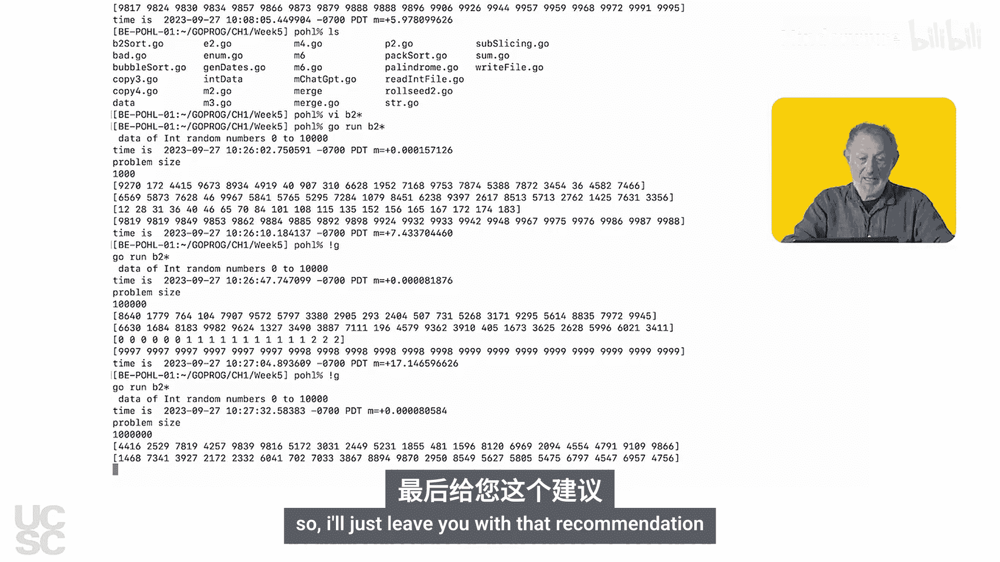

# 【加州大学】Go语言编程-｜-Go-Programming-Everyone-Part-1-p29-P29_冒泡排序_05_01_07--BV1h3e7zBE3U_p29-

Sorting is one of the most used algorithms in computing。

 it's also one of the most studied algorithms。It enables you to order data so that it can be readily and efficiently processed。

There are many， many sort algorithms。The most famous reference to that is canuth Vole3。

For anybody serious in computer science， that's a must book to get。

It not only describes the algorithms in detail， but analyzes them in detail so you can understand why one algorithm is better than another。

Many of these algorithms are available in standard libraries。

 so while you most likely will use a library for sorting， such as a package and go called sort。

Just like you have the package format。It's still important in learning how to write code。

And if you want to become a computer scientist， it's absolutely fundamental to master these codes and understand why they work and how they work now。

In some ways， the easiest code will be what we'll show right now。

 and that's going to be an algorithm called bubble sort。

 it's called bubble sort because metaphorically the numbers bubble up to the top of a surface。

The problem with bubble sort， while it's very simple to code is it has a large downside。

It's very inefficient。It is what we call order n squared。 That means for n elements。

 the running time goes up as a square。 So for， let's say， your running time for 1000 elements。

Is iss a microsecon。Then if you have a million emms。It's going to be the square of that。

 It will get to be many more seconds。And so on， so when you have such an algorithm。

It soon becomes impossible to order very large amounts of data。

 Imagine you're in the social security system。 Well。

 there are hundreds of millions of elements there， and they need to be ordered so that。

So security people can efficiently search that data。However。

 we know of many more efficient algorithms and will'll have you do one of those。

 It'll be called merge sort that are instead order n log N。 Again， we're using capital O。

 which is standing for order， which is what's called the big O notation。

 and we're not worried about like little constantsons in there。

 which is worried about things like n squared and cubed and factorial and log N。

 All of these get used to describe the efficiency of an algorithm。Now。

 in writing this bubble sort algorithm， we're going to use a special feature of go。Somewhat unusual。

Go allows multiple assignment。 We already saw that。Where。

We do something like the four range and we get two values out of the range。

And sometimes one of those values， we。Throw away using the underbar。

But any function can produce multiple values and can be assigned。

To a common separated list of identifiers。This is not possible in a language like C。

 So it's different。When you do a sorting language， then when you do a sorting algorithm。

You have to swap elements， the elements are thought to be out of order。

And if two elements are out of order， you're going to interchange them。

Swaapping and go can be done in this very simple fashion。 A comma B is assigned B comma A。

It allows A and B to swap values without needing a temporary。

 which would be the way you would do it in most languages。

 And here I show you how you would do it in the C language。 You would have a temporary。

 You'd assign the A value to the temporary。 So it would be kept。

 And now you would assign B to A and B。If you tried to assign a to it would be the wrong value。

 and you'd now have two B values。 So instead you assign attempt to be。 But the go trick or whatever。

 the go formulation of multiple assignment。Means that secretly， the compiler is providing that swap。

And that's what we're going to do in our bubble soil， we're going to use that。

So let's see how bubble sort works， we're going to assume that we're bubble sorting on a set of integers。

 you can bubble sort， of course， on anything。You can bubble sort of anything in which there's an ordering。

So you could also bubble sort floats。 You could bubble sort strings using something called Alexographic ordering。

 That's what you have when you go to a dictionary or a phone book， you have things sorted。

Lexxiographically， according to their letters。So bubble sort of work in order n squared。

 we'll see how that works。Principally， we're going to have this major loop and the major loop is going to be for the length of the slice that we're containing the values in。

So we're going to go over that slice。And now。We'll have a second loop。

 and that's where we get n squared。The length of the considered to be N。 And then in the J loop。

 we go up to length the minus I -1。So that's called the inner loop。

So here we again see in bubble sort how we have a double loop， an outer and inner loop。

And inside the inter loop， we're doing the interchange， we check to see if two elements。

Are out of order if the if the lower element， DJ is less than DJ plus1。

Then those elements are swapped。 and you can see that we use that。

A little trick in the go language for swapping using a multiple assignment。Now。

 if you think about this。If D0 was the largest value。

Then D 0 from that inner loop would be bubbled up to the top。

And then we know that the largest value in the first iteration of the inner loop gets bubbled to the top。

Right， it always wins that comparison， and it always gets exchanged。 and it gets moved to the top。

 And then we can leave that alone。 That's why we keep getting that minus I in there in the inter loop minus I comes from the fact that we've ordered up to that point we've ordered the top elements。

Each iteration provides an additional element in the ordering。

So each iteration moves the largest remaining element to the current end of the slice。

So the largest element remaining bubbles to the top and the two loops are clearly order n。

Order n squared。Both loops or order n。 So they multiply and you get a order n squared。

 So consider if we have an unordered sequence like 9，7，15，3 and 6。 what will happen at first， first。

7 gets compared to 9。 Nothing happens。9 gets compared to 3，9 gets moved。9 gets compared to 5。

9 gets moved。9 gets pair to 15，15 stays the largest。Now， if we go to the next iteration。

 we know that the largest 15 is out there。 So we're going to start 7 compared to 3。 That moves 7。

 compared to 5。 that moves。7even compared to9， no，9 is the largest and so on。

 So you should try this yourself， convince yourself that this is all going to work。

It's always important to hand simulate your algorithms to make sure you understand them and that you see that they're correct。

So a very good skill to learn。Now， how are we going to test this？We're going to have a function main。

Maine is going to print a bunch of。诶。It's going to generate a bunch of random numbers between  zero and 10。

000。And since we don't want to repeat the same run each time we're going to use a seed。

 we've already done this many times。And in this instance。We're going to。

Arbitrarily bubble sort 3000 elements。 so we'll make。A slice of that size。And inside that slice。

Will assign a random number between 0 and 10000。That's what that。

That's what we've done there in the4 eye our arranged data slice。

So then we've produced a random assortment of elements， 3，000 of them in this case。

And now we call bubble sort on that slice on the data slice。And we don't want to print out 10，000。

 so we'll just print out the first 20 and the last 20。And you can see there we're doing subss。

So those things。Well， let us check。That the first 20 elements and last 20 elements are appropriate sorted。

And that'll be fairly conclusive that we've got this right。So。In summary。

 we're going to generate unsorted data to test our bubble sort。 We're going to then bubble sort it。

 and then we're going to print。Some subss to see that the result is appropriate。Okay。

 now let's turn to running it on screen。So。Here I have a bubble sort that's similar to what we just described。

Bring it up on the screen， my terminal window。So you can see。

 I'm going to use a comma B become a a for my swapping。If you're an old C programmer。

You've learned how to swap two values by。Calling a function。

In which the two values are passed by pointer and then using an internal temporary to perform the swap。

You could write it that way。Go allows you to do that， but this。

Very nice feature means you can avoid that。So we're going to generate data。呃。

And here's a simple bubble sort， just like we saw its order n squared。

Outer loop for I equals0 up to the length。-1。And internally。

 they have the inner loop for j equals 0 up the length D minus I。 So each time through the loop。

 we do one less。And then， we do。Our swap， if necessary。

Let me mention one thing if you want to try this。You can try to improve on bubble sort because sometimes you get the list sorted before you're done。

 or maybe by accident， you were given a sorted list。How could you know that the list is sorted。

I'll give you a second to think about it before you're done。 How could you know that。

The way you would know that is。If over here， there were no interchanges。So you could。

 in the inter loop， set a flag。That。Is true if there are no interchanges。

And only turns false if you get an interchange。And once you get an interchange。

 you have to continue with the algorithm。 But if you go through a whole inner loop within an interchange。

 you can exit。You can do a return from bubble sort， so you could think about that。

 you could try it if you want。So here we are。 I'm going to print out a whole bunch of numbers。

 I'm going。啊。InIn this model， I'm going to ask the user。To produce。呃。The slice。

And then I'm going to show you in this model。What the values are before we sort and what the values are after we sort。

So hopefully， you can be convinced。 I'm also printing the time because I want to also demonstrate that it runs in order and squared。

 So it's not very efficient。So let's go and run it。Okay， let's do a small problem。

 let's do a thousand。And you can see it's 1 thousand。 You can see。

The initial random numbers start like 9，2172， there's no apparent order to these subslics。

And then we call bubble， and you can see we get 12， 28， 31， 36， 40。And we get small numbers。

 and then we get the large numbers at the end， the last 20 in the slice。

And we did that in a very short amount of time。 Now， I'm going to redo this。

And why don't we try a problem size of 100000。It should work， I believe。

So now you see the thing sed rather than。Immediately producing。

It's just showing you the slices before the sorting。And you could see a noticeable pause。

So in the first instance， when we did a thousand， it was very fast。 I don't know。 a few microseconds。

A milliseconds。And now， all of a sudden， it was 17。So it grew。And if we go one further。

We'll really get a delay in here， and this is the difference。

You'll find between this sorting routine and then the use of a sorting routine in the library like a quick sort or the sorting routine。

 I'm going to ask you to write as your last problem Merth sort。

 So here we're doing problem of a million。 No problem in generating the million values。

 See how fast out was that occurred in generating the million random values。

 They just happened immediately。So that was not part of the problem。

 The part of the problem is we get something like a million squared。

 and that's going to be very large。So。Here we are。And it's taking a very long time。 And you can see。

That once these numbers get large and a million isn't that large for a big database。

It becomes impractical to use bubble sort。Okay， I'm not going to wait for it to finish。

 you can try this out on your own。So。I'll just leave you with。That recommendation。

