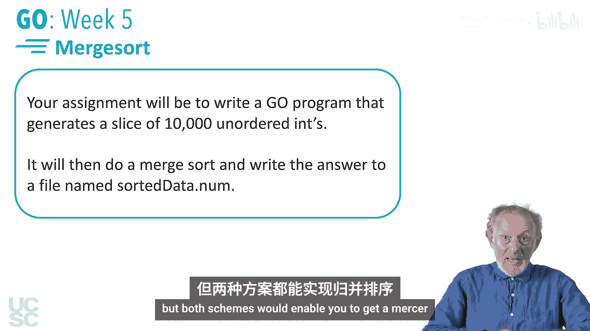
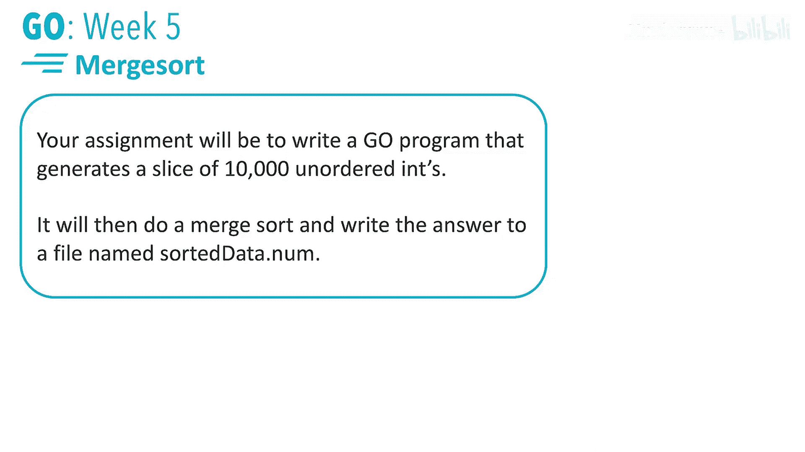

# 【加州大学】Go语言编程-｜-Go-Programming-Everyone-Part-1-p30-P30_归并排序_05_01_08--BV1h3e7zBE3U_p30-

This is our final video for this class。And in this final video。

 we're going to outline how you do your last homework assignment， your last programming assignment。

So we're going to explain how you do a merged sort。And why a me sort is important is。

It's way more efficient than a bubble sort。 If you remember the way we talk about efficiency is to talk about the order。

Of a computation。And bubble sort for n elements is order n squared， so。That grows exponentially。

 whereas merge sort is order N log N， and you'll be able to see how much faster it is for very large N。

computer is too fast for small numbers。 but if you start running it on 10 million things to sort。

 you will see it very noticeable。I'll run time。Difference。And order N log N is much smaller than。

Order n squared。呃。Now， the key idea in merge sort is a divide and conquer idea。

 So let's consider that we have two piles。And they are already sorted。 And the two piles。

 one of them is 3，9，1823， smallest first。 The second pile is 2，161729。

So Merth sort has as its central idea， to have two piles。

And merge them into a sorted and two sortded piles get merged into one bigger。Sort of piles。

 It's frequently natural to use sizes that are powers of two。 So here would be two squared sizes。

 And sort of you double the size of what is merged as you go through the algorithm。

And that's sort of how you get to see that it's order log n， order n log n。Okay。So in this slice。

 we take the smallest from each。And we're going to keep track of where we are。

 And the smaller of 2 and 3 is 2。 And so two goes in。To the new merge pile。And then what remains。

 we have to。Again， look at， well， we didn't put three in yet。

 So three is now smaller than what was in the other pile。And that goes in。

 And we just keep repeating this step until we end up with 2，3， n。9， in this case，16171823 and 29。

 That's what the merge will look like。 Now， in order to get this。

We would then have 16 elements in order。 And if it was a much bigger pile。

 we would then merge to 16 element piles。 So we keep going until we finish up with everything being merged into asortded order。

Now。I'm going to give you some code that's almost go code。

 which lets you look at a critical way to conceive of how to do your homework。

Though you may want to read elsewhere。 mergedword is very important sort in the computer science world。

 Many explanations of it。 You can go to Wikipedia and even see it coded in other languages。

 So it's well worth looking in detail at how to do it。

 But for those who want to try and think it through yourself。

 this piece of pseudocode because I haven't completed everything in the code。

 get you the essential merge step。 So remember， I have one pile， I'm calling that sorted slice 1。

 I have a second pile calling sorted slice 2。 And then I want to。Make them merged。

 So I put them into the merge slice。 So what I'm going to need is three indexes。

Why do I need three indexes Because I've got to know where I am in pile 1。

 I have to know where I am in pile 2， and I have to know where I'm putting my next element into the merge slice。

 So index3 is for the merge slice。So I'm going to。Keep going until I either。See the end of slice one。

So I have a four statement that looks like。Index one。Goes until the length。

An index 2 goes until the length of slice 2。And this for loop will stop。

 It's really a wild loop in disguise because it only has the one central。

Thing in the three two semicoant positions。So it only has what you need to do until it's false。

And when we stop， we'll have exhausted one of the slices or both of the slices。

And then we have to add on。What the remaining stuff is from the other slice that hasn't yet been。

Gone through。Okay， so here we're looking at sorted slice one index one that would have started at zero。

And then we compare it to sorted slice 2 index 2， if it's less than。

We put that element into the merge sort index 3， which starts at 0。And then we have the increment。

That the index， where we took the。Element from， which was， in this case， index 1。

 And we have to always end and。Increment index 3， the merge place so that we go from 0 to element 1 to element 2 until we're done。

 So index 1， as before， would have been it。 but index 2 was not incremented。

So it's not the element that's been transferred yet。 And then we'll keep processing the code。

 picking the next smallest element and sticking them into the merged list。And after it completes。

We merge the rest of the slice that has not yet been depleted。

So this piece of code is central to possibly writing a full merge， because at any one time。

That's the code you use to get the merged slice。Okay， and your assignment is going to be to write。

Merd sort。With a slice of 10000 unordered integer elements。

 And the way you'll get those integer elements。呃。Is。To use。A。呃。Random number generator。

 that'll be the easiest way to work with this material。Now in doing this， O。But to test your thing。

 we will provide a file named sorted datata。 Nom， because we want to know that you've got it right。

 so we will be able to see if it runs on sorted data and gets everything sorted。

 but we're also going to generate those 10000 numbers using a random number generator。 So when you。

Try it out。Try it out with a much smaller pile of numbers so you can understand what's going on and make sure。

You know， even do it for six numbers。So just generate six random numbers。

And you should be able to hand simulate your code on six numbers。

 making sure you see what's happening， making sure that your code will work。

 And then when you write the code， run it on those six numbers and make sure that indeed。

 it provided the sort。 And again， you will see in the overall routine is basically two principal ways to do it。

 the more sophisticated way is to use some kind of recursion。

So I do invite you to think about how you can use a recursion。To make this work。

🎼As opposed to an iteration， but both schemes。Would enable you to get a merge。🎼Okay。

