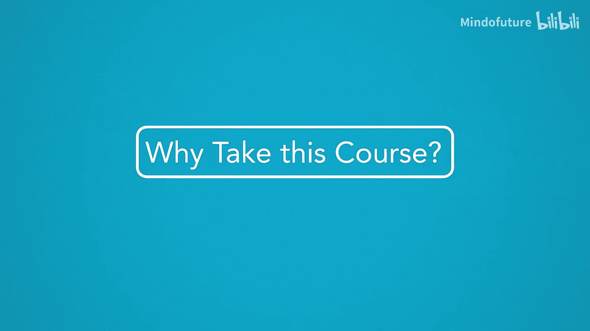
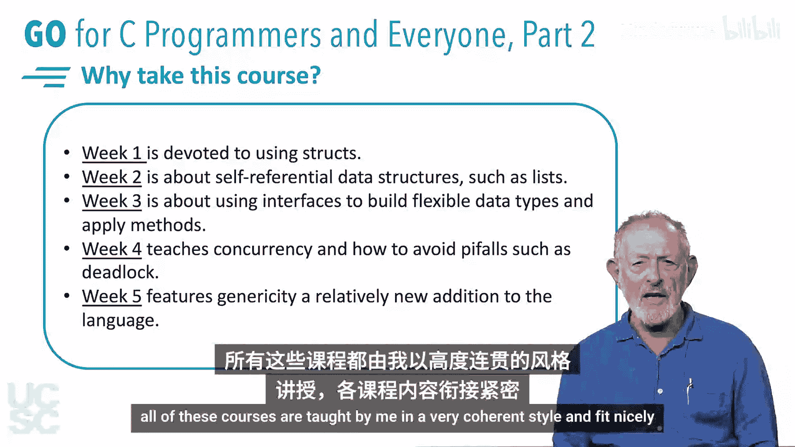
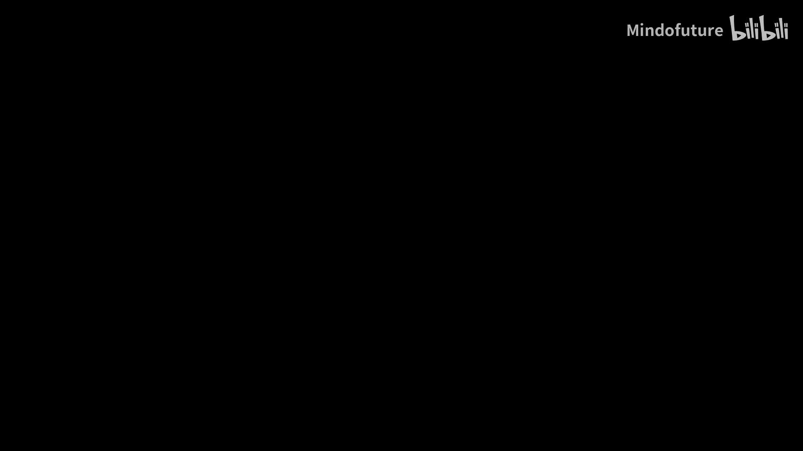

# 【加州大学】Go语言编程-｜-Go-Programming-Everyone-Part-2-p01-P01_为什么要学习这门课程_01_01_01--BV1GTe7z3Eqi_p1-

🎼はい。I'm Professor I Raol of the University of California， Santa Cruz。

And I want to invite everyone to take part two of Go for everyone。

In this class you will learn how to build and use complex data structures such as ghoststructs。

 you will also learn about some unique features in the language such as interfaces and how they are used to generalize data types go also let you do concurrent programming within the language which is different from CNC++ where you must use libraries。

Finally， youll practice writing code using all these advanced features。

And a relatively recent addition to the language， generosity。The class is five weeks long。

 Week one is devoted to usingstructs， week two is about self referential data such as lists。

 Week3 is about using interfaces to build flexible data types and apply methods。

Week 4 teaches concurrency and how to avoid pitfalls， such as deadlock。 Week 5 features generosity。

 a relatively new addition to the language。Each week takes about five hours of viewing an effort。

 and then if you are taking these courses for a certificate。

 there are quizzes and programming homework each week。By the end of this class。

 you should be comfortable with almost all the features of the gold language。 Additionally。

 there will be certificates available。For learning， go along with learning C C++。

All of these courses are taught by me in a very coherent style and fit nicely together。

