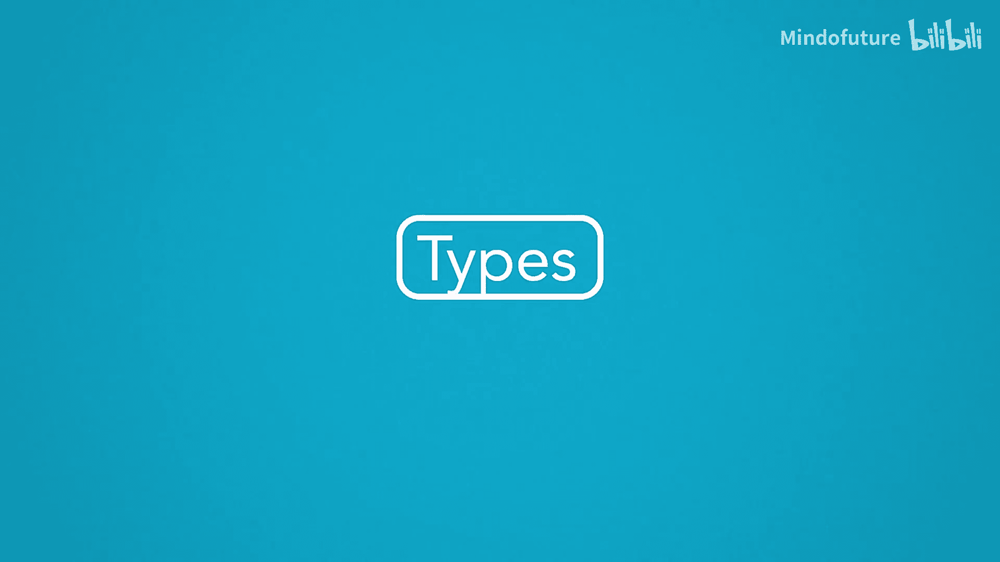
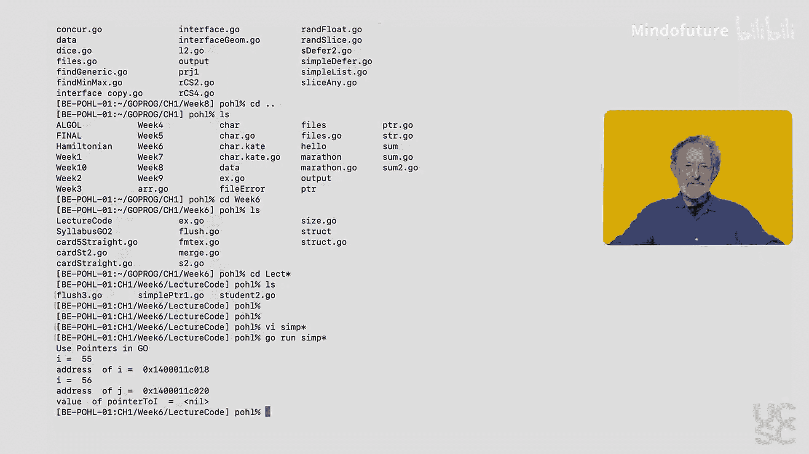

# 【加州大学】Go语言编程-｜-Go-Programming-Everyone-Part-2-p02-P02_类型_01_02_01--BV1GTe7z3Eqi_p2-

So you've taken my first course and in my first course。

The types you had available were things like ints and strings。

 And they were given to you by the language。But it's not really possible to have types for every problem domain。

 So in modern languages。We have ways of building what are called user defined types。

 and we will study in this first week。How we can have the basics of a user to find type and go。

And to do this， we have to know about typed declarations。More about pointers。And especially struck。

 So those are what we're going to do。So the first part is to devote how to devise a user defined type。

 We'll see in one of my early examples that I will define a type card， playing card。

And then we're going to do a problem in trying to figure out what。

ItWhat the probability of getting a flush is in poker。 So when we do this。

Instead of using the available standard types like int and bull， which work for many problems。

We instead， by defining our own type to fit the problem， we get a lot of benefit。

 We get the benefit of having the code be clearer， we get some benefits from type safety。

 another example will be how to build a student， for example。

 and if we want to maintain information about students at a college or university， then。

We have to write code about students， and we have to understand what's important about students。

And students， for example， are person。 so we can build a student out of a person。

 and we will discuss how also to do that。 But unlike a normal person。

 students are in class and they have grade。 So we might have a student have as part of its description。

It's graves。So all of these concepts come under the term user defined types and， as they say。

 critical in developing code in these domains， it makes them more maintainable and more readable。Now。

What we use to do this and go is。A type declaration。

 And we use what's called a struck and a pointer to a struck。

 So we are going to show how to use type declaration。

 And there's a very simple way to have a type declaration。

 Here's an example where we say type type is a key word and go。 and then。

I'm going to call my type a test grade， and I'm going to make it。Be an unsigned in 8。 So， you know。

 you can think of this as it's going to be grades between 0 and 100。

 and a small unsigned integer is enough to keep that grade。

But because we're calling it a test grade in our code， it'll be easier to maintain。

 and there'll be a degree of type safety as well， because it won't be convertible easily to。

Other types， so we can't make conversion mistakes。While this use is a very simple use。

 it just makes your program as well more literate people reading the program。

Understand what you're doing Now， more importantly。

 rather than just taking a standard type and giving it a new name。

 we're going to show how to also definestruct types。Now。

 before explaining how to use Struc to create a user defined type。

I want to go over and further explain pointers because pointers are going to work closely withstructs and they're going to be very important to using user defined types。

So recall that a pointer is an address of an object。So if we have an object like a。Colon equal 5。

 which creates the variable A initialize it to 5。 And because the compiler recognizes that5 is an int value。

 it says a is a variable of type int。Yeah。Now， if we also do pointer colon equal ampersand of a Ampersand。

 remember is the operation that takes the address of a address of a is where a is located in computer memory and modern computers have。

frequently。Hundreds of millions or even billions of bytes。

 so it's going to be a very big address where the compiler stores this variable。

You could think of the variable as being a post box in it， the value will be 5。

 and on the outside of the post box will be its address。

 which will be some typically very big number。 So pointer to a is now a variable whose type is。

Pointer to int， not int， but pointer to int。Yeah。Then， if we now。

Do an operation called the D reference， which is the star operation on the pointer。

 then rather than have the pointer itself contains the value of the address。

 But star of the pointer contains the value stored at the address。 So in this case。

 that's going to be 5。Okay， now if we use pointers again and we do star pointer to a assign star pointer to a plus 1。

 we will have changed if we do a print line of a， we will see that a's value is now6。So these。

 the two fundamental operations you want to understand is ampersant address of and star de reference to Okay。

 so now let's turn to using pointers。And go。And we'll have a simple program that shows you all the use of these pointers before we go on it struck。

啊。We， of course， have package main。 We import our format， and then we have this main function。

 And here we start by declaring and assigning a value of 55 to。I， an integer variable。

 And then we do what we just did in the previous slide pointer to I is the address of I。

 and then we'll print it out。 And I'm going to show you this and run it， but it should print 55。

Then we're going to also print the pointer value， the pointer value will not print 55， it'll print。

When it's a pointer， it prints an hexodadecimal， because addresses are。

Typically very large an heodadecimal lets you readily display a very large number and computer people use things like heodadecimal and ocal when they're talking about the internal memory of a computer。

 And then if we do the D reference， we'll get back to 55。So here in this step。

 when we do de referenceference pointer to I and increment it， then we should be adding one。

 and that means that now if we print out， I will print out 56。Now we can do a reassignment。

And that we can do an assignment to J and so we have a new integer variable。

 we can reassign the pointer variable can be reassigned to the address of J。

So the pointer can have the use of pointing at different objects of。Type int in this case。

 we couldn't do that reassignment if J was not an invariable。And now we'll do some printouts。

 And then finally， there's a special value that pointers can have。 It's called a nll value。 N IL。

 Nll is a very important special constant in the go language。 So we'll see it。

 We've already seen it used， for example， in certain kinds of four statements when we use the four range。

And here we're using nil as the empty a pointer to nothing。 It's pointing to empty space。

 And if we assign a pointer to nil， then we essentially lose where that pointer is pointing it and we'll print that out as well。

 Okay， so now let's turn to my computer and we'll just run it， make sure that it all works。

 as I've just said。So here's that program we saw on the slide。

 it's a simple program that shows how that pointers get used， which will be important， as I say。

 to everything we do with Str。啊。And pointers in go look like they're sea light pointers。

 So I know a lot of you are coming from the sea world， but while they're similar。

 there are important differences， so they're safer because。In go， you can't do point arithmetic。

 as you can in see， which is。Typically， one of the places where hackers。

When they're attacking things written in C code， manage to。A breakak into some of the C code。

 so they restricted pointers。So that they can't be modified in this kind of very general way that you found and see。

 so that's among the differences。Okay， so that was up again。 let's look quickly。 Here's a variable I。

 We've declared it by assigning it in the duct typing scheme。 I is 55。 Here's the pointer to I again。

 we're using for declaration purposes， the colon equal， and we're assigning it the address of I。

 then we're printing out I and we're printing out a pointer eye。

 and we'll see that print as hexadeimmal。Now we do an increment。And again。

 we have to use the de referenceence operator， so you have to get used to using Dreence and ampersand address of dereence。

And then we'll print， and hopefully that will have been incremented。

 so it should turn to 56 and then we'll show that we can reassign pointer to I to J that's sort of pointer to I shouldn't really point at J。

 but that's legal， we could have said pointer to int。And then that could that could have been。

 maybe that would have been a slightly better。Shoice of identifier。

 because now it's really pointing at the address of J。 We'll see how that differs。

 And then we can show you how to assign the special value Nil。

 and Nll is going to be very important in some of our applications。 Later on。

 we're going to see how to use pointers andstructs to build a very important data structure called the linear linked list。

And in that linear linked list， the way you tell that you're at the end of the list is you look for the special value of nil。

 so frequently with pointers nil is。啊。A signal that were at the end of something。Okay。

 so we're done looking at this code。And now I'm going to just run it。And there we are。U。We have。

We've used program appointeders and ago。 we see I is 55 and heres。

This is a hexadecimal based integer。You know， a sex of democus is printed out as0 x x。

Stands for Exodadecimal。And that's why， for example， C is a diit。 An exodadeciimmal your're base 16。

 What's C， Think about it for a second。 A is 10。 B is 11。 C is 12。D is 13， E is 14。

 and then the last exit of that small digit is f which is。15。So this is a heodadecimal base number。

 and you can see it's quite big。I don't know what it translates offhand into。

 You could try that as an exercise into decimal。But it's going to be a very large number。

 which is pointing at where that variable is in memory。 And now recall that we dereence。

Did the pointer and auto incremented。What we de referenceence。 So that's why I turns into 56。

 Well we did it through ereferencing the pointer。 We didn't do it through directly incrementing on。

 So using de referencing or what they call indirection。Also lets you manipulate the variable。

 very important。 be comfortable with that。 And now we have the address of J。

 And notice the difference between those two values is the difference between 18 and 20。Now。

20 is at hexidadeimmal 20。 So it's really。32 bits away。

 So this address is 32 Bs away from the eye address。

 and the compiler is clearly sticking these variables in adjacent parts of memory。

And then just as I said， if I want to print out a pointer that's been set to nil for whatever reason is nil。

 then you see how print Ln works when it's printing the Nil pointer and it just shows nil okay。

 so go play around with similar programs， make sure you understand how to get an address。

 how to dereference pointers。🎼And have fun with。

