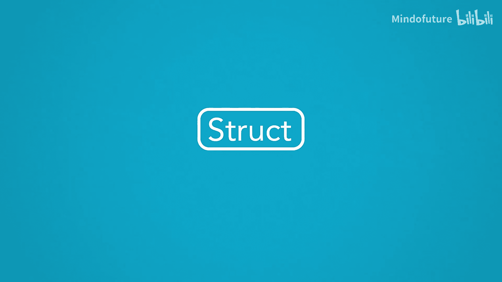
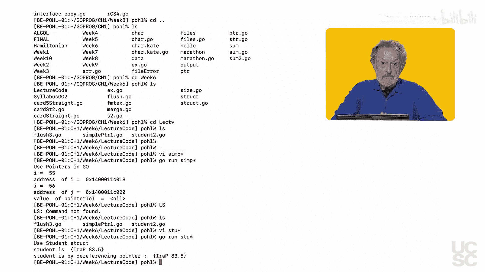

# 【加州大学】Go语言编程-｜-Go-Programming-Everyone-Part-2-p03-P03_结构体_01_02_02--BV1GTe7z3Eqi_p3-

So now we've discussed pointers again and we've discussed the simple use of the type declaration。

 but to get interesting user defined types， we need something called a struck。

 we've seenstructs before if you've done my C class。呃。

And struck like things are in many programming languages， so if you're coming from another language。

 you probably have something like a struck variablerable and that's critical to building more complex user defined types。

So let's go on to the next slide and see how that's done。Here we're going to define a person。

So you can imagine that we need this for lots of reasons， for example， if you're in a large company。

啊。A person will be an employee。So person will be central to lots of software。And。What。

Are the elements of a person in this way， we've done a name which would be a string type。

Name is a field， so these things that are individual declarations inside there。

 like addresses a string type， so security number is an unsigned 64 bit integer。

Sex will be bully and true or false for male and female。So。We're using basic types to build。

The basic types are defining the fields。To build this type person later we'll see that person itself can be used to build even more complicated objects like employee or student。

Now， one thing to notice is that we've capitalized persons， so that tends to be。

An important ghost style convention。Now， you don't have to capitalize it。Att capitalization。

 remember。In a package means that。Object can be exported。

So if you're going to use this in a large amount of software and it's sitting in a package。

 you want it exportable and that's why we use the convention of。Having it capitalized。Now。

 once we have this type， we can use it and don't forget it helps make our code more literate so we could say there P is a person。

So now some variable of type person has been created， and then we can， for example。

 instantiate one of the fields so we can do what's called the dot expression。

 which accesses the field。 So we'll see if we say P dot name is the string Iipol。

Then that will be my name stored in the name part。 If I have to。

 I can also initiate the address and the Social security number and the sex， so I would。

Be building this by doing assignment to each of the individual fields。 By the way。

 you can also do initialization when you first declare the struck as well。

 by putting the values inside。For appropriate fields inside the declaration。

 and we'll see that later， okay。So where P is a person， pointer to person。Again。

 will be very useful and will take an address of P。 And now this contains the address of P。

 And now it turns out， and this is very critical。 If you say pointer to person dot name。

 you also get access just like you did P dot name。 Now。

 this is a little bit confusing if you've also been a C programmer。It turns out in C。

 you would tend to use pointer arrow to name。So in go。Both。

The dot can be used either with the variable name or with a pointer to the variable。

Either thing works， and that's important to keep in mind。

 and it is slightly confusing to us all C programmers who aren't used to that。Okay。

 the use of pointer is going to be very important in functions because again， remember。

 everything in a function gets called by value。 so if we call。Something like a struck person。

And we want to make changes inside a function， we can't pass the person because the person will be。

Replicated locally。But unchanged externally when we call the function on it。So instead。

 we need to call it with a pointer。And then modify things indirectly。

 And then when it when we come out of that function call， we could have things properly changed。

So that's an important use of pointer in conjunction with。Function arguments。Okay。Let's。

Talk a little bit about this。呃。In the 1950s， programming languages were largely used for numerical computation。

 The most famous of them were Fortrann。 Fortrann was invented at IBM。

 It was invented to do numerical computation。 and also internationally。

 there was a publication language called Algo 60 designed by。

An international group of computer scientists， very important language in the history of language design。

 but all of its types were similarly built in numerical types。

 so those early programming languages were largely for numerical computation。In the 60s。

 companies like IBM saw that much of their computation was no longer purely numerical or scientific。

So they decided to start developing languages。That could use non numerical types。

Such languages that got developed was like the language PL1 got developed at IBM as a universal language with non numerical types。

 including a struck type， and there were languages that came from the Alg tradition such as Pascal and Alg W。

 both produced by Nicholas Worth，One of my professors when I was a student at Stanford many。

 many years ago， and Bth himself as a touring Award winner。

Especially for his a great impact in programming language design， so Pascal。

 which was enormously successful in the 80s as a language both in use and industry。

Such as with the compiler Borlin Pascal and was the basic teaching language of most schools。

 had what were called records。As did Algdobio， which was somewhat a preceding language before Pascal。

 but also a very nice language that Bha designed。 So all of this was where languages started incorporating user to find types。

 This was the 60s。 But then C got developed by Dennis Ritchie to build eunuchs。And。

They decided to use the keyword struck。Instead of record， for example。

 and also have the ability to create user defined types with this concept of struck。

 And that's what have come down to。Our current languages including go。Okay。So here is a use。

 let's look at student。And student we can have a struck where there's a name。And a GPA。And then。

We'll show how to use it so in that。Main function。We'll use that student struck。

 we'll create a variable of type student， we'll also create a pointer to the address of it so that it can be accessed。

 willll initialize it to my name I in this case。And then I'll create a GPA。Again， as I said earlier。

 it's a little different than C in that the pointer operation uses the dot。

Which is the same as like a field operation with the actual variable name instead of in the sea world。

 the arrow operation。And then we can print out。What the student is or we could print it out through do referencing。

 so we should be able to see the same thing。But understand the use of either pointer type or directly struck variable。

Now。It'll also be important when we want to develop even more complicated programs and you can think about this already。

Maybe students should have built not， we shouldn't have had a name there。

 maybe we should have had a person because we already created the type person。A student is a person。

 and then we would add a field like GPA， okay。So。We're going to。

Try this out on my machine and we'll see how it all works。 Okay。

 so here's the program on my terminal， on my Mac。And。That program， let's look at its name。

 it's going to be。啊。Student2。t go， so I'm going to。Look at it first。Just to show it。

Here's my comment where I was talking about the history of how this all got developed。

Here's a type declaration and go that's not available in the sea world。

Though if you were in the C++ world or the Java world。

 you can do something like this with classes or objects。You call those techniques encapsulation。

 they're very similar in these other advanced languages。

 but this is actually a simpler scheme that's closer to the actual way C did it。

So we have those two fields， name and GPA。And then I make use of them here here's a variable S student is a pointer task。

I'm using my name and a made up GPA I wasn't really all that great and then we're trying to print that out and as I say。

 play with this program itself make sure you can understand it and indeed why don't you combine it with that previous idea of creating a person type and that's a way to build more complex structures so instead of name string of person in there and then in a more complicated way you can get at and access the individual fields that would be inside the if that was a person you would have to get a field inside of person as well so let's run this code。

So it's really very simple， we see down at the bottom of my screen that。It saysSt is IP83。

5 for my GPA。Then here in that second thing， I said， student is by dereferencing the pointer。

 colon and the print。Is exactly the same， so indirect I can get it the same values as I can get directly through the variable。

And we have to be comfortable。throwinging it both way。Okay。

