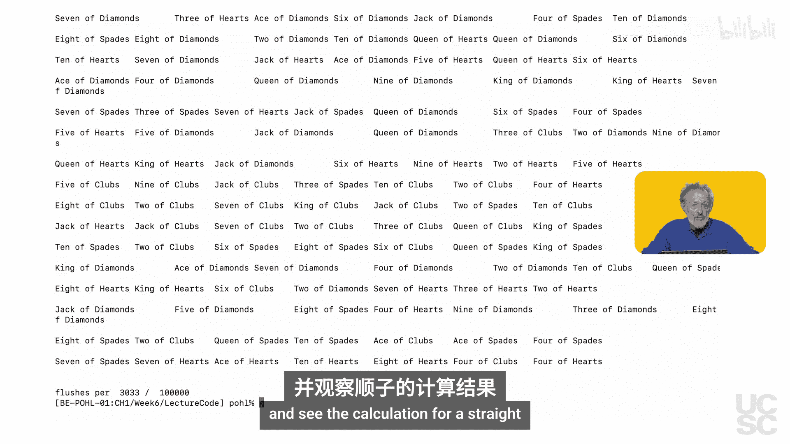

# 【加州大学】Go语言编程-｜-Go-Programming-Everyone-Part-2-p05-P05_方法-结构体_01_02_04--BV1GTe7z3Eqi_p5-

So here we're going to try and put together a lot of what we've already seen with the struck and pointer types。

And we're also going to bring in a new concept called a method。So we're going to do all this by。

Using it to compute the probability of flushing in seven card poker。

And we'll show why it's valuable to have these user defined types。

 so the user defined types will be specific to the card domain。

 and that'll make the coding more transparent， more literate。啊。Easier to understand。

And then we're going to show how to declare methods， which。

Is a concept we find in object oriented programming and go technically is not object oriented。

But go has the ability to declare functions that have an explicit argument a struck。

 So a method is like a function which has， in effect， an additional argument。

 The additional argument is a dotted argument。 So the function gets called with。

The struck variable dotted to the function name。Okay。So let's see an example。

We're going to start off by first defining a card and the way we're going to define a card is we have to have a suit type。

And。TheThe suit types are going to be club， diamond heart and spade， and they're going to be。

The special set of integers。And again， if you recall in our first class。How to use Iioda。

 Iiota is a way to start an initialization。 And if you have it set up that way。

Clubs will end up with a value 0， diamonds 1， hearts 2， spades 3。

 So Iiota provides you a way of initializing a sequence of integers integer values starting at0。

 And then we're going to say that the card is a struck。In which the first field is the suit。

So that suit can either be club diamond hard or spade。

 which are really the constant zero through three。And a PP value and a PP value is what the value of the card is。

 so it could be ACce2，3 through 10。Or Jack。Queen King and Jack will be an 11。

 queen will be a 12 and King will be the integer 13 So Pip。Field will give you these integer values。

That'll let you determine what the card's value is。 and S will give you the suit value。

 Those are the two things you need to deal with a card。 Okay。

 and now we're going to try to see how you can define a function called a method rather than an ordinary function on card。

 Let's see that in the next slide。You have the syntax where you start with funk， F UC。

 which is that keyword， and all go declarations of function start with that keyword。

 and then you have an identifier with a type， and that type has to be a struck type。

So or it can be a pointer to a struct type。So that identifier type is taken from my card in this case。

And then you have an ordinary parameterist and the function identifier。

 So you could have something like print card。 We'll see it next。

And it prints a particular card and then。Inside the body of the program will be the code for doing that。

 so let's look at this method。The method takes。C， a variable of card type。

And that's going to be the instance that we print。Now。Inside， we're going to have。2 things。

 a variable called the suit name and a variable called the Pipps name and string。

 We want to end up printing something like ace of clubs， ace of hearts，3 of clubs， Jack of clubs。

 So if you recall， the way we set up the fields were that Pipps was a integer value。

And suit was basically an integer value。 But now we want to change that to something we recognize。

As how somebody who likes to play cards would say this card is the ace of clubs， for example。

 So we're going to do that with big switch statements， So we're going to switch on C dot S。

So C is the implicit card argument being passed in the method。So it's going to be dotted。

We'll see it later when I actually use it in the program。And then we do an ordinary switch。

So if it's a club， then the suit aimed to end up being the string clubs if it's a heart。

String hearts， etc。And then the same thing with the PP name where we have all the cases for Pps。

It's a whole bunch of cases。goes from one to 13 and that means that we start with a of two of three of up to Jack Queen and King。

 etc ce， okay let's look at the next slide these are the rest of the Pip's name so as' the rest of that code so you can get eight of nine of ten0 of Jack of Queen of King of。

Case 13 as king of， that's because of the way we set up Bips。

And then we just print out the card name now how are we going to build a program that will check on a flush。

 we're going to do this all with a Monte Carlo method， Monte Carlo method。

 if you recall when we talked about this in，Our first course。Was the use of。

Soran number generators to generate a whole bunch of what appear to be random instances。And then。

 we accumulate。Over those random instances。The probability that something happens。

So the idea is we're going to shuffle a bunch of cards， deal out seven card hands。

 and look and check and see if the hand has a flush in it。Okay， why does a hand have a flush in it。

 hand has a flush in it if it has。5 or more cars that come from the same suit as the definition of flush and poker。

So what we do is we did that for loop， the forlo counts the number of times it sees a particular suit。

 and then if the count of one of the suits， either the club count， the diamond count， the H count。

 the hard count and spde count is greater and equal to five。

 then is flush and the reason we call it is is supposed to return a Boolean value。

 returns the value true。So we've identified whether the seven card hand。

Has a flush in it by counting the four suits。And if any one of those suits has five or more cards。

 then it's true， that's how we find out that there's a flush。

Now let's look at the next part of the code。Now here's how we create a deck。

And I'm going to show you all this。At the end of this lecture in a demonstration of this code。

 so here in order to create the deck。The Pps values run from1 to 13， so the way we get a card。

 a card is there are 52 cards in a deck。The Pips value， deck PP。Can be between one and 13。

 we get that using the modo operator。And we do that for all 52 cards。

So all 52 cards have some value between 1 and 13， but the cards also have to have a suit value。

 So then we have to。Do the suits， the first 13 cards will be clubs。The second， 13 cards。

Will be diamonds。So there you see deck i。s is replaced by diamond， remember diamond is a constant。

It was built by Iiota。 So it would be the constant one。

 Then we do the same thing for hearts and spades。 And now we've established a deck。

 That's how we've initialized a deck。 The deck has all the proper。52 cards with four suits in them。

Okay， so let's go on。Now。After we' shuffle the cards and you'll see shuffle later， here's shuffle。

 Well， I will see how shuffle is defined later。So we call shuffle to shuffle the deck。

We call it using an address and why is that well？We know we have coal by value。

 So we want the deck not to be this organized deck。 We want it to be。Whatever shuffle does。

 shuffle will be done by a random number generator mixing the cards up properly。

And so we need to have the result passed back to the external world from。The function shuffle。So。

We're going to shuffle。deck as many times as we want and we're going to have a big inner loop and then we're going to create a hand。

 a hand as seven cards because we're modeling seven cards stud if we wanted to model five cards stud。

 it would only have five cards。So hand zero has the first card of the deck。

 and one has the second card of the deck， etc cea， and we get the seven cards。

Now we test is flush on the hand， so we pass in the hand， we check。And if there's a flush。

 if it's true， we increment a flush count。Here we're also going to every。Time， we reach 100 flushes。

We're going to print out the flush just this is just a check that we've done it right。

 So you'll be able to see that we actually， and I don't want to do it every time because that would be too many times on the screen。

 So once every hundred0 flushes， we printed out just to， just to check。 in a normal case， I would。

Comment that code out， no reason to print out the flush， I just want you to see that it works。

And then we finish with。The number of flushes。Per the total count。

And you'll be able to tell by the proportion， roughly speaking what the probabilities are to get that flush。

So what are takeaways going to be？We have used， struck， and type。

To model the playing card environment especially to do this broker calculation。

So that's one takeaway。It makes sense， it lets us think more clearly about cardplay。 Once we do this。

 we can do lots of other things with cardplay， for example。

I can expect you to also figure out what the probability is of sting。

Straighting is when the pi's value are sequential， like ace 2，3，4，5。 You have a five card straight。

And theres some probability， normally in poker sts are less valuable than flushes。

 which means they should be more common， so you could check that by also computing the value in seven card stud of getting a straight。

 it should be a higher value than getting a flush。Now we use a method。

 so you see how methods are built for printing the struck。

 You don't have to use methods because you could always include。

Struck or the pointer to struck as an argument in the argument list。 So it's just an alternate way。

 It's closer to what we were calling an object oriented way of doing it。

 And sometimes that makes sense。We're going to use Monte Carlo for doing the calculations going。

Do a zillion calculations And we're going to shuffle the cards。Moonnie Carlo。

 so that we can get an appropriate， hopefully in appropriate。啊。Probability calculation。Okay。

 so let's go and look at all of this code and try it。So let's look at the code for flushing。

All right， recall from my first course at any time we use pseudo random number generators。

We imported them from math that ran。And the reason we're using time。

 if you recall why we're using time because we can get。

A initial seed that differs each time by calling on the clock time。

 So the seed for the random number generator will be seated using。The clock through time。

So that should be review for you in case you haven't seen that before you should go back and review that。

Here's。Our tight suit， which is an int， which is initialized using the Iiota scheme。

 Here's a type card。Now let's look at shuffle， shuffle is what you might call the Monte Carlo aspect。

We're taking a deck of cards。And notice that they're being passed in as a pointer type。

So we have 52 cards。We randomly choose， we use。The seed that's stored in the ranand package。

And we seed it from time that now that Unix nano， so that gets us some initial seed number that should vary every time。

And then we go over the range of D， which is the cards。And each time we randomly do。

We pick out an index。And then we take that index and move it around。The first element。

We've picked another index out using the random number generator。

 and 52 means we're going to be between  zero and 51。

And that new index is going to be used to interchange the two cards。

 so we're doing the shuffling by randomizing the location of each card in turn。

And that turns out to be a fairly reasonable。Way to get。A truly randomized shuffle。And again。

 the reason we've chosen to use a pointer there。Is that we need shuffle to return the deck with new values。

 we don't want to keep the existing values。Here's the is flushush。Again， if we look at this flush。

 we have a。The C count， the D count， the H count， the S count。

 those are the counts for the individual。Sus， so C is for clubs。 D is for diamonds， Hs for hearts。

 S is for spades。We go over the hand， the hand is passed in， so here's the hand。Of cards。And if。呃。

We have a club。 We increment a club count。 If we have a diamond， we implement a diamond count。

 If we have a spade， we implement the spade count， and then we have this big logical statement with a logical ore。

 So if any one of those are true， that means that one of the。Suit counts。

Is five or more suit of that suit That means you can return true for。The logic。

 that's the logic of getting a flush。That's how his flush work， and here's a method。

See the difference in how a funk is declared when it's a method funk。

In a funk declared the method funk。 The first part of the argument， It's not an argument， it says。

This method works on cards。That's how you read that first parenthesized thing then you have。

The function ID print card and then you have。An argument list in this case。

The argument is all the implied argument cards。 So I didn't need to pass in an argument。

 If I wrote this as a normal function， I could have as well done it where the argument was passed in。

I could make a print card function。 That was an ordinary function。 You should be able to do both。

And then here， I'm looking for the suit name。 I'm turning the suit name into a string。

 and I'm turning the pip name into a string。 So I'm going to end up with things like two of spades。

3 of clubs， four of diamonds， et cetera。When I read out the cards and print them properly。

So at the end of this， I'm doing a print F of the PipP'ps name。

 which is a string followed by the suit name。And that's familiar to people who play cards。

 that's what they can expect。So then what am I doing in Maine？I'm telling you I'm using a cardstruct。

 that's part of the example， I start off with a big deck， I need 52 cards。

I'm going to have a variable for counting flushes。 I'm going to have a variable that tells me how many trials I'm going to use。

 the more trials in a Monte Carlo， typically， the more accurate the answer。

 So if I'm only going to do 10 trials， I'm going to get a wildly different answer each time。

But if I do a million trials， I should get a very accurate answer。

So then I'm going to print how many trials and ask for that。

 the user will provide me a trial number called a total count。 Then I'll increment the deck。

 That's the for eye getting the deck incremented。That could have been made into， by the way。

 a procedure， so I could have made that a funk itself。So after the deck is made。

I make a hand out of the deck。The deck is going a hand is going to be seven cards。

 so that's what the make does H is now a variable that's basically a slice of seven cards。

That's what make does for me here。Then I do a shuffle。How many times am I going to shuffle。

 This is fairly expensive， So I'm going to shuffle， however， many times。I want to do the Monte Carlo。

 but I'm only going to use the first seven cards of the shuffle。You could change this code。

To deal out four or five hands， right， each hand is seven cards。Is 52 cards。

So it would possibly be more efficient to deal out， for example，6 hands，6 hands or 7 hands。

7 handss is 49 cards。 So I have enough cards for seven ans。

 So I could deal out 7 hands and then examine each one and do it that way。 And then I do。

 I do one7th of the shuffling and shuffling is part of the more expensive part of running this code。

Finally， I check on the is flush， here's where I show you the flushing every hundredth flush。

 just so you can see that it's all working properly and then I print the result。Okay。

 let's run that code now。So the first thing it says is how many trials do I want？

So let's do 100 trials， that's very short。It's found three flushes in 100 trials。

But it didn't print out any flashes， because。Three is not enough to get to 100。So it only。Remember。

 I use that。嗯。Moullo operator to pick out a flush every1 hundredth time， so let me redo this。

And now let me do 10，000 trials。Ah， now you see three flushes。

Why do you see three flushes because my flushes were 342 flushes out of 10，000？So roughly。

 what does that mean， it means that。A little more than 3% of the time。I can expect a flush。Right。

342 out of 10，000 hands had a flush that's how。Often， that will happen if you have truly。

A randomized deal。 And you can see here， what kind of flush was it， Jacker clubs， King of arts。

 Four of clubs， four of arts， King of clubs，3 of clubs，5 of clubs。

 So that7 card hand had two clubs in it， but had five hearts。Look at the next one， six of hearts。

 Kinging ofhars， two of arts， Jack of Spade's，9 hearts，4 of club seminar art。

 So there were three suits there， but five hearts。So again， it's a hard flush。Finally。

 this is five of spades， green of spades， nine spades， eight of spades， eight of diamonds。

10 of spades， four spades， so that was a six card flush。

It doesnn't help you to have a subscribed flesh and poker。You take the highest of flushes。

Defined by the highest card in the flesh。So if two people have the same kind of flush。

 the one with the higher cards wins and the higher cards start with， in this case。

The queen of space would be its highest。 So it would beat somebody who had a flush， which had only a。

Jack of hearts， for example， but it would lose to somebody who had a flush whose highest card was a king。

で。I'm going to try it one more time。Why don't we do 100，000 trials， it didn't take too long to do 10。

000。And now you saw the screen go by pretty quickly because there were quite a few more， in fact。

 there were 3，033 flushes。So that means that we will have seen 30 flushes up here。

 I'm not going to go through them， but if you follow this and you do it yourself and you want to print out things you will see that all of these are indeed flush hands。

 but here get you should have now a way more accurate answer and indeed when you go and check tables you can check these tables on Wikipedia。

For mathematically calculated flushing possibilities， because it can be done mathematically。

 you will find out that a flush is roughly。呃。Three， little more than 3%。

So this gets to be a much better answer as that's true of most Monte Carlloos。

 you get more stability as the larger the sample size。Okay。

 and part of what you might want to do with this is when I said， take the same kind of code as is。

🎼But instead of this flush， try and write is straight and see the calculation for a straight。

Okay。

