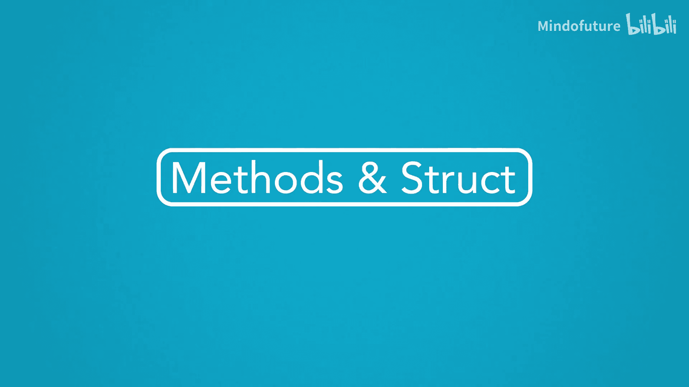
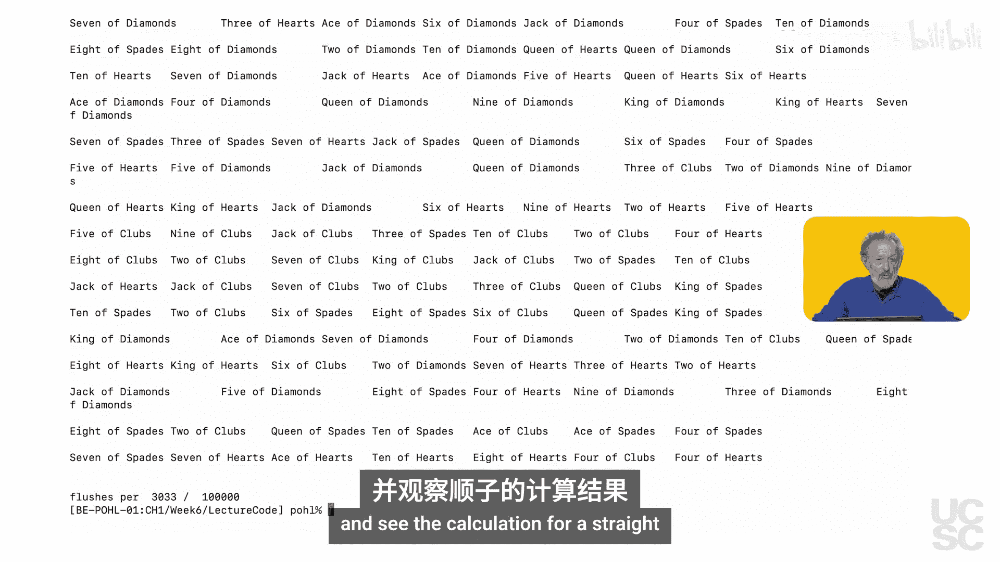

# Go语言编程：P05：方法、结构体与扑克概率计算




在本节课中，我们将结合之前学过的结构体和指针类型，并引入一个名为“方法”的新概念。我们将通过计算七张牌扑克中同花顺的概率来演示这些概念。课程将展示用户自定义类型在特定领域（如扑克牌）中的价值，它能使代码更清晰、更易读、更易理解。我们还将演示如何声明方法，这是一种在面向对象编程中常见的概念。虽然Go语言在技术上并非面向对象语言，但它允许声明以结构体作为显式参数的函数，这种函数就是方法。

## 定义扑克牌类型

首先，我们需要定义一张扑克牌。一张牌由花色和点数构成。

我们将定义一个`Suit`（花色）类型，使用`iota`来创建一组特殊的整数常量，分别代表梅花、方块、红心和黑桃。

```go
type Suit int

const (
    Club Suit = iota // 梅花，值为0
    Diamond          // 方块，值为1
    Heart            // 红心，值为2
    Spade            // 黑桃，值为3
)
```

接下来，我们定义`Card`（牌）结构体，它包含两个字段：`S`（花色）和`Pip`（点数）。点数用整数1到13表示，其中1代表A，11代表J，12代表Q，13代表K。

```go
type Card struct {
    S   Suit
    Pip int // 1 = A, 2-10, 11 = J, 12 = Q, 13 = K
}
```

## 为结构体声明方法

上一节我们定义了`Card`类型，本节中我们来看看如何为它声明一个方法。方法类似于函数，但其第一个参数是一个特定的接收者类型（这里是`Card`），调用时使用点号语法。

以下是一个`PrintCard`方法的示例，它用于将一张牌的花色和点数转换为“Ace of Clubs”这样的可读字符串并打印出来。

```go
func (c Card) PrintCard() {
    var suitName string
    var pipName string

    // 将花色整数转换为字符串
    switch c.S {
    case Club:
        suitName = "Clubs"
    case Diamond:
        suitName = "Diamonds"
    case Heart:
        suitName = "Hearts"
    case Spade:
        suitName = "Spades"
    }

    // 将点数整数转换为字符串
    switch c.Pip {
    case 1:
        pipName = "Ace"
    case 11:
        pipName = "Jack"
    case 12:
        pipName = "Queen"
    case 13:
        pipName = "King"
    default:
        pipName = strconv.Itoa(c.Pip) // 将数字2-10转换为字符串
    }
    fmt.Printf("%s of %s\n", pipName, suitName)
}
```

## 构建牌组与洗牌算法

为了进行概率计算，我们需要一副完整的52张牌。以下是初始化牌组`deck`的代码。

```go
deck := make([]Card, 52)
for i := 0; i < 52; i++ {
    deck[i].Pip = (i % 13) + 1 // 点数循环1-13
    switch {
    case i < 13:
        deck[i].S = Club
    case i < 26:
        deck[i].S = Diamond
    case i < 39:
        deck[i].S = Heart
    default:
        deck[i].S = Spade
    }
}
```

初始化后，我们需要洗牌。这里使用一个接收指针类型参数的`Shuffle`函数，以确保能修改原始牌组。洗牌算法通过随机交换牌的位置来实现。

```go
func Shuffle(deck *[]Card) {
    rand.Seed(time.Now().UnixNano())
    d := *deck
    for i := range d {
        j := rand.Intn(52)
        d[i], d[j] = d[j], d[i] // 交换两张牌
    }
}
```

## 判断同花顺的逻辑

现在，我们来看如何判断一手7张牌中是否包含同花顺。同花顺的定义是至少有5张牌的花色相同。

以下是`IsFlush`函数的实现逻辑：

```go
func IsFlush(hand []Card) bool {
    cCount, dCount, hCount, sCount := 0, 0, 0, 0
    for _, card := range hand {
        switch card.S {
        case Club:
            cCount++
        case Diamond:
            dCount++
        case Heart:
            hCount++
        case Spade:
            sCount++
        }
    }
    // 如果任一花色计数达到5或以上，即为同花顺
    return cCount >= 5 || dCount >= 5 || hCount >= 5 || sCount >= 5
}
```

## 蒙特卡洛模拟计算概率

我们将使用蒙特卡洛方法来估算概率。其核心思想是：通过随机生成大量牌局（例如10万局），统计其中出现同花顺的局数，然后用这个数量除以总局数，得到近似的概率。

以下是主程序`main`函数的核心循环结构：

```go
flushCount := 0
fmt.Print("输入模拟局数: ")
var totalTrials int
fmt.Scan(&totalTrials)

hand := make([]Card, 7) // 一手7张牌

for trial := 0; trial < totalTrials; trial++ {
    Shuffle(&deck) // 洗牌
    // 发前7张牌作为一手牌
    for i := 0; i < 7; i++ {
        hand[i] = deck[i]
    }
    if IsFlush(hand) {
        flushCount++
        // 每100次同花顺打印一次牌型示例（可选，用于验证）
        if flushCount%100 == 0 {
            fmt.Println("发现同花顺示例:")
            for _, c := range hand {
                c.PrintCard()
            }
        }
    }
}
probability := float64(flushCount) / float64(totalTrials)
fmt.Printf("在 %d 局中，发现 %d 次同花顺。概率约为 %.4f\n", totalTrials, flushCount, probability)
```

## 代码演示与结果分析

运行程序时，它会提示输入模拟的局数。例如：
*   输入100局，可能得到约3次同花顺，但结果波动较大。
*   输入10,000局，可能得到约342次同花顺，概率约为3.42%，结果更稳定。
*   输入100,000局，可能得到约3,033次同花顺，概率约为3.03%，非常接近理论值。

程序在运行时会偶尔打印出同花顺的示例牌型，例如“Jack of Clubs, King of Hearts...”，这有助于验证逻辑的正确性。理论上，七张牌扑克中获得同花顺的概率略高于3%，我们的模拟结果与此相符。

## 总结与扩展练习

本节课中，我们一起学习了以下核心内容：
1.  使用**结构体**和**常量**（`iota`）为特定领域（扑克牌）创建了用户自定义类型，使代码意图更清晰。
2.  学习了如何为结构体声明**方法**，这是一种将函数与特定类型绑定的语法，使代码组织更接近面向对象风格。
3.  实现了**洗牌算法**和**同花顺判断逻辑**。
4.  应用**蒙特卡洛方法**，通过大量随机模拟来估算复杂事件的概率。

一个很好的扩展练习是：修改代码，编写一个`IsStraight`函数来判断一手牌中是否包含顺子（连续点数的五张牌），并计算其在七张牌扑克中出现的概率。根据扑克规则，顺子应该比同花顺更常见，因此其模拟概率应该更高。




