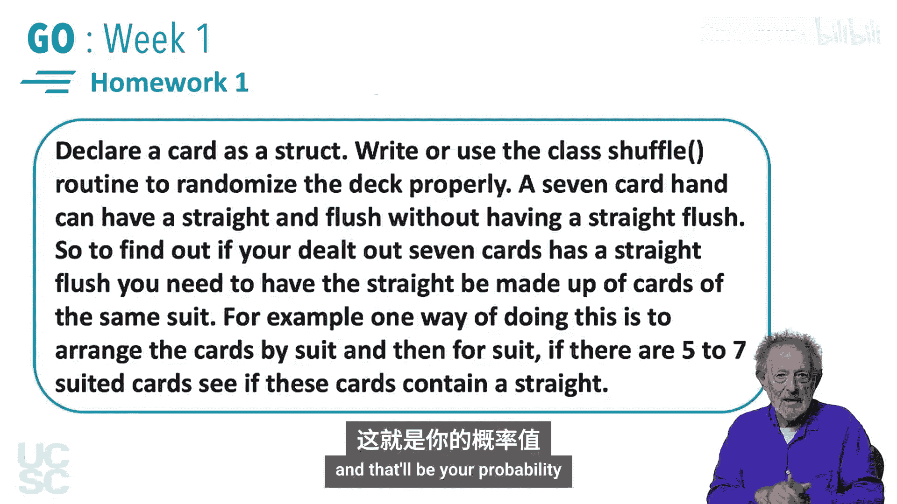

# 【加州大学】Go语言编程-｜-Go-Programming-Everyone-Part-2-p06-P06_第一周_同行评审作业_01_02_06--BV1GTe7z3Eqi_p6-

We did a lot with a random number generation to find probabilities。And I showed you。How to compute。

Some probabilities related to poker。So the homework for this week。

It's going to be how to compute the probability of a straight flush in seven card poker。

 seven card poker is classic poker where two cards are placed up and four cards。

 two cards are placed down excuse me， four cards are placed up and a last card is placed down and there's sort of betting throughout。

So it's a very， in fact it's my。As much as all the current poker playing you see is。呃。

What are called Holum where you get only two cards down and the five cards are up in the middle and are shared。

This is a form of poker that I think requires more skill levels， so it's one I enjoy。Now。

 how we're going to do this is what we're calling Monte Carlo evaluation where we run。

Huge numbers of trials to find out what the average probability is for that event。

So let's look now at the next slide。To get in a reasonable。

 we need a very large number of trials for a straight flush because straight flush is the rarest of event。

 a straight flush is the highest normal hand in poker。呃。

And there are relatively few straight flushes that can be dealt out。And to do this correctly。

 we need to properly randomly shuffle a deck， it's an interesting mathematical question。

 as in an ordinary shuffle。We'llCall the Rile shuffle。呃。We generally don't get a single riffle。

 we don't get a random shuffle so we have to make sure that we're properly randomizing the shuffle。

 in fact if you go to casino now they no longer use dealers to do the shuffle。

 they have automatic shuffling that guarantees randomness by machine。呃。Now。

 after the shuffle we're going to deal how seven card hands now shuffling itself is going to be expensive by expensive。

 I mean， the computer time to do the shuffle is going to be a significant portion of the computation time and since we're going to do many millions of this。

We want to be as efficient as possible。There's a 52 car deck。

 and we don't want to just deal one hand out and evaluate it for whether there's a straight flush。

 So it's best to deal out7 hands。Question for you out there， a little trick question。

 why not aid hands， okay？And then we're going to see if there's a straight flush。

 which is five cards of one suit， let's say， five hearts。And each of those cards。

Can be arranged in a strait， so they can be like 4，5，6，7，8。 So you need five cars that are flushing。

 but also straighting。And then there could be a six card or seven card straight flush。

And when you evaluate the hand， the hand is evaluatedvalu with the highest straight flush because if you have one straight flush that's in spades and the other in hearts。

 if they're both the same， then it's a tie game， but if one is，To the eight and the other is to the1。

 the one， the person who has a straight flush to the  ten will win。

Now the highest possible straight flush is what's called the Royal straight flush and that's where you go10 Jack Queen King Ace that's the hardest hand to get。

 In fact， there are only four such hands in the entire possible。

Number of possible shuffles and dealing out of seven Carians， so that's an enormously unusual event。

Okay。So， again， we don't want a riffle shuffle。 We could attempt to riffle shuffle。

 That's going to be expensive in itself。 And it turns out mathematically。

 there's an interesting theorem that says， if you're going to at home Rffle shuffle。

 at least riffle shuffle seven times if you want the deck to be truly random。 In fact， really。

 really sharp poker players who don't shuffle very much and they see how the cards are folded in。

 can guess that where some of the cards might be， and that could affect。How they bet。

So the shuffle routine we use in earlier。The use of one of our programs will guarantee a random order。

Now here's what we've seen before and something like this is what you should use。

 we're going to declare。A type suit。And we're going to use a struck for a card and the card is going to have a type suit which is。

What we call an enumerated type， even though there isn't that exactly in。Go。

But we tend to use this specialized Iiota， and that would mean that club suit is zero。

The diamond suit is one， the hard suit is two， the spade suit is three， so that's really ns。

 and by assigning Iiota to the first value in that list of constants， we generate consecutive values。

And the values are a suit， and then the pit count and the pit count is going to be something between typically one and 13。

To indicate the card value。Okay。Now we'll do a shuffle in the shuffle we'll take we'll first。

Do our 52 cards。Get our cards assigned to our slice。

And or into our array because we know it's going to be 52。And then。

Over the range of cards will interchange each position。So DI comma DJ equal DJ comma DI。

 we've seen that before， that's unique to go， it's not found in C or C+ plus。

 and that's an interchange without using a temporary variable so that's pretty cute。

And then we just run through the deck and basically each card is placed in a random position。

 so that gives us a random shuffle。Interesting fact。

We can use all this to determine how good a random number generator is， because the mathematics。

 while it's not easy， we could find out the probability of。Getting a scrap flush or a royal flush。

And then we could see whether our code actually produces that kind of value， okay。So。

Here's how you should proceed， to clear a card as a struck just like we showed you。

 or if you have some other scheme that you think is better， try that。

 then write or use the shuffle to shuffle the cards。And draw out seven card hands。

Test them to see if they're flushing， Take out all the flush cardss， and then in those flush cards。

 see if you have a straightit。And that way you can tell。If you have a straight flush。

 so if it fails to have a flush， which is going to be the normal case， they're relatively。

Even a flush is a relatively rare event in7 card Stud。

 So most of the time you're going to have an immediate failure。 And then every time you have a flush。

 you have to arrange all the flush cards， which may be 5 to 7。

And then see if there's what the highest straight might be in those cards and if there can't be a straight。

 then that fails and you can say you have a fail out of that particular Monte Carlo test and then you just add up all the hits。

 let's say you run it。10 million times and you'll get some number。

 and it'll be that number over 10 million， and that'll be your probability， okay。

