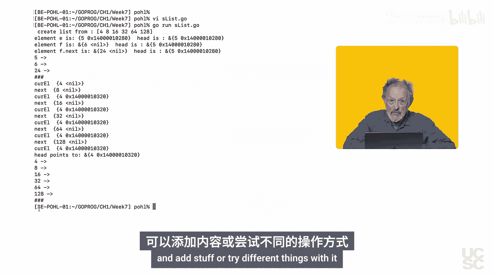

# 【加州大学】Go语言编程-｜-Go-Programming-Everyone-Part-2-p07-P07_列表_02_01_01--BV1GTe7z3Eqi_p7-

We now come to one of my favorite topics， which is how to build a self referential data structure。

So this gets to be more complicated because the elements of this data structure are defined in terms of themselves。

 That's what they're self referential。And the basic simplest one of these is the single linked linear list。

Now。If you're a user of languages in certain languages， this is a basic。

Structure that's given to you， just like can go， an array it or a slice is given to you。And indeed。

 in the early AI language， which is still in use in AI list。Was based on。A list data structure。

And that was sort of the central data structure to list in modern languages。lis。

May not be as part of the language， but is almost always part of what's called the standard library。

Modern coders。Generally， don't have the。Develop。This structures themselves as they can use it in most of these languages。

 like C plus plus。Have very well worked out lists and other kinds of self referential data structures。

Already built in their library。 And that's what you would tend to use。

 But it is very important to understand their construction and use。 And occasionally。

 you might have a reason to build your own。And might be some kind of variation where you get an advantage to building your own。

 So very important to understand it。 But this is going to be the simplest of these。So， the central。

Element of building a struck is basically something that keeps。

A data element in this case will say in， but it could be anything else， for example。

 we could use person， much as we use person or student。啊。As a struck， so it could be a complicated。

Data type itself， but for simplicity， we will keep it as int。

And then the self referential part next is the pointer。

And it's a pointer to list element theres self referiality。Visually。

 what you could think of is think of how probably nobody does this anymore。

 maybe some eco friendly people do it。They'll use an external rope to hang their laundry on。

 And that rope will have a little pulley system。 and you can put something on the front of the rope on the drying line。

 And then as you need more items to hang， you would just hang them at the front。

 And you can hang an indefinite number of items。 So one of the benefits。

Of a struck or this type of data structure， as you can， in principle。

 have an unlimited number of elements you can just keep adding to the struck can get bigger and bigger。

 or it can shrink as you take elements off。 So it's extensible。All right。

 so let's see some of the code。We have that list element， and then we want to create。An element。

 so we need to。Go。And we can create it inside a function。 We call it create list element。

 This can be done in a number of ways。I've chosen one one way to do it。

 and that's just to declare the list element。Initialize it to。It's data value。

Initialize it to whatever the pointer value should be。And return it。

So when you've created it in this funk， it really is being created in what we call the heatap。

 so it survives。Exiting this function。And there itll be， there will be a list element。

 so that's very simple way to do this and to add initializing it with data。Okay。Now。

Here we see the use of a method。 I'll call it printless。 And again， this a very important。Iiom。

For working with self referential data structures。The idiom here is we use as our control structure。

 not a loop。 We could use a loop to print a list。 Remember， the list is like a rope， a drying lo。

For items and we don't know how many items there are until we get to the end of the rope。

The end of the rope is going to be marked by a special point of value called nil。

 We've seen that value before。 Nll is a very important value inside the go community。呃。

And it's used as the empty pointer value is also frequently used to indicate that something has gone wrong。

 but in this case， it's the end of the list。So if where we're looking is nil。

Then we're going to print。Those three characters that'll just make it look like， oh， we're done。

And return。 So that's the base case of the recursion。

The general case is to print the data and then to print symbolically a pointer。

 So that's why I'm printing the arrow。 So I'm going to print a series of things in which。

The data is going to point at the next item， point at the next item， point at the next item。

 And that keeps going in the recursion because the recursion pick works by。

H dot next dot print list it calls itself。 That's why it's a recursive method。

So we get all of the elements done。Okay， going on。What about filling up。Our lists， Well。

 it turns out that when you start using more elaborate data structures like lists and trees。

They have special uses。But probably the most flexible and most useful data structure is。

 indeed a slice。So if you want to turn a slice into a list， this funk。We'll let you do that。

So this is a function that fills the list from a slice of values。And of course you could。

Write a function to do it the other way。So。We have a current element。

 The current element is created by our previously written function list element。

 And what does it say， it says。Use data slice of zero。And。

Next is going to be nil because we don't have a next element yet。

And we'll show that by printing it out。And then。Will， say。Take the header element。And use it。

To retrieve the address of the current element。So this will end up being the header for the list。

The current element is the header of the list。 It's the first element that we've created。And then。

We advance the pointer。 We make the pointer to the current element B。The address of current element。

 and now we're going to iterate over the rest of the values。So。

We had to start by doing the first element。 that was important。

 And then once that's created with a header， we can start。

Operating on the rest of the elements of that slice。So， we can go。Up to the length of the data slice。

And we start at i equals one， so it's really the second element of the slice。And we say next element。

Colon equals list element data slice common nil。 So again。

 this is where we create the next element and it's created out of data slice in the first instance。

 data slice1， so this is going to iterate is is going to be data slice2 data slice3 until we get to the end of that slice。

And again， just for purposes of making sure we are doing the right thing， I put some。Print out there。

Normally， you wouldn't have print out there。 is just a check that the algorithm is working properly。

 And then we rearrange the pointer。 the pointer to current dot next is pointing at next element。

 Next element was the element just created。The previous element was the current element。

 so that's how we're building our list。And then we just keep going。Updating the pointers。

And at the end of this。Itlareration。The last element will stay with the pointer list element。

 The last element of the list， data slice， whatever， the length data of slice。

Will be nil indicating the end of the list， okay？So we form the list from a slice here in the function main。

 and we're going to test this out。 We start with a head。 That's the head of the list。

And if you declare the list， there head dot list element。Just like if you declare an int that way。

 you would get an initialization of0 here the initialization will be nil。

 So when you just declare a pointer without assigning it a specific address。

 the assignment is given nil。 So that's basically the empty list。

And here I've created the data for a slice。And that is a slice with what 4，8， 16， 3264，128。

 so it has six integers。And nowm going to create a slice from that I'm going to create a linear linked list from that slice。

So I fill the list from the slice Xd。And I'm filling the list that's pointed at my head。

And then when I'm done， I'm going to print it out。And then I'm going to， that will be a print。

 You'll see that that that way we'll just print a pointer。But then we'll use the method。

 that recursive method we wrote to chain down the list of elements and print the list。

So if you get used to that recursion， whatever you want to do。

 let's say you wanted to add up everything in the data。You could also chain that way and do a sum。

 as opposed to a print。 So as I said， the recursion is a model way to navigate a list readily。Okay。

So we'll go to the terminal and show how all of this works with the version of that program。Okay。So。

We've explained how to build a linear linked list and process it。

 Now we're going to actually demonstrate， hopefully that everything works as we expect again。

This is code that you can play with。 One thing you might think about doing a more elaborate thing。

Is think about writing a linear linked list。But instead of having just one link next。

 have two links next and previous。And that'll make。The doubly linked list， easier to navigate。

 It'll turn out that certain algorithms will become faster and easier to do。

But it'll be at the expense of having extra storage in each list element， and。

Somewhat extra updating because you'll need both a next and a previous link。

But there are other things you can do to play with。

 Another very simpler thing to do to play with is think of making this as a list。Of students。

And then writing code on the list of students to do things like process the average or print out the student list。

Okay。So what do we have？Again。We have the basic list element， data event。

 and it could be way more complicated。 And then the critical thing for a single linked list is it can be next。

And then if that next is nil or if the head pointer is nil， that means there's no more list。

And here's our basic way of creating。A list element。We've declared it。And then， we。

Initialize the data and initialize the pointer to whatever they were。 And then we return the element。

We could have also created it other ways but some of these ways are more obsolete， for example。

 there is a built in function called New and that could be used as well to create the settlement。

Okay， here's a method。 That was。 This is our method explained because it's a recursion。

 The base case is checking for nil。 If it's nll， we just write out。Three cross hatched characters。

And we were at the end， otherwise we have to repeat， we do， we print out the data。

 we print out an arrow to the next element， and then we recur by saying H dot next。

Here's our filling the list。From。An existing set of data that's in a slice。Again。あ。In this case。

 we've done it with the loop。 The critical part of the loop is to go up to the length of the data slice so we can do this dynamically。

And in turn， we add an next element， and the last element will remain with a nll pointer。

 All the other elements will have。Pointer Kern thought next， updated to Ampersand of next element。

That's this step。So that's where you get the update。And finally。

 here is where we're processing all this。We have。Increasing。4816， I chose powers of two。

 so we have six of them there。I'm going to create a list from that。TheHello West is going to。Well。

 I'm going to first show you as a very simplest head equals a variable E。

And there'll be a second variable F。E and F will have data five and6。

 so we'll see that that can be printed out。And then we'll do this where I use the。呃嗯。

function that creates a list from that set of powers of two。So let's run this。啊。

Make sure it all works。Okay， so let's look at different lines here。We've created a list。

 we're going to create a list from 4， age 16， 32， 228。

We first did this simplest where we had an element E， which had a value 5。

 And here you can see the pointer value of some kind of big hexadecimal number。 Don't forget。

 a pointer is really an address。 and the memory。 Memory is quite large。

 So we tend to use exethmal numbers。And element E is five and then head points at five and that same number。

 So that's two ways to print it out。Here's element F。And that's got a nt pointer。And。

F dot next has a value 24 nil。So。Here， instead of a hexidadeciimmal address。When。

A prince sees a nil value for pointer。 It prints it out as a。Bracketed nil。 All right。

 So if we printed out that particular simple list， we had 5。Next element is 6， next element is 24。

 end of list。That's how our print works。And now we go on to create current elements for。

Next is8 with Nll then we create， we show the head of list so the head of list remains four with its address。

 but each new element gets created as its data item nil。

 and then the nll field will be updated as you recall in that iteration。And then， finally。

The head of the list though points at four with that address。

 and then when we go to do a print of the whole list recursively， we get four points at 8。

 points of 16， points at 32， 64128， and the list。So。Works as expected again。

If this is somewhat new to you， you should really try to do this on your own or play with this。

Add stuff or try different things。

🎼Okay。

