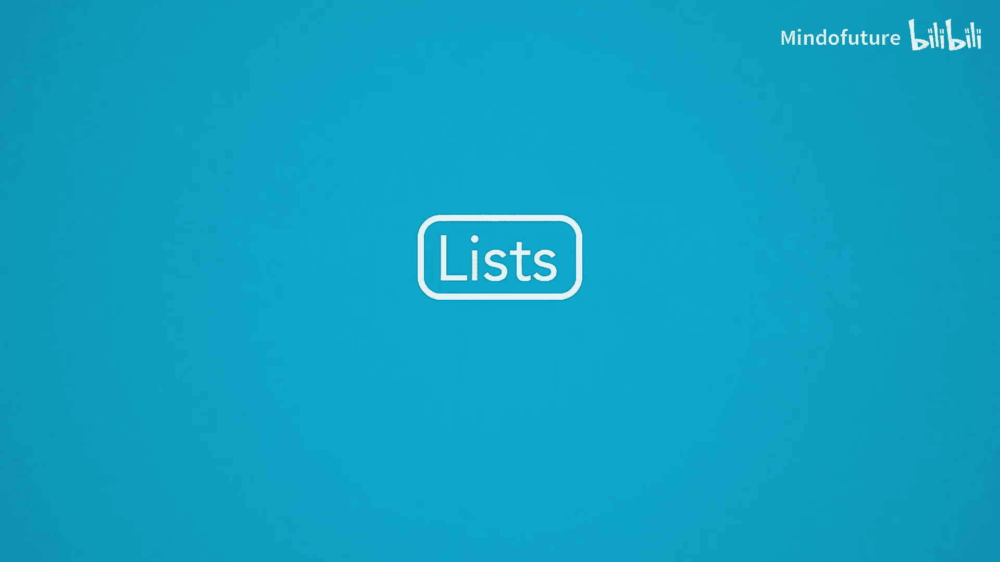
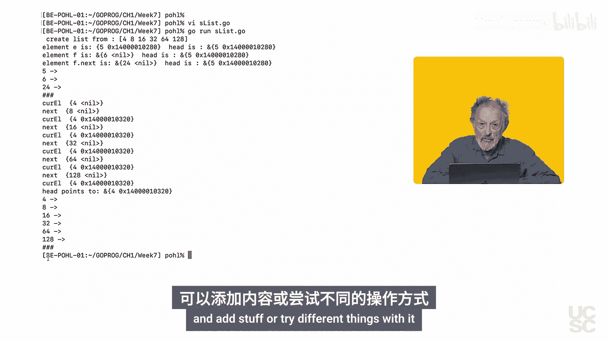

# Go语言编程：P07：自引用数据结构与单向链表



## 概述
在本节课中，我们将要学习Go语言中一种重要的数据结构——自引用数据结构，并以最简单的形式——单向链表为例，详细讲解其构建原理、操作方法以及如何与Go语言中的切片进行转换。理解这些概念是掌握更复杂数据结构的基础。

## 自引用数据结构简介
上一节我们介绍了基础的数据结构。本节中我们来看看自引用数据结构。自引用数据结构的特点是，其元素的定义中引用了自身。这是构建动态、可扩展数据结构的关键。最简单的自引用数据结构是单向线性链表。

在某些编程语言中，链表是语言或标准库提供的基本结构。例如，在早期的AI语言Lisp中，列表就是核心数据结构。在现代语言中，链表虽不一定是语言内置部分，但通常是标准库的一部分。现代开发者通常直接使用库中已实现的结构，但理解其构造与使用原理至关重要，有时你可能需要构建自定义的变体以获得特定优势。

## 单向链表的核心元素
单向链表的中心元素是一个结构体。这个结构体需要包含两部分：
1.  一个数据字段，用于存储实际数据。
2.  一个自引用字段，这是一个指向同类结构体的指针，用于链接到下一个元素。

视觉上，可以将其想象成一根晾衣绳。你可以在绳子的前端挂上衣物，需要时继续在前端添加，理论上可以悬挂无限数量的物品。链表也是如此，你可以不断添加元素使其增长，或移除元素使其收缩，因此它是可扩展的。

以下是链表节点的Go语言定义：
```go
type ListElement struct {
    data int
    next *ListElement
}
```
在这个例子中，`data`字段是`int`类型，但它可以是任何复杂的数据类型，例如之前用过的`Person`或`Student`结构体。`next`字段是一个指向`ListElement`类型的指针，正是它实现了自引用。

## 创建链表元素
理解了结构定义后，我们来看看如何创建链表元素。以下是一个创建并初始化链表元素的函数示例：
```go
func createListElement(data int, next *ListElement) *ListElement {
    var le ListElement
    le.data = data
    le.next = next
    return &le
}
```
这个函数在堆上创建了一个`ListElement`，因此即使在函数退出后，该元素依然存在。它接收数据和下一个节点的指针作为参数，初始化后返回该元素的地址。这是一种简单直接的创建方法。

## 遍历与打印链表：递归方法
创建了链表之后，我们需要一种方法来查看其中的内容。处理自引用数据结构（如链表）的一个重要惯用法是使用递归而非循环进行遍历。

链表的末尾由一个特殊的`nil`值标记。在Go语言中，`nil`是一个非常重要的值，常被用作空指针值，在这里它表示列表的结束。

以下是打印链表的递归方法：
```go
func (h *ListElement) printList() {
    if h == nil {
        fmt.Print("###")
        return
    }
    fmt.Printf("%d -> ", h.data)
    h.next.printList()
}
```
该方法的工作原理如下：
*   **基准情况**：如果当前节点`h`是`nil`，表示已到达链表末尾，打印“###”并返回。
*   **递归情况**：打印当前节点的数据和一个箭头符号“->”，然后递归调用`h.next.printList()`。这样就会依次打印出“数据1 -> 数据2 -> ... -> ###”的格式。

递归是遍历链表的模型化方法，你可以基于此模型修改代码来实现其他操作，例如计算链表中所有数据的和。

## 从切片构建链表
在实际编程中，切片可能是更常用和灵活的数据结构。因此，将切片转换为链表（或反向转换）是一项实用技能。以下函数演示了如何从一个整数切片构建链表：

```go
func fillListFromSlice(head **ListElement, dataSlice []int) {
    if len(dataSlice) == 0 {
        return
    }
    current := createListElement(dataSlice[0], nil)
    *head = current

    for i := 1; i < len(dataSlice); i++ {
        nextElement := createListElement(dataSlice[i], nil)
        current.next = nextElement
        current = nextElement
    }
}
```
构建过程遵循以下步骤：
1.  首先，用切片的第一个元素创建头节点，并将链表的头指针指向它。
2.  然后，遍历切片中剩余的元素。
3.  为每个新元素创建节点，并将前一个节点的`next`指针指向这个新节点。
4.  更新“当前”指针，使其指向这个新节点，以便为下一次链接做准备。
5.  循环结束后，最后一个节点的`next`指针自然保持为`nil`，标志着链表的结束。

## 完整示例与演示
现在，让我们在`main`函数中将这些部分组合起来，进行测试：

```go
func main() {
    var head *ListElement // 初始化为nil，代表空链表
    data := []int{4, 8, 16, 32, 64, 128}

    fillListFromSlice(&head, data)
    head.printList() // 输出: 4 -> 8 -> 16 -> 32 -> 64 -> 128 -> ###
}
```
我们首先声明了一个指向`ListElement`的指针`head`，它被初始化为`nil`，代表一个空链表。然后，我们定义了一个包含6个整数的切片。调用`fillListFromSlice`函数后，这个切片被转换成了一个链表。最后，调用链表的`printList`方法递归地打印出所有元素。

## 总结与扩展思考
本节课中我们一起学习了Go语言中自引用数据结构的概念，并重点实现了最简单的形式——单向链表。我们涵盖了链表的节点定义、元素创建、递归遍历以及从切片构建链表的方法。

为了加深理解，你可以尝试以下扩展练习：
*   **双向链表**：修改结构体，使其包含`next`和`prev`两个指针。这将使某些算法（如反向遍历）更容易、更快速，但需要额外的存储空间和维护开销。
*   **复杂数据链表**：将链表的数据类型从`int`改为更复杂的结构，例如`Student`，并编写计算平均分、打印学生列表等功能。
*   **其他操作**：实现链表的插入、删除、反转等常见操作。




通过动手实践这些练习，你将能更牢固地掌握链表这一基础且重要的数据结构。