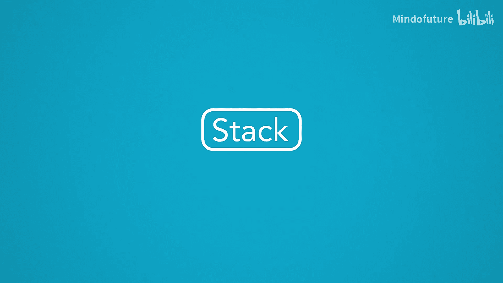
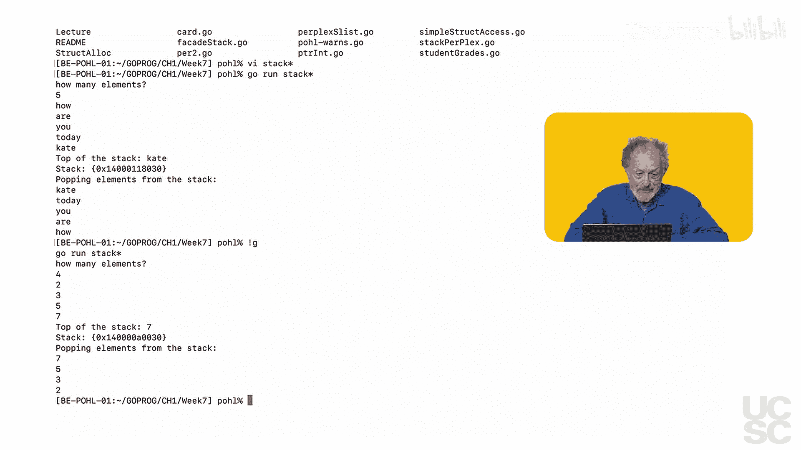
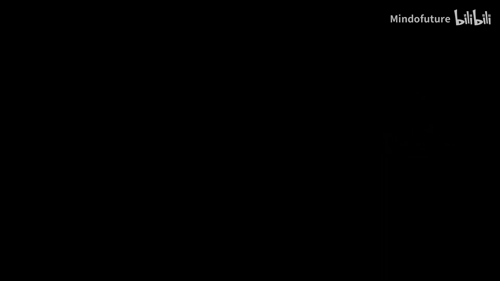

# 【加州大学】Go语言编程-｜-Go-Programming-Everyone-Part-2-p08-P08_栈_02_01_02--BV1GTe7z3Eqi_p8-

Now we're going to turn to another。Very useful data structure， a stack。

It's a standard data structure again， you'll see it。

As part of a language and usually part of a standard library like in C++。呃。Now。

 stacks can be created from other data types like slices or linked lists。When we take a stack。

And created out of these other data types， this form of code design is called a facade it's sort of hanging something on top of some existing。

Structure and frequently we limit what you can do with the existing structure。 so if I create。

A stack from。An array or a slice。The notion that I could in a slice do an arbitrary indexing。

And get an arbitrary element goes away because in a stack。We don't have those operations。

 so even though the stack lives on top of。Slice or lives on top of linked list。

It's restricted to the operations that we want for the stack。

 we want to think about the data type as a stack， even though it's built out of a more powerful data type。

So typical stacks have at least four standard operations。One of the operations is called P。

 where we put the thing on top of a stack。The other is called P when we take something off the stack。

Another is just called top where we just look at what's on the top of the stack， but don't remove it。

And then finally， we want to know if the stack is empty。

 so that's something where we'll return a boolean value if the stack true， if the stack is empty。Now。

 in real life， you've seen stacks， for example， typically in college cafeteria。

 there'll be a stack of trays。And you'll take， you don't be very bad for them to go in the middle。

 you're supposed to take a tray off the top or when you're putting dirty trays back。

 you're supposed to。Push them onto the stack。 So you're familiar with stacks in real life。

 There's push and pop。 And then you can see what's on the top。 And you can see if the stack is empty。

 Oh， that's what stacks do。 So let's see how we build that。Out of our linked list。

So it's exactly a linked list， look at node， what we used to call list element we're now calling a node。

It's the same data structure， it involves some kind of data here I decided to use a string。Again。

 it's just because the example is more interesting where the data is a little more complex than。

 but that can be any data type and then again。As with the normal link list。

 there's a next aer to the next element。And then a stack just like a link list will have a top or in the case of a link list we call it ahead and that top is appointeder to a node。

 so this is all basically the same as the linked list。

 but because of how we operate the push pop we've had will only restrict it to the verbs that。

Are commonplace for。A stack。All right， let's look at those， let's look at how to form those。

So here's one of them。Here's a method we operate on the stack， we'll do a push。

Now the type of element we're pushing onto the stack to type of data as a string。

 so in creating the new node we get the new node and then we get S dot top equals new node because new node itself was a pointer to the node being created。

Then。And notice that when we said new node， we use that colon equals when we use the colon equals。

 we're creating， that's a declaration really， we're creating the node and taking its address。

 and then that's going to be push puts it on the top， so S top。Gets to be the new node。

So the method on the stack recreates an element， then places it on the new node and notice that the。

Old node was in next， the old node is the existing S do Okay， let's go on to P。

Pop takes an element off， so if we have first off。When we're popping。We can't pop an empty。

 you can't pick up a tray from an empty heap of trays， empty stack of trays。If the top is nil。

 we're going to return the value， a string value saying empty， it'll be like an error message。呃。

Otherwise。The value is S dot top of data， so we've looked at that particular element through its pointer。

We get its data。And now。Because we pop it we have to move the top to the next element so that's the next thing and then we can return that value。

 the string value that we found so that's what method pop does it returns the string value of the top element and it also does the internal bookkeeping this is our top so what's the difference between top and pop。

Top just examines the value without changing。呃。Without removing the top element。

 so top is just a way to look at the top element， some places they call that a peak。

I think top is a more common term for it。And again， we want to see if the list is empty。

 if the list is empty， we have to return some special value。呃。And otherwise， we return。

The data value that's seen at the top， but we didn't advance the pointer。

 so we didn't remove in effect， remove what was at the。Top of the stack。Finally。

 we're just asking if the stack is empty and that's just a normal boolean method and it just returns the comparison is S thatt top nil if it is。

If it's equal to nil， then is empty as true。And by the way， you could recode。呃。

Top and some of the other code by using is empty as a test for whether the stack is empty rather than just directly test a pointer for Nil。

 so that could be a way of maybe making the program a little more literate。Okay。

Let's see some of the use of this。呃。Here we've created a stack。呃。It's empty initially。

 and we're going to ask for how many things we're going to put in this stack。

So we're asking the user of our code how many elements you want and then it'll be returned via the SF。

And now each element is a string， so we'll call that a word。And then for the loop。

I equals zero to how many。We'll do a scanf and stick the resulting string into word。

And then we'll do stacked out push。So that's where we're using the stack。

We're getting the elements onto the stack in that。呃。Here's iterative for statement。Okay。

Now let's try to demonstrate some more of the stack。So we'll continue。

We'll show how to print the stop of the stack。诶。Will print。Stack itself。

 which probably is a point of value。Then we're going to start popping the elements from the stack。

And here's where we get to use is empty。 In other words， is empty is。

A way to iterate over the stack by popping until you're done。

 so we'll just check to see that we're not empty if we're not empty， we continue。

To write out what's in the stack and then we pop it。And that'll。Run until we get to the empty act。

Okay， so this is the use of a stack stackck has some special uses。

 it's not all that common to be using a stack because almost anything you could do with a stack you can do with a slice or you can do with a list。

And so it's sort of extra effort to bring in the stack type。But there are some things in which。Stack。

Is a natural， one of the things is evaluating。Polish notation。

So if you have ever seen Polish notation for arithmetic。

It turns out that pushing and popping on that notation is a way to do evaluation。Okay。

 so now let's run this on the terminal。Okay， so let's look at the code for。Using a stack。Here's our。

 as you see， code that looks like a list。So it's this facade。

 the reason is we're going to restrict the kinds of operations we can do to stack operations。

Here's our push operation， which is a method on the stack。

It creates a new node when we push something， we need a new node。

 we need a new node to go on the top， and the old top gets the press， so what was the old top。あ。Is。

Next in the new top。And here's the pop， which is sort of the opposite。

 we check to see first off if it's empty。As I mentioned， this could be。

A test using or is empty instead。And we return a special value， we could return nil as well。

 because that's a special value。Then if it's not nil， we can return the actual value of the data。

And then we can advance the stack in effect getting rid of the top element， we've moved off from it。

 and now the pointer is pointing to whatever was the next element。Now this is very similar to PP。

 as I said， it's a method in which we're just looking to see at the top， again。

 we're checking to see if it's nll， if it's not nll， we just return the data to it。Finally。

The Boolean function is empty as just checking if the stack top is nil。So that's a very。

Simple method。So here's our stack， we've created an empty stack at the beginning。

Then we're asking for how many items go into the stack。Then those items。

 which in this case is going the data we decided on was。

String data so it's going to ask for how many words and we're going to stick them in and then we're going to push them onto the stack and then we're going to pop them and see how all of that works Well let's run that code。

So it's asking me how many elephants， elephants， elements。Let's put in five。

So the top of the stack is Kate because it was pushed onto the stack at the end， that's called。

Last in first out， LIFO as a term used in conjunction with stacks， last in first out。

So Kate was the last thing to be pushed onto the stack and if you pop it。

 Kate will be the first thing out notice the stack itself is just some address that's just。

Where an header is sitting in memory。And now we're going to pop elements for the stack and notice they come out in reverse orders。

 so yet Kate today you are how。Sounds like Yoda to me。Let's try it one more time。Okay， let's run。

F elements。And。It looks like I put in numbers， but numbers are strings。So using a string， I can。

Put a lot of things in there more complicated than I would if I had used as data int。

 if I'd used as data int and I tried to put in a string， I would get。A input error， it wouldn't work。

 but here because I said I'm using a word word can be any set of characters。

It looks like I'm inputting。Integers， but I wouldn't be able to do something like a sum。

Because these would be the strings，7，5，3，2。Okay。Anyway， play with that yourself。

 maybe try to use different data types if you can and you want to do something more advanced。

Look up how to use a stack to evaluate Polish notation。

That would be a more advanced exercise for those of you who have more of a computer science education。

Okay。

