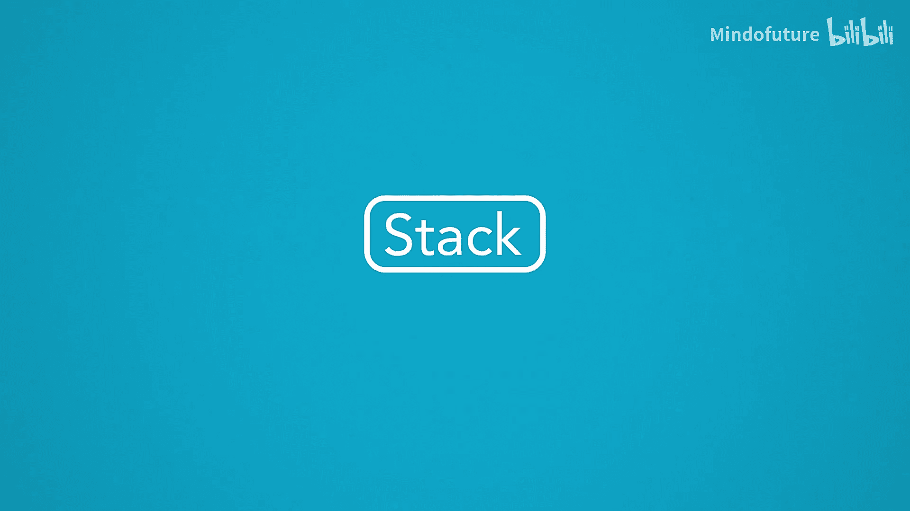
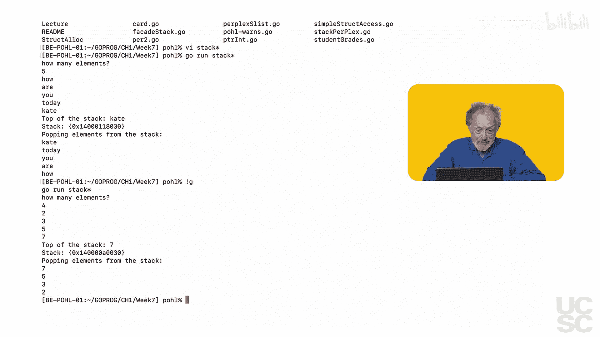

# Go语言编程：P08：栈



## 概述
在本节课中，我们将要学习一种非常实用的数据结构——栈。我们将了解栈的基本概念、标准操作，并学习如何在Go语言中基于链表来实现一个栈。

## 栈的基本概念
上一节我们介绍了链表，本节中我们来看看另一种数据结构——栈。栈是一种标准的数据结构，你会在许多编程语言及其标准库（例如C++）中见到它。

栈可以由其他数据类型（如切片或链表）构建而成。当我们基于这些现有类型创建栈时，这种代码设计模式被称为“外观模式”。它是在现有结构之上附加了一层功能，并且通常会限制你对底层结构的操作。例如，如果我基于数组或切片创建了一个栈，那么切片中任意索引访问任意元素的能力就消失了，因为栈不支持这些操作。因此，尽管栈构建在切片或链表之上，但它被限制为只允许栈的标准操作。我们希望将这种数据类型视为栈，即使它是由更强大的数据类型构建的。

## 栈的标准操作
典型的栈至少包含四个标准操作。以下是这些操作的介绍：

1.  **Push**：将一个元素放入栈顶。
2.  **Pop**：从栈顶移除一个元素。
3.  **Top**：查看栈顶元素，但不移除它。
4.  **IsEmpty**：检查栈是否为空，返回一个布尔值。

在日常生活中，你见过栈的例子，比如大学食堂里的一摞托盘。你应该从顶部取托盘，归还脏托盘时也应该放到顶部。这就是栈的“后进先出”特性。你熟悉栈的`push`和`pop`操作，也可以查看栈顶或判断栈是否为空。

## 基于链表实现栈
现在让我们看看如何用链表来构建栈。

栈的结构与链表基本相同。我们之前称为`ListElement`的节点，现在称为`Node`。它包含一些数据（本例中使用字符串`string`，但可以是任何类型），以及一个指向下一个元素的指针`next`。栈本身有一个指向顶部节点的指针`top`（类似于链表的`head`）。

虽然底层结构相同，但我们将操作限制为栈的标准动词（`push`， `pop`， `top`， `isEmpty`）。

### Push 操作
`Push`操作将一个元素放入栈顶。

```go
func (s *Stack) Push(data string) {
    newNode := &Node{data: data, next: s.top}
    s.top = newNode
}
```
该方法在栈上创建一个新节点。`newNode.next`被设置为当前的`s.top`（即旧的栈顶），然后将`s.top`更新为这个新节点，从而将其置于栈顶。

### Pop 操作
`Pop`操作从栈顶移除一个元素。

```go
func (s *Stack) Pop() string {
    if s.top == nil {
        return "栈为空"
    }
    value := s.top.data
    s.top = s.top.next
    return value
}
```
该方法首先检查栈是否为空（`s.top == nil`）。如果为空，则返回一个错误信息。否则，它获取栈顶节点的数据值，然后将`s.top`指针移动到下一个节点（`s.top.next`），从而移除原栈顶元素，最后返回获取的数据值。

### Top 操作
`Top`操作仅查看栈顶元素，而不移除它。

```go
func (s *Stack) Top() string {
    if s.top == nil {
        return "栈为空"
    }
    return s.top.data
}
```
该方法与`Pop`类似，但它只返回栈顶的数据，而不移动`s.top`指针。有些地方也称之为`Peek`。

### IsEmpty 操作
`IsEmpty`操作检查栈是否为空。

```go
func (s *Stack) IsEmpty() bool {
    return s.top == nil
}
```
这是一个简单的布尔方法，通过检查`s.top`是否为`nil`来判断栈是否为空。你可以在`Top`和`Pop`方法中使用`IsEmpty()`来使代码更具可读性。

## 栈的使用示例
了解了栈的实现后，我们来看看如何使用它。

首先，我们创建一个初始为空的栈，并询问用户想要放入多少个元素。

```go
var stack Stack
var howMany int
fmt.Print("输入元素数量：")
fmt.Scanf("%d\n", &howMany)
```

然后，通过循环读取多个字符串（单词），并将它们依次推入栈中。

```go
var word string
for i := 0; i < howMany; i++ {
    fmt.Scanf("%s\n", &word)
    stack.Push(word)
}
```

接下来，我们演示如何打印栈顶元素，并开始从栈中弹出所有元素。

```go
fmt.Println("栈顶是：", stack.Top())
fmt.Println("开始弹出元素...")
for !stack.IsEmpty() {
    fmt.Println(stack.Pop())
}
```
我们使用`IsEmpty()`方法作为循环条件，不断弹出并打印元素，直到栈为空。这展示了栈“后进先出”的特性：最后被推入的元素（`Kate`）会最先被弹出。

## 栈的应用与总结
栈有特殊的用途。虽然很多栈能做的事情用切片或链表也能完成，因此引入栈类型有时显得多余，但在某些场景下，栈是非常自然的選擇。例如，在计算**波兰表达式**时，栈的压入和弹出操作是进行求值的一种方式。




本节课中我们一起学习了栈数据结构。我们了解了栈的四个基本操作（Push， Pop， Top， IsEmpty），并基于链表在Go语言中实现了这些操作。通过示例代码，我们看到了栈“后进先出”的行为。你可以尝试修改代码使用不同的数据类型，或者进行更高级的练习，例如研究如何使用栈来求值波兰表达式。