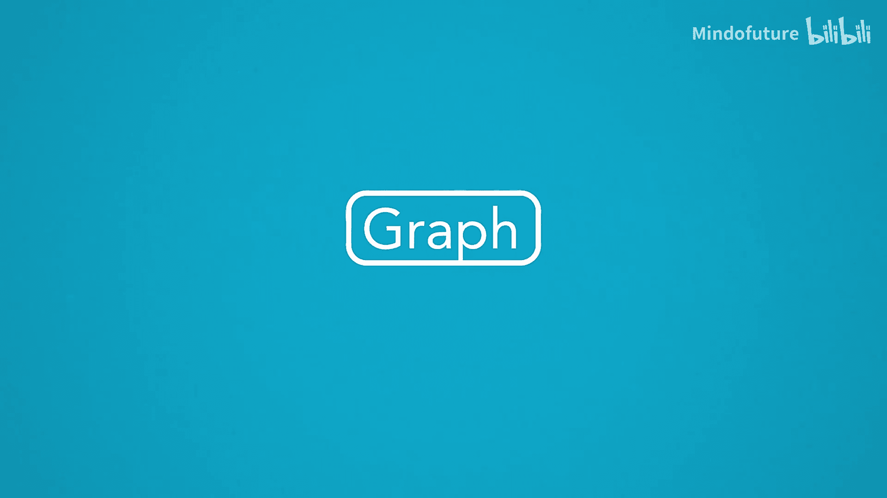
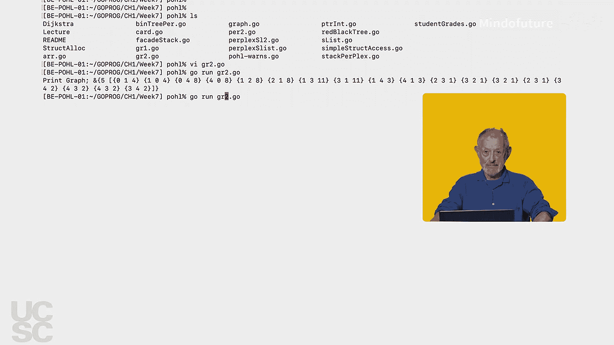
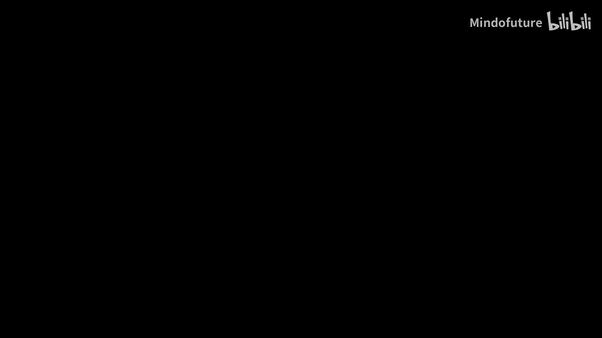

# 【加州大学】Go语言编程-｜-Go-Programming-Everyone-Part-2-p10-P10_图_02_01_04--BV1GTe7z3Eqi_p10-

So our next data structure that we're going to。Write code4 is called a graph。

And a graph is a generalization of。Things like lis and trees。And it's。

Absolutely of super value in computation。So all of you are familiar with graphs because。

In most cases， when you're driving in your car， you have the ability to access a graph。And the graph。

On your cars。呃。System will let you know， for example。

 what is the most convenient route to go from point A to point B。

 so if I was driving from Santa Cruz to Salinas。I would give the address where I want to get to and there。

The little computer on board is going to compute a route through the many different ways I can go from Santa Cruz to Salinas。

And this computation occurs hundreds of millions of times a day throughout the world。

 throughout all sorts of。Vans， cars， trucks。Because。It's such a valuable computation。

And one that is very suitable to a computer。So you can adjust that computation for almost any kind of cost structure。

So cost could be， for example， distance， I want to go between the two places。

In the shortest distance。It might also be time， not the shortest distance might not be the shortest time because maybe I can go on a superhighway。

 I can go much faster than on a local road which might actually be a shorter distance。Finally。

 some of these map programs also let you。Avoid things， so you may have things where you。

Consider things to be a hassle and it minimizes the hassle in going from A to B or maybe maximizes your scenic pleasure。

So all of these things can be represented by a graph in which you choose to optimize。

For a particular cost。 and most often that cost。Is。

Distance because for things like Amazon delivery drivers。Where they have to。

Use a lot of gasoline over the deliveries， they want the simplest。

 cheapest path between all the things they are going to。So we're going to show you how to represent。

This kind of item。In a graph。Okay， so first off。If you go back and think about things like roads。

 they will be represented by what we call an edge structure。

An edge structure connects a source with a destination。So in my graph， for the moment。

 I will identify the different locations as integers， so Santa Cruz might be one。

 Salinas might be 17， San Jose might be six， San Francisco might be not。

 so I have sources and destinations。And they will be the two points between a road。

And you even think of the road as being possibly one way or both ways。 So if the road is one way。

 you can only go from the source to the destination。 and then。For that road。

 there's a cost on going from A to B。And that cost will be。A floating point number。Now。

 a graph itself will just be a whole bunch of these edges and vertices。

 the vertices will be the numbers。So if I have 20 cities in my map。

And there will be a 20 a set of 20 vertices， and then there will be a slice that'll collect all the edges that connect all those vertices。

 So again， my graph is。A set of edges that are source to destination。

And then a set of vertices that might be thought of as。The cities。Then another term for vertice。

 by the way， a node， so in graph theory， you might instead of vertex， you might see the term node。

Okay， so that's how we're going to represent this。Now。

 how are we going to compute things so if we want to build the graph。

Just like we wanted to build the binary tree or we wanted to build。Linear linked list。

 we start off by returning。An address of such a graph。Where we declare it with its value of vers。

 its vertes value， which is an int。And a slice that will contain its edge as initially the slice。

Will be empty。So we're going to add edges。Into that graph。So our function for adding edges。

 and you'll see in my comment there， even though it's on two lines。

 it's meant to be a single line comment。It says add and edge。That is undirected， what's undirected。

 undirected on your road means not only can I drive from here to there。

 but I can drive from there to here， so sort of think of an undirected edge as a two lane highway。诶。

Undirected edges are very common， directed edges are common too， but in the undirected case。

 we're going to consider the undirected case as every。Source and definition， source and destination。

Well have an edge that's destination and source。So it'll just be a tuple， right？

If I have edge from 3 to 7， I must have edge from 7 to 3。

So anytime I want to create in this methodology。An undirected graph。

 I really am creating what you might call two directed edges， and you'll see it in this little code。

 So here we're saying an edge is an append。Of a G。Edge。With a source， destination and weight。

And also a second edge， which goes destination sort and the same weight。So we're actually appending。

Into the slice。 remember， we did that make in the first thing。

And we have that make and the make is the edges value of the struck。

 and there we're doing in effect two a into that slice。Okay。So that's how we create the graph。

 so moving on， let's use this， so here's a function in main。

And we're going to create a graph with five vertices。So the vertices will be labeled zero， one，2。

 three， and  four notice the first edge， the first edge is zero to one。And it's weight。Is。4our。

 so each。Edge has a way to it。And each edge has a source and destination。So we add the edge zero，1。

 zero，4，1，2，1，3， one，4，2， three， three，2。3，4，3，4。呃。And then we're going to print the graph。

So let's go ahead and show that。We're going to now run that program。So here's our code。

The basic type of edge is a struck with a source of destination。And await。Now。In。The graph。

 which is undirected。We're going to have a set of vertices。And for that set of vertices。

 we're going to have a slice that contains all the edges。

 so all the edges will be this three three part struck， which is source destination and weight。

And then the overall graph just says what the size， the node size， verdict size of the graph is。

And then we have as we've sewn in the lecture。A creation。

Where we just create a graph which basically starts off as empty。And that makes a new graph。

 And so the slice。The make for the slice is just zero， a size zero capacity zero。啊。

Slice and then we call on add edge to add each edge in turn。

 which is a source and destination and then for each edge。We do a source destination。

 destination source， and that's what makes the edge symmetric。Or undirected。

And then we can show creating it with this set。And then we'll actually go at the end of this and print it out so you can see what that representation would look like。

And then。While we won't do that with this program， we're going to write a program that will。

Get us least costly pass through a graph。So ultimately。

 we want to show you how this major league program， which is out there in the world。

 which optimizes for your。Driving is actually something that's not all that hard for you to。

Imagine doing， though， the way they do it in the real world where。

Street maps can end up having hundreds of thousands of locations。Many values。

 they have some other tricks that they're doing to optimize for something that big。

Let's run that program now。And。嗯。You see what got printed on the bottom of the terminal screen。

 it says。Print graph。 and then it shows that the graph was。Something that has five nodes。

And then among the node are 0，1， and 4，1，0， and 4，0，4，8，4，0，8。 So you notice that。

The undirected character of the graph is reflected by aing。Two pairs of edges。

Where the source and destination are reversed， but they have the same value。呃。4，0 has8，0，4 has 8，1。

2 has8，2 one has8，1，3 has 11，3，1 has 11。 and then imagine if that's our roadm。11 might be 11 miles。

 or。Something else like time。 maybe it's 11 minutes， whatever we're going to use to optimize。

Within that type of map problem。And so on。Okay。So again， this is something you can play with。

 an interesting experiment is rather than enter your own graph。

Try to use a random number generator to create artificially。

Different graphs of different sizes with different characteristics。That's an interesting。Further。

More sophisticated set of tools for playing with graphs and graph theory。Okay。

