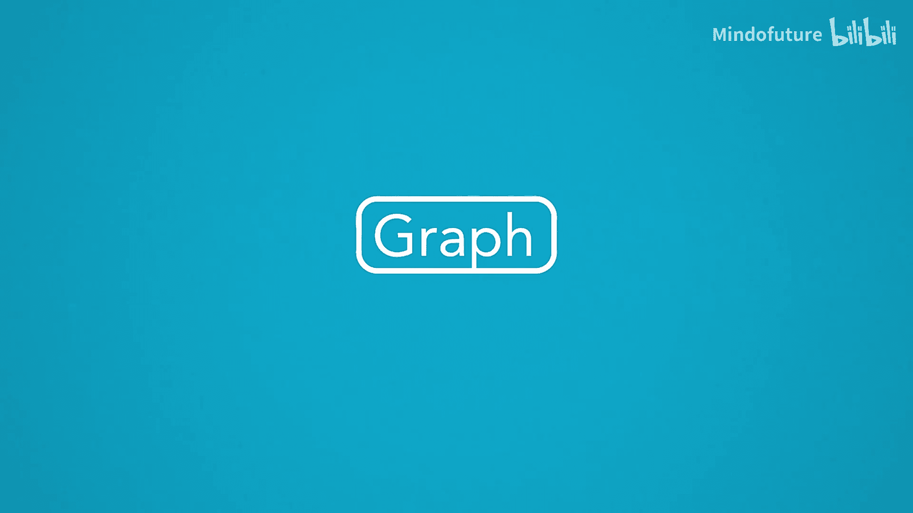
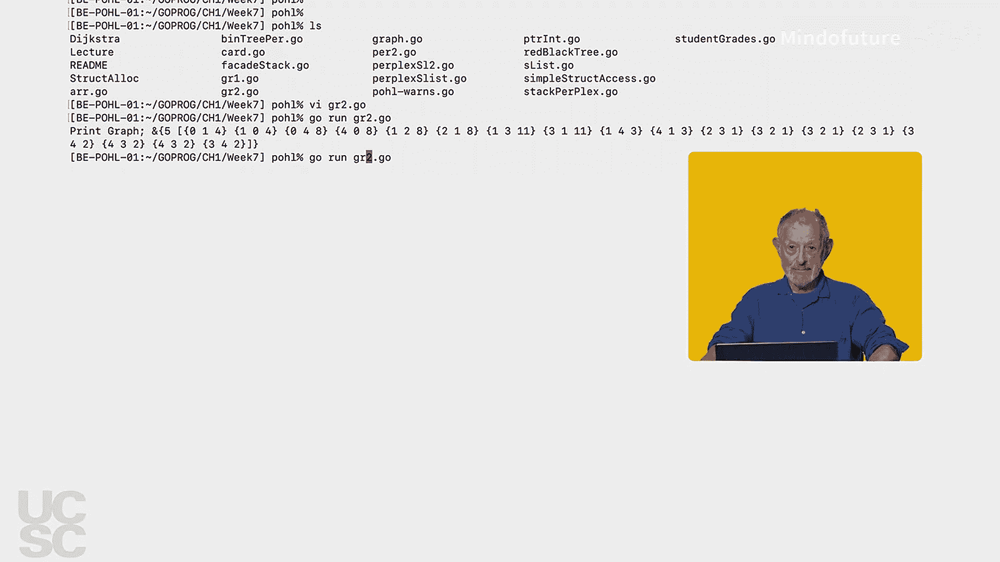

# Go语言编程：P10：图数据结构



## 概述

在本节课中，我们将要学习一种新的数据结构——图。图是列表和树等结构的泛化，在计算领域具有极高的价值。我们将学习如何用Go语言表示图，并理解其在现实世界中的应用，例如地图导航和路径规划。

## 图的基本概念

上一节我们介绍了树和链表，本节中我们来看看图。图由**顶点**和**边**组成。顶点可以代表地图上的城市或交叉路口，边则代表连接这些顶点的道路。

一个边结构连接一个源点和一个目标点。在图中，我们暂时用整数来标识不同的位置。例如，圣克鲁斯可能是1，萨利纳斯可能是17。边可以是有向的（单向）或无向的（双向）。对于每条边，都有一个从A点到B点的**成本**，这个成本通常用一个浮点数表示。

图本身就是由许多这样的边和顶点组成的集合。顶点就是那些数字。如果我的地图上有20个城市，就会有20个顶点的集合，然后会有一个切片来收集连接所有这些顶点的所有边。

顶点的另一个术语是**节点**。在图论中，你可能会看到节点这个词。

## 图的表示方法

我们将用Go语言的结构体来表示图。一个图包含顶点数量和边的集合。

以下是核心数据结构的定义：

```go
// 定义边结构
type Edge struct {
    src  int     // 源顶点
    dest int     // 目标顶点
    weight float64 // 边的权重（成本）
}

// 定义图结构
type Graph struct {
    vertices int   // 顶点数量
    edges    []Edge // 边的切片
}
```

## 创建图与添加边

就像我们构建二叉树或线性链表一样，我们首先返回这样一个图的地址。我们用一个整数值`vertices`和一个初始为空的边切片来声明它。

我们将向图中添加边。添加边的函数，在我的注释中，即使它写在两行上，也意味着是一个单行注释。它说“添加一条边”。这是无向的，什么是无向？在道路上，无向不仅意味着我可以从这里开车到那里，也意味着我可以从那里开车到这里。所以可以把无向边想象成一条双车道高速公路。

无向边非常常见，有向边也很常见。但在无向的情况下，我们将把无向情况视为每个源点和目标点之间都有两条边。所以它只是一个元组，对吗？如果我有一条从3到7的边，我必须有一条从7到3的边。

因此，在这种方法中，每当我想要创建一个无向图时，我实际上创建的是两个有向边。在这段小代码中你会看到这一点。这里我们说，一条边是向`g.edges`切片中追加一个`{src, dest, weight}`，同时也追加第二个边`{dest, src, weight}`。所以我们实际上是向切片中追加了两个元素。

以下是创建图和添加边的函数：

```go
// 创建新图
func createGraph(v int) *Graph {
    return &Graph{
        vertices: v,
        edges:    make([]Edge, 0), // 初始化为空切片
    }
}

// 添加无向边
func (g *Graph) addEdge(src, dest int, weight float64) {
    // 添加从 src 到 dest 的边
    g.edges = append(g.edges, Edge{src, dest, weight})
    // 添加从 dest 到 src 的边，构成无向边
    g.edges = append(g.edges, Edge{dest, src, weight})
}
```

## 示例：构建一个图

让我们使用这个功能。这是`main`函数中的一个示例，我们将创建一个有五个顶点的图。顶点将被标记为0、1、2、3和4。

以下是添加边的步骤：

1.  第一条边是0到1，权重是4。
2.  添加边0到4，权重是8。
3.  添加边1到2，权重是8。
4.  添加边1到3，权重是11。
5.  添加边1到4，权重是8。
6.  添加边2到3，权重是7。
7.  添加边3到4，权重是9。

然后我们将打印这个图。

```go
func main() {
    // 创建有5个顶点的图
    g := createGraph(5)

    // 添加无向边
    g.addEdge(0, 1, 4)
    g.addEdge(0, 4, 8)
    g.addEdge(1, 2, 8)
    g.addEdge(1, 3, 11)
    g.addEdge(1, 4, 8)
    g.addEdge(2, 3, 7)
    g.addEdge(3, 4, 9)

    // 打印图
    fmt.Println("打印图：")
    fmt.Printf("图有 %d 个顶点\n", g.vertices)
    for _, e := range g.edges {
        fmt.Printf("边: %d -> %d, 权重: %.0f\n", e.src, e.dest, e.weight)
    }
}
```

运行这个程序，你会在终端屏幕底部看到打印的内容。它显示图有5个节点。然后列出了节点之间的边，例如：0->1权重4，1->0权重4，0->4权重8，4->0权重8。

请注意，图的无向特性通过添加两对边来体现，其中源点和目标点是相反的，但它们具有相同的权重值。例如，4->0权重8，0->4权重8；1->2权重8，2->1权重8；1->3权重11，3->1权重11。

想象一下，如果这是我们的道路地图，11可能代表11英里，或者代表11分钟，无论我们用什么来优化这类地图问题。

## 总结




本节课中我们一起学习了图数据结构。我们了解了图由顶点和边组成，并学会了如何在Go语言中用结构体和切片来表示它。我们重点实现了无向图的创建和边的添加，并通过一个示例演示了如何构建一个简单的图。图是路径规划、社交网络分析等众多应用的基础。虽然现实世界的地图可能包含数十万个顶点，但核心原理与我们今天所学的相同。你可以尝试使用随机数生成器来创建不同大小和特性的图，这是探索图论更复杂工具的一个有趣起点。