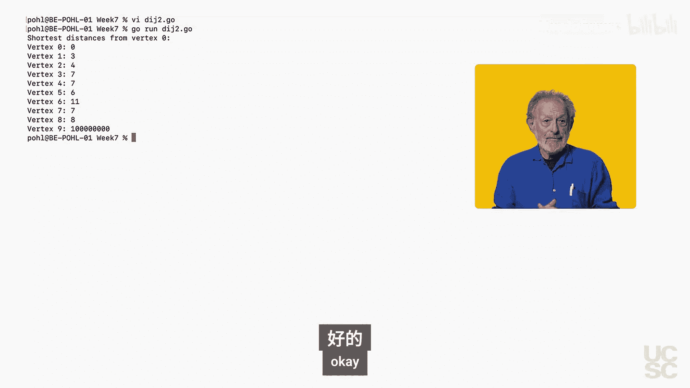

# 【加州大学】Go语言编程-｜-Go-Programming-Everyone-Part-2-p11-P11_迪杰斯特拉算法_02_01_05--BV1GTe7z3Eqi_p11-

So in this segment， we're going to discuss。The shortest path problem and use go to solve it by writing。

Dextrarous algorithm。Now， this going to involve a data structure for a graph。 So it's non trivial。

 So we're seeing how we can usestructs again， and we're going to see it in the case of。

A quite interesting algorithm， in fact， it's an algorithm I helped develop in my own research。

So among the most important computations and frequently done computations are computations involving optimization。

When they involve maps and roots。So imagine your local FedEx or UPS truck driver。

 and he's given an eight hour plan for delivering all of his packages。Well。

 you don't want to just take a package， go here， then go back to the home base。Go to the next place。

 go back to the home base， that's going to be very expensive。

So there are ways to map out the roots that minimize some form of cost， in other words。

 it's an optimization problem。And you've probably seen this if you have a car with a GPS route finder。

 So that car is actually using some version， some way more sophisticated version of what I'm going to show you of the Dxrous algorithm to compute。

A path for you that has certain properties。 In fact， if you've noticed on your car。

 the most frequent thing they compute is a shortest time path。 And nowadays。

 they even take into account traffic so they don't necessarily do the shortest route。

Now what we're going to do is。Optimize for the shortest route on a map。Now， Dyextra himself。

 as called Dyextra's algorithm， is Dyextra was a Dutch computer scientist， and in 1972。

 he was one of the early winners of the Turing Prize。

 which in computer science is the equivalent of what we call the Comp Science Nobel Prize。

And he's also very well known besides for algorithms like this。

A paper called Go to statement considered harmful， which you wrote in 1968 in the EACM。

 And as you have noticed， one of the things I haven't discussed yet in this class is the fact that you can use a go to in the go language。

 And that's because most computer scientists feel that you should be able to code without resource。

Of using go to to give you what is sometimes called spaghetti code is some kind it'ss a pathway through the program that is hard to track。

 So you want to avoid that and and this very famous paper of Dktra。Discuss that very problem。Okay。

 so let's switch。To seeing how we're going to compute this and here is。An undirected graph。

 undirected means on the edges between the nose。We can go in either direction。

 So think of it as a highway that can go in either direction。 you can go from A to B。

 and you can go from B to A， and in effect， you can use the same road。

 And they're on the road in this case， we're using integer values。

 are the costs of the path and you can think of them as kilometers or miles。

 whatever you want or some some form of costs， notice that they're all positive。

 because typically when you go from city A to city B， you can't do it in negative time。All right， so。

In that graph， we're going to try to find a shortest path。 And how does Dtra work。

 Dyextra is a form of greedy algorithm。Greedy algorithms are very nice because they tend to be highly efficient。

A greedy algorithm generally optimizes something locally， something easy to compute。And then。

 continuing with that。You get the proper solution， so problems that allow for greedy algorithms generally can be solved very efficiently。

Now what we're going to do is we're going to start from node zero that's going to be considered。Our。

Home location or start point if you're on a map and you're going from San Francisco to。San Diego。

 you might consider the start。0 being San Francisco in the endpoint。Being in this case， we have。1，2。

3， for us，9 nodes。 So the endpoint would be labeled node 8。

 So San Diego would be node 8 and then all of those。Roads are intermediate paths。

 like going from San Francisco to Redwood City and Redwood City to San Jose and San Jose down to。

San Juan Baista， San Juan Baista。Over to。Somewhere else， et cetera。

 I'm finally getting to Los Angeles and maybe Irvine and then San Diego。

 and we have to look through all those possible paths， which are very large number because at each。

Kow at each city， there are many ways out of that city。

 and you have to figure out what is your best way out。So we start at San Francisco node zero。

 and we look around and we take the shortest initial path out so here。We have。An edge from 0 to one。

 and that's the shortest length。And once we have that shortest length。

 we know that that's the shortest path that's why it's a greedy algorithm from 0 to node 1。

 There isn't anything shorter because we took the least value。

 and since adding any other edge edges value， everything's going to be larger。

So what we're building is a shortest path tree。Now， we consider no zero to be closed。

 and we consider what we just found to also be closed。

 Close means that we've already found the shortest distance from the origin node。

 from the start node。Then we again try and compute from the nose that we have just put into the closed。

Sys them into the shortest tree。What we where we can reach next， we add those values。

 and now we have a collection， what we call the open class。

 and we select from the open class the next node。That is shortest。

And then we put that in the closed class and that。Continues until we find San Diego in this case or until we find node 8。

 And when we find the node we're looking for。We have found the path and its shortest distance。

So that's how Dxter works， so let's look at the next slide。How it's implemented。

 so we need to implement a data structure。For a graph。

 graph is not one of the basic data structures already provided。And go。

And the way you typically do that is createstructs that reflect that particular data structure In this case。

 we're going to first off have a type that's an edge。And they edge type。

 and you can see it's capitalized because that's a fairly standard thing to do when you create a type in go。

 it also means it can be exported from your package。So that struck is going to have a source。

 a destination。 and then。A weight。So the weight is some kind of cost。

The source and destination are labels， and we're going to use the integer labels0 to n minus1 for an N graph problem。

Finally， in order to represent an undirected graph with positive edge lens。

We're going to have a graph structure， and the graph structure is going to have a collection。

 a slice of edges。Those edges will be of type capital edge。

 So the graph is just a collection of edges。And the vertices。

 the size of the graph is some integer number， so we know。

How many cities we have in the graph and we know that among those。

 we have a whole bunch of edges in a slice and that's our graph。Okay。

 now let's use that graph to implement Xs algorithm。So。We want to compute a minimum distance。

And we have a distance。Which is one of the parameters and that's a slice。

And then we have the nose that we're going to visit。So in each case。

We're going to start with some very large number。Which will effectively mean we haven't reached those edges。

 Remember， as I was explaining how you used the Xrous algorithm。

You're building a shortest path tree until you find the node you want to reach。So large in this case。

 it will be something like a million and thatll be larger than anything by far that。

You would find in the graph。And you start off。With your zero vertex。

And you see if something is visited and a distance to a new vertex is less than some minimum distance。

Then we replace a minimum distance with that new distance。And。We return with that value。

 So we're going to have an iteration that I described earlier。

 which is look over in effect the visited nodes。 Those are the nodes that are what I call in the closed set。

And extend that list to see where you get a new minimum distance and assign that distance。

To whatever that vertex is that's been visited。And then when you are done。

 you will have found the minimum distance for in our case， node 8 or San Diego， okay？So。

Let's look at the second part of this algorithm。On the next slide。

 so here we get another major force statement and in that force statement we're running through all the possible distances。

That we can compute。That are the next distances on that tree， on that minimum distance tree。

 And we're selecting out。Amen， and then we're making sure that it's on our visited list。So that。

We have completed that and we're going to do that obviously we're going to do that at most end times。

Because each time through the extra algorithm， we find a next shortest。No to reach each time through。

 we get， that's the greedy part。 we get the next shortest node to reach。

And since there are only and node， we only have to do that at most end time。 and in fact。

 we could find it right off the bat。 I mean， in the trivial case。

 we want to go from San Francisco to San Francisco。 so we don't even have to look at zero iteration。

 But if we're going from San Francisco to Redwood City， which is maybe the most nearby city。

 and that's our destination， we would find it right off the bat even in a very large graph。Okay。

 so let's continue We're going to set up a graph and you can see in my comment it says create poll graph page six of a slacklack report and this goes way back to when I wrote my dissertation and I wanted a check that I was doing the algorithm correctly。

 so I took a very simple graph。呃。And here are all the edges in that graph。

And I create it by adding an edge to the graph G， so I create G as a new graph。

Remember that was struck。And that's going to be size 9。So it's going to have nine nodes in it。

 they're going to be labeled0 to8 just because in go like and see we typically start our slices or our labeling with zero。

And then you can see how an edge is， an edge has three components， so edge0 to1 has length3。

 edge 0 to2 as length 6， edge 0 to3 as length7。Now， that suggests， by the way， just looking at that。

 we know going from edge 0 to one is the shortest because 0 is where you're going to start。

And that's going to be Le 3。 So the first iteration should lead us to。

Putting city one in the visited。A pile with value 3。Now， since this is an undirected graph。

 we're also going to have edges 1 to0， B3， 2 to0， B6， etc。So we're going to have。

A symmetric set of edges with the same weights。Okay， let's look at the second part of Maine。

 that's the rest of it。There's San Diego， there's node8， we can go to node 8 from node5。

 we can go to node 8 from node 6， we can go to node8 from node 7。

 and then we're going to compute the distance by invoking Dyxtrous algorithm Okay。

 so that's it and now we're going to try it out。Okay， so here's the detailed code on my terminal。

Let's make sure we have what we've been talking about。

 we have the edge structure source destination int， we have a weight which is int。Of course。

 weight could be something else， it could be aloat。But it's our cost。

 it's whatever the cost structure is going to be then we have。A graph of size vertices。

That'll be an int。 and then we have a slice of edges。Okay。

 and then we have a function that lets us create a new graph。And the new graph works by。Returning。

A reference to something where the vertices， the number of vertices have been sent in。

 and then we make an empty slice。 So we make a set of edges that are empty。

 which we're going to read in。And then we have a function here that adds a new edge。Willll。

 will read in the source destination。And the weight。

And notice that we have symmetrically two edges produced。 Why is that。Undirected。Now。

 you can do the extra algorithm on a directed graph。

 So it would work just as well on a directed graph。 and then each edge would be entered separately。

 and you wouldn't necessarily have。A path， there could be a path from A to B， but not from B to A。

And here's our Dyster algorithm， our greedy algorithm， which we already describe。为。

Make up a distance matrix and we make up a visited matrix and the distance matrix will be the values we compute through our greedy Dtra algorithm。

 that'll be the shortest distance to those vertices。And then we'll have a Boolean slice。

That will tell us whether we've already visited。And have a shortest distance for a particular verdict。

And then we use this large， which I have up here as being。10 million。

 so 10 million is going to be larger than anything in the。Value range that I'm playing with。

And then I iterate。Over the graph。Much like we said before， we go over the edges， we see what's。

Visited， we compute what a next minimum distance is。And then。Here's the edge set。

For the graph that I've discussed。And it's going to try and find the minimum path from0 to node8。

It actually will find， in this case， all of the vertices。

The shortest path tree to all the vertices starting from Siro。Okay。

I have a long comment explaining the code。诶。But why don't we just run it， make sure that it'll work。

So I will now run it。All right。Notice there is no verdictex 9。

 so that's why that 10 million pops up there， you can't reach it。

But all of the other vertices have ver zero， San Francisco， in my discussion， that's zero。

 of course it zero， that's where we started。Then the first。Notode。

 if you remember how the graph looked was vertex 1 was the shortest thing from zero。

 and that was three。So that becomes a visited node with value 3。Then verdicts 2。

Can be visited directly as well from0。 and that value is 4。

 and then you successfully have different values。 And getting to San Diego Vertex 8 is a path that takes 8。

So indeed， these are the correct answers you can work this out yourself if you want to go back and make sure you understand it。

 it's very important to try and hand simulate your algorithms or you can try this particular。

codeode or write a version yourself。 and then try it out on a fairly small graph system to make sure。

You understand。Okay。

