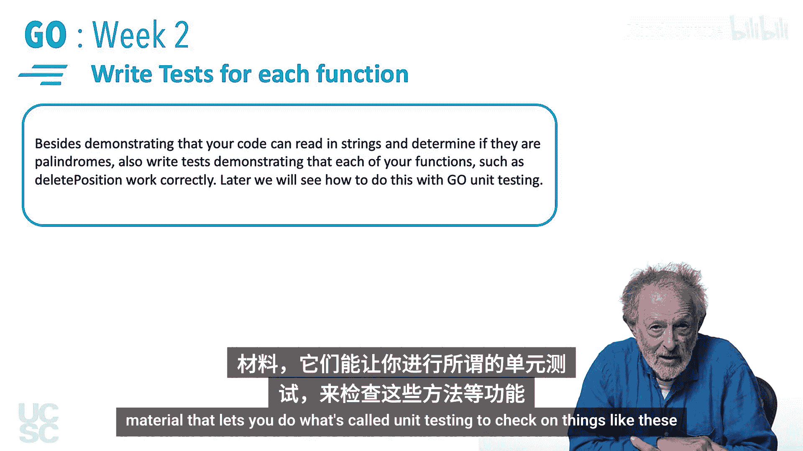

# 【加州大学】Go语言编程-｜-Go-Programming-Everyone-Part-2-p12-P12_第二周_同行评审作业_02_01_07--BV1GTe7z3Eqi_p12-

In this week's homework， we're going to implement a doubly linked list。

Now we've seen this week how we are using Strs to build more complicated data structures。

 and we've already built a singly linked list and we've built some trees。

And so all of these things have different uses， for example。

 an advantage of a doubly linked list is that it can be navigated in each direction so you can go forward from the head or you can go backward from the rear。

So this makes it easier to perform， for example， an insertion。呃。

And you'll see that in the code you write over the use in a singling one。 What's the disadvantage。

 The disadvantage is there's added memory， So you're going to need a pointer to go forward and you're going to need a pointer to go back。

 And that's an extra word of memory。For each element in a DOub linked list。

Now the homework will be we'll use the Doub link list to store a sequence of characters。

And then determine if that sequence is a palindrome。

 a palindrome again is something that can be read the same way forward and backward。

 so a very simple pallodrome is the name Oto。Okay。So again。

 what you're going to do is read in a string， you're going to read in from your terminal。

 a string of characters， and then you're going to march forward and backward， front and rear。

Seeing if the characters are the same。 So character 1 and the last character have to be the same if you're going to be in a palintro。

And if you get in the middle。So you're marching forward and backward。

 comparing one character in each position。 And if they're the same， you continue。

And if they go through the middle and none of them have differ so far， you have a palantro。Now。

 I also want you to make it a little more interesting。

 I want you to add a flag that tells the palangme。Function if you want to consider capitalized characters and uncapitalized characters are the same。

 So that would mean if I had Otto again， and we had a capital O for the first name Otto O T T lower Ca O。

 that would remain a palindrome under this flag， if a flag was true。

 and it would not be a palindrome if we thought capitalized and uncapitalized characters are different。

 than it would be false。Okay， let's go on here and here is a。

 it's always useful with lists and some of these more complicated data structures to draw our diagrams so you can understand your algorithms。

 for example。There's a head pointer，s pointing at the doub link list inside each element。

 there's a value in this case we're showing a character， but it could be something else。

 It could be an in， It could be a complicated struck， and then there are two pointers。

 the forward pointer and the backward pointer ro。Next and previous。And while it's not seen here。

 I want you in your doubly linkless data structure to also and have the equivalent of a rear instead of a head。

 So the rear will be。A terminal that you can start back from。

 just like the head is where you can go forward from。And if you have the empty W link list。

 both head and rear will be nil， okay， and then。呃。Everything else is similar to a singly linked list。

 So this is a visualization。 And if you look at that visualization。

 you can see how much easier it would be， for example。

 to stick an element in the middle of a of a doly linked list than it would be of a singly linked list because。

In a single link list， youd have to know what the next character is。And a doub link list。

 you have the previous pointer and the forward pointer。

 and they both could be used to attach the new element。

 and you don't have to do a more complicated calculation for that。 so insertion。And indeed。

 deletion are a little easier when you have a doubly linked list。Okay， let's look on now。

I want in the homework for you to do a fairly complete job on implementing the functionality of a WE linked list。

 So what are the things you need to do in a WE linked list。

 you need to be able to grow theE linked list and you need to be able to add to the front。

So you'll have some value in our case for the palindme problem。A character。

And that would be its value， and that would be created at the front。

We could also because it's doubly Linked and we'll have a rear pointer that's not always the case。

 but you might want to add to the rear as well。You also， since we have both a rear and a front。

 we want to throw away a front element。 We want to delete a rear element。

Makes it a more useful data structure to be able to do things both at the front of the rear。

We want to be able to find out where an element is in the list， so we give it a value。

 and then we run a search to find what position the element is。

 find the pointer that points at that element if it's and otherwise its nll。

And we also wanted to delete an element within the list， so we might give it a value。

 search the list。Delete the element that has that value。Is empty is a very simple one。

 we just want a test to see if the list has any elements。

We also might want to find the lens of the list。For example， we might want to。

Go from a W link list to a slice， and if we find the of if we know the length of the W link list。

We could create a slice and array of that size。And then place the elements from the。

Wubly linked list into the slice。Finally， we want to insert in a particular position， let's say。

 the eighth position。A value so that insertion can occur along with deletion。

And then we can also delete from physician， so I want you to be able to implement all of those largely be methods on a doubly linked list。

Let's look at the next slide。Here's the typical representation。

 it looks remarkably like a single list element looked。Instead， we've added previous。

So if we're at the end of the list， it'll be nil。If we're at the front of the list previous。

 we'll be nil。So。Again， data could be anything， so it could be itself a complicated drug。

And then we have simple pointers， list element， list element， one is next， the other is previous。

 and that's the extra element that gives us all this additional flexibility over a single linked list。

 Okay， next。Now。Once you have all that done， the key thing I'm asking you to do is demonstrate the code by。

Reading in a string and then determining if that string is a palanttro。

But I also want you to be able to write tests on all the other codes。

 so even though you're going to implement all that code。

 I also want you to run tests on deletion insertion， so for example。

 I want you to write a test to see if the position works correctly。Later in the class。

We are going to talk about some special go。A material that lets you do what's called unit testing to check on things like these methods。

 Okay， that's your homework。

