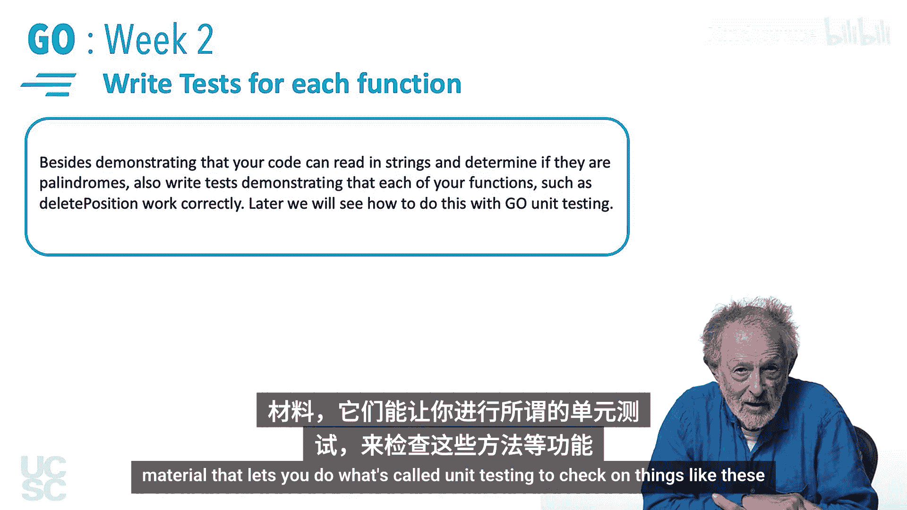

# Go语言编程：第二周：双链表实现与回文检测 🧠


在本节课中，我们将学习如何实现一个双链表数据结构，并利用它来检测一个字符串是否为回文。我们将从双链表的基本概念开始，逐步构建其完整功能，最后应用它来解决实际问题。

## 概述

本周的作业是实现一个双链表。本周我们已经学习了如何使用结构体构建更复杂的数据结构，例如单链表和一些树结构。双链表的不同之处在于，它可以在两个方向上遍历，既可以从头部向前，也可以从尾部向后。这使得某些操作（如插入）更加容易。然而，其缺点是增加了内存开销，因为每个元素都需要一个指向前一个元素的指针和一个指向后一个元素的指针。

我们将使用双链表来存储一个字符序列，并判断该序列是否为回文。回文是指正读和反读都相同的序列，例如名字“Otto”。此外，我们还将添加一个标志位，用于控制是否将大写和小写字符视为相同。

## 双链表的基本概念

上一节我们介绍了双链表的优势与用途。本节中，我们来看看其具体的数据结构表示。

双链表的每个节点包含三个部分：存储的值、指向下一个节点的指针（`next`）以及指向前一个节点的指针（`previous`）。在我们的实现中，除了头指针（`head`），我们还将维护一个尾指针（`rear`），以便从尾部开始反向遍历。如果链表为空，`head`和`rear`都将是 `nil`。

以下是一个双链表节点的典型Go结构体表示：

```go
type Node struct {
    value    interface{} // 可以是字符、整数或更复杂的结构体
    next     *Node
    previous *Node
}
```

与单链表相比，双链表使得在中间插入或删除元素更加容易，因为我们可以直接通过`previous`和`next`指针来重新链接节点，而无需进行复杂的计算。

## 需要实现的功能

为了构建一个功能完整的双链表，我们需要实现一系列方法。以下是需要完成的功能列表：

*   **`AddToFront(value)`**: 在链表头部添加一个新元素。
*   **`AddToRear(value)`**: 在链表尾部添加一个新元素。
*   **`DeleteFront()`**: 删除链表头部的元素。
*   **`DeleteRear()`**: 删除链表尾部的元素。
*   **`Find(value)`**: 在链表中搜索给定值，并返回指向该节点的指针（如果未找到则返回 `nil`）。
*   **`DeleteValue(value)`**: 搜索并删除链表中第一个具有指定值的节点。
*   **`IsEmpty()`**: 检查链表是否为空。
*   **`Length()`**: 返回链表中元素的数量。
*   **`ToSlice()`**: 将链表转换为一个切片。知道链表长度有助于预先分配切片空间。
*   **`InsertAt(position, value)`**: 在链表的指定位置插入一个新元素。
*   **`DeleteAt(position)`**: 删除链表中指定位置的元素。

实现这些方法后，我们的双链表将成为一个非常实用的数据结构。

## 应用：回文检测算法

现在我们已经了解了双链表的功能，本节将利用它来解决回文检测问题。

算法思路如下：
1.  从终端读取一个字符串。
2.  将字符串中的每个字符依次添加到双链表中。
3.  同时从链表的头部（`head`）和尾部（`rear`）开始，向中间移动。
4.  在每一步中，比较头指针和尾指针所指向的字符。
    *   如果设置了忽略大小写的标志，则在比较前将字符转换为统一的大小写（例如小写）。
5.  如果所有对应的字符都相同，直到两个指针相遇或交错，则该字符串是回文。

这个算法有效地利用了双链表双向遍历的特性。

## 测试要求

在完成所有代码实现后，关键任务是演示其功能：读取字符串并判断是否为回文。

此外，我还要求你为所有其他功能编写测试。例如，你需要编写测试来验证`InsertAt`和`DeleteAt`等方法是否能正确工作。在本课程后期，我们将讨论Go语言中的单元测试，这是一种用于检查此类方法的专用工具。但现在，你需要自己编写简单的测试逻辑来确保代码的健壮性。

## 总结



本节课中我们一起学习了双链表的实现与应用。我们从双链表相对于单链表的优势（双向遍历）和劣势（额外内存开销）开始，详细定义了其数据结构。然后，我们列出并描述了需要实现的一系列核心方法，以构建一个功能完整的双链表。最后，我们探讨了如何利用这个数据结构来解决一个具体问题——回文检测，并强调了为所有功能编写测试的重要性。通过本次实践，你将更深入地理解链表数据结构及其在算法中的应用。