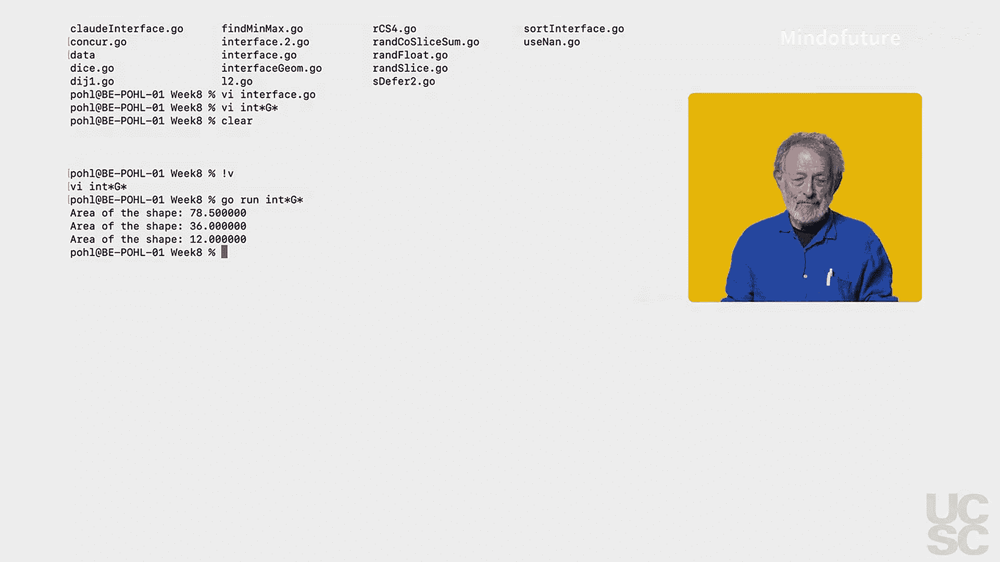

# 【加州大学】Go语言编程-｜-Go-Programming-Everyone-Part-2-p13-P13_接口_03_01_01--BV1GTe7z3Eqi_p13-

So we're coming to a novel topic in the go language。

 something you tend not to see in other languages like there's nothing like this in。The C language。

 it predecessor language。 So this is called an interface and an interface in go is an abstract type specification。

What it allows you to do is to。Give。A recipe。For what a certain class of types？

Need to look like they have to implicitly match。An interface specification and once they match it。

The compiler knows that that type matches what you've declared as an interface。

And it can identify it。Without you having to say what it is。

 this is sometimes also calledduct typing。Because it'll no。

And we'll see that in a second in the simple example I'm going to use。

 so I'm going to define an interface named the shape。

 so imagine that I'm drawing things I' architect。And I have I'm creating a package for drawing all sorts of shapes。

 but I need to be able to compute。Area。The buildings I'm designing。

 so I need a way of knowing what the area for individual shapes are。

 and my shapes might include squares and rectangles and triangles and circles and who knows what octagons。

So anything that conforms to this interface， so notice what I did， it says type， keyword。

 then I declare and typically again， I use a capitalization shape that's just so I can export it。

And then the keyword interface。Open Bra， and then a series of methods， one or more methods。

That characterize that shape， so anything that is concrete。

 anything that has a method for computing area will be will be considered a shape。Okay。

So here is a circle， I've declared a circle to be a struck。Astruct that has a radius。

 that's typically how you define， that's a defining characteristic。Of a circle。

And then how do you compute the area of a circle。 Well here is a method。 So remember。

 the funk of a method， we have to have the type as a special argument。

 Then we have the name of the funk area。 Then we have what its parameters are。 And in this case。

 theirre past implicitly as part of the circle C。 So the area is just 3。14 times C's radius squared。

😊，Now I could have used I should have used a better approximation to pi I'm only using three digits there。

 recall how you can do that you can go to the math library and call on math do P where pi is capitalized and you'll get something of appropriate precision Okay。

 so that gets us our area and now what about an area of a square again。

 we have a struck we've called it a square and it must have。

A way you characterize the squares each side has the same value。

 so you only need one side we'll have a floating point number for it and then its area is just the size squared right so there's a method for computing the area of a square Okay now let's move on。

And yet another shape rectangle rectangle is a little more tricky than a square right it's got a width and a height and they can be different a square is just a special kind of rectangle so width and height are both there and its float and now we return width time height and if you wanted you could have yet other shapes。

 but those are be the ones that will look at。Now let's see how we can use them。

So this interface gives us what's called a form of polymorphism。 It gives us a form of。

Writing code that can be used over a series of types as long as those types meet that specification。

 so we've created a circle， the circle has a radius of five， we've created a square。

 the square has a radius not a radius a side of six， and we've created a rectangle。

which has a width of three and a height of four， and we could have other things。

 we could make up other structures， you could try it， make up a struck for triangle， for example。

And then what we do is restore in a slice。Which is of type shape。 What's type shape。

 That was the interface type。 So all three of these types。 that's where the polymorphism enters。

 All three of these types can be stored inside that slice。

So we don't have to do things individually and now we can。Go over the range of that slice。

And compute。呃。The areas of each shape。And that's what's happening in there。

 we're just saying shaped that that area and we can get the answers to all of those types with that one simple for loop so now let's go and see how this runs。

So we have our program that computes the area of shapes。

 you'll notice the top comment perplexity contributed to this example， so modern day coding。

 we have AIs that can be helpful。you may want to investigate some yourself and I from time to time use perplexity to generate these examples so they're fairly straightforward in any case。

呃。So here is what we just described， here's our interface shape。

 it's an area we computed it as a floating point number。Again。

 an interface has to have methods in it。 By the way。

 there can be a special interface called the null interface where there's no methods。

 Now that can have some special uses， but it's something I'm going to stay away from because the null interface means that everything can satisfy it。

 right， since there's nothing specified， every type would specify the null interface。

 So that's very special， but we'll be dealing with interfaces that have specification。

 Those specifications are methods。In this case， anything that meets that specification like a circle。

Here's's where it meets it， here's an area， a method， again notice the syntax。

 when you have a method you say funk， then you give the type that you're operating on in this case。

 a circle。You don't need to pass in the radius for the area because the circle is automatically passed in。

 the variable C is a circle， so you can get at the field， the radius field of the circle internally。

And there's our use of pie。3。14。As they say， that's rather。

You actually want to use something like mathth dot Pi to be more accurate。

And here's your square where there's only one side and here's how the area is computed again。

 it's side squared and here's your rectangle height。And that's。

With time site for your rectangle and then。If you notice in my function。

 here's where I'm using some polymorphism。So I can store everything if you look at that line， shapes。

I have a slice。It's got the circle， the square and the rectangle all stored in it。

 so then a simple forceesstatement can be used to go over all those shapes and compute shape that area。

Dd， very nice， very powerful， let's just run it。So。I'm going to。Oh。And there they are。

 the area of the first shape was 78。5。I believe that was the circle。

 but I'd have to look back at that and then 12 is four times three and the square was， I think。

 six times six。Okay。So it all worked。

