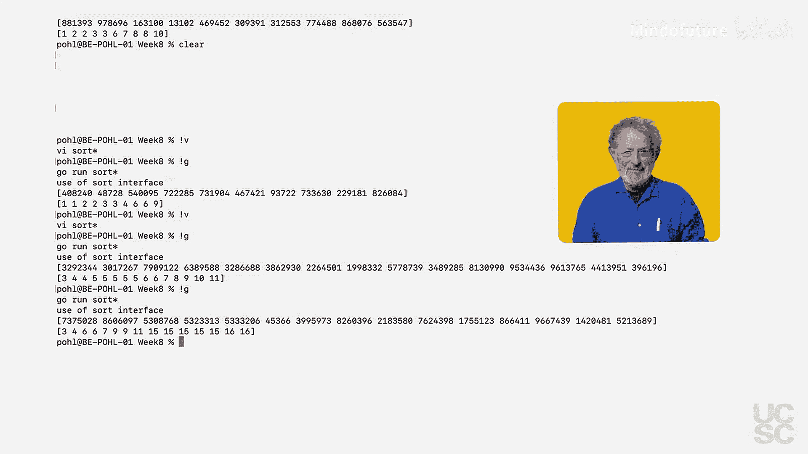

# 【加州大学】Go语言编程-｜-Go-Programming-Everyone-Part-2-p14-P14_排序_03_01_02--BV1GTe7z3Eqi_p14-

Okay， so we've already seen how to。Do a sort an interface type and now we're going to。

Show how to use a very important interface called the sort interface。Now。

 sorting is one of the most important topics in computing。Why。

 because when you have large sets of data， mean what's computing for。

 if you have just a small number of things， you can do it by hand。

SoComp is really powerful when you have to deal with very。

 very large numbers of things and consider like the Social Security Administration。

 so it's dealing with maybe 150， 200 million people actually the population in the United States now is 340 million so everybody gets at some point a social security number and they have their name and they're in the system and much information has kept track of。

And the way to do it efficiently is to have the ability to look people up。Very quickly。

 And that requires that the data be sorted。 Okay， well， since that's true for many。

 many different things， sorting is one of the most critical。Algorithmic topics。

Very much worked on and requires great expertise to write the most efficient。Alrithms。

And place them in libraries， so you leave that to experts。

And such is the case with the ghost sort package， it's an easy to use interface that allows you to take your user to find type anything that will match。

That interface and sort it efficiently using。Typically something called a form of quick sort。 Now。

 if you need to know about sorting， there is a wonderful volume by Don Canth Vole 3 in his collection of books that deals with sorting and searching and explains all of these things in Gory Gory detail。

 but we'll look at the sort interface。 Let's look at that next。What's required to sort things， Well。

 we have to know how many things we're going to sort。

Are we going to sort the 300 million social security numbers。

 that's going to be the length of what typically will be a slice right。

 so we'll have some length of what we're sorting。We need to know in what order how to order things so ordering we're going to use something called less than and less than is going to be if object I is less than object day。

 then the Boolean value for that is going to be true。

 so we need a method that produces a Boolean that gives us the basis for the ordering namely。

What less would be in that ordering。Now less in integers is just a， less than B。

 where let's say two is less than3， but what does it mean if you're trying to compare strings。

 let's say you're sorting a whole large number of names well then you need something that's capable of doing less on a string and knowing that a vc is less than bear。

 so that would be two strings you might keep track of a whole bunch of animals in a list a zoo might have everything and have information on all their animals and they might want to look up avak which is less than bear。

So you need a less method and finally， if things are out of order， you need to be able to swap them。

 so any kind of basic sorting method if it has those three things，It can accomplish the sort。

 that's the sort interface， so let's try and imply it。Okay， here's。A type we're going to call data。

 It's going to be a very simple type。 It's just going to be a slice of integers。 We， we。

 we already know that that could be sorted。But now we have to produce the methods of it。

 so we're going to say。When。It's just going to be the length of the slice D。

Less than is just going to be the comparison operator less D I compared to DJ。

 and then swap is that fancy little way you can swap and go namely。

You can take DI and DJ and replace DJ DI by DJ， and you don't need a temporary。

 so go has that interesting little idiom which lets you do a swap without a temporary which you would need if you were trying to do this in C。

So these three operations are needed to sort。And a。We will now just apply it。To a very large。

Sorting routine so we're going to generate data here， I think we're generating a million items。

And the data is going to be generated using our random number generation just to test this out。

 So we'll make a million items and willll。There'll be integers。And。After we've generated them。

 we will they'll be unsorted， so we have。呃。We'll see that in that first print statement。

 The first print statement is format， dot print。And will do the subslice 0 to 10。

So I don't want the screen， I don't want the screen to fill up with all million numbers。

So you'll just see that those initial 10 numbers are random。

Then we'll call sort from the library package sort。On that type data。

And we'll see how efficient that is。 We'll see how quickly that can run on a modern PC like my Mac。

 and then we'll check that the initial random numbers are now in sorted order。

So let's now just try that out on our program。So let's demonstrate on my terminal window， my Mac。

The use of the sort interface first off， I'm going to import a number of things I'm importing the sort package that's the library routines。

That work on the sort type。And remember， how do we know it's a sort type implicitly。

 it's byduct typing， so anything that fits。Less as methods for less。swap。呃。Will。Fit that interface。

And。And length。So here is a type， a simple type， we're calling it data。

 it's just a slice of integers。And here's how we define the four methods。呃。

The length of D is one of the methods that tells us the length of the slice， how much got filled in。

Here's less than that's just using the operator less than， here's the swap operator again。

 as I mentioned in the little bit of lecture that's using that special go routine notation that avoids using a temporary。

And here we're going to choose to use a million elements。And we'll do a seed。

 so each time we run the remember the reason for doing R dot seed using time as you get a different seed each time。

 which means you get a different random number selection so you can run it。

Each time getting different data and just checking out that it'll work。And here， notice in this line。

 datata of I is equal to RA dot int and how many？So I'm going to generate。

A random integer between zero and a million。Right， that's why I put in how many。

 so there'll be all sorts of integers。And by the way。

 they don't have to be unique because the random number generator could generate multiple。呃。🤢。

Entertersgers that are the same。Then I'm going to show by printing it out at first the first 10。

That indeed it's random and then we'll sort and then we'll see that those first 10 are in sorted order。

 so let's try that。It went so quickly that I'm going to try it with a larger number， but look。

 here's that first print line， the first print line says， oh， the first 10 elements were 408。

240 and then 48，728， etc cetera。But when we finished up， we had 1，1，2，2，33，4，6，6， and nine， remember。

 there's no reason why you couldn't get duplications。So let me make a change。

 I'm going to go back to that algorithm that went very quickly。あ。What if I up it by a factor of 10？

So now I'm going to have 10 million。I think I don't need to change anything else。Okay。

 why don't I do 20 rather than 10？Or made no 15， I'll do 15。Hopefully this is all going to work。Yeah。

Okay。If you watched。This worked a little slower than the previous， the previous one。

 the answers came up immediately， this time the answer there was a blink between the unsorted numbers and the sorted numbers。

And you can see now that the sort of numbers are even larger。

 I have a larger range because how many was larger and but we end up with the 15。

Numbers we start with three in this case。 Obviously one didn't get generated。 so we have 3，4，5，6。

 We have four。5ive showing up sixes，2， sixes，7，8，9，10 and 11。All in sorted order again。

I don't know if we'll be able to see it。See， it is a stall it stopped。

 that's why it was actually roughly a little more than 10 times slower than doing one million。Anyway。

That's amazing that on a small computer like this， we could generate 10 million elements and do a sword on them。

 and basically it almost shows up。Nearly instantaneously。So it's highly efficient。All right。

