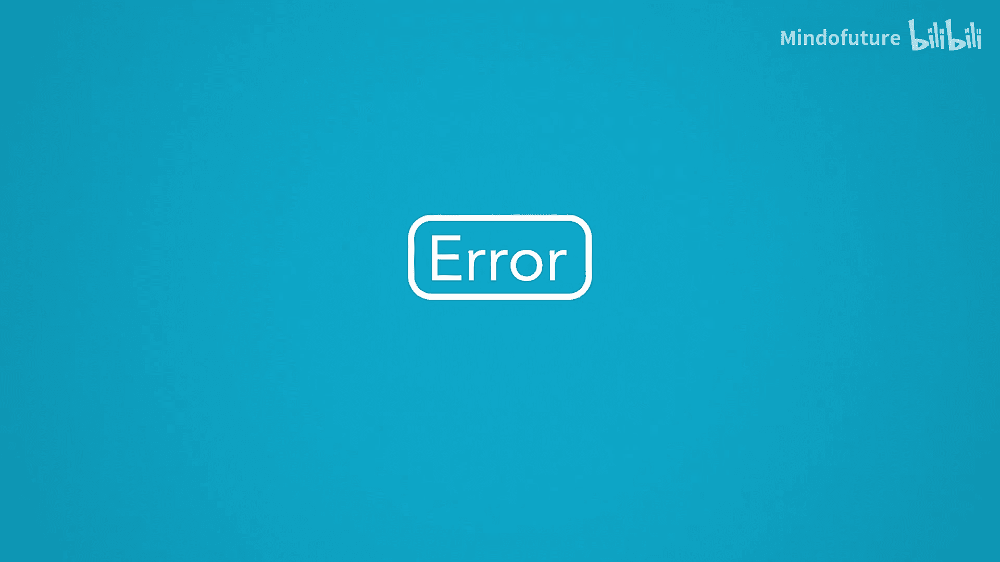
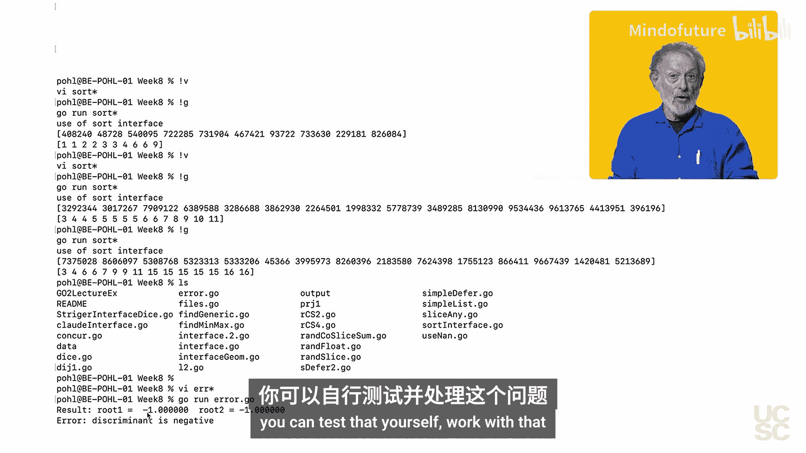

# 【加州大学】Go语言编程-｜-Go-Programming-Everyone-Part-2-p15-P15_错误_03_01_03--BV1GTe7z3Eqi_p15-

So one last interface that I want to discuss is very important in go because it provides a standard way error checking is done in go。

 and this is somewhat an idiom a style adopted by the go community and it involves an interface。

Now in languages like C++， you have the ability to work with what are called interrupts。

But interrupts give you。More complicated code and add an overhead。That go did not want to provide。

 so go avoided interrupts and instead uses what you might call very old style。诶。

Eror checking based on this error interface。Which。Is。A method that returns a string。

 so think of something going wrong， let's say you ran out of a resource。

The error might be machine ran out of resource and then the machine halts， or in some cases in go。

 you get the panic message but。If。You were to just rely on the go operating system to deal with errors。

You might not get all the information you want， so by providing an interface that lets you write out a string。

That tells you explicitly what your problem was。You get a form of error checking at runtime。Okay。

So let's look at a problem in which we're going to possibly determine an error。 and in this problem。

 it's sort of your classic high school algebra problem finding the roots of a quadratic equation。

 So remember a quadratic equation is an equation that looks like A x squared plus B x plus C equals0 and to solve that you want the roots and again just recollection。

The way you get that is。You take one， there are typically two routes。

And the roots are B plus or minus the square root of b squared minus4 AC over 28。

 So that's a formula for solving the quadratic， giving you two roots。

 the plus and minus gives you the two different roots unless the roots turn out to be the same for the roots turn out to be the same B squared minus4 AC has to be0。

 right。And indeed， that might occur if you have a simple， think of the simple quadratic expression。

 just x squared。Equals one。What the two roots are going to no the roots there will be plus one and minus one。

 so that's not quite the right one， but can you can work it out so。

Where are we going to get an error， Well， the classic era is if we get。

In the discriminant B squared -4 A C， a negative number。 Why。

 because the square root of a negative number is not a real number。 It can be an imaginary number。

 but we're not going to work with imaginary numbers here。 So when we see that the determinant。

That thing under the。Square root sign is negative， we have an error。Okay。

 so a positive determinant indicates quadratic has two distinct real number solutions。

But a discriminant of zero indicates there's only one solution。

But a negative one is going to lead to the error， so let's see how the code looks。

Just repeating it the roots。The quadratic is going to be written as a times x times x plus b times x plus C。

 the discriminant is just b times b minus4 times a times C。

 and then we're going to compute root1 as b plus that square root。

And root 2 as b minus as square root。呃。And then we're going to produce an error if the discriminant is negative。

 So now let's turn to。The actual function。The function gets us roots。

 notice that we have three values being returned in the function， remember。Go is。

Different than C in that。You can have a return value that is a multiple set of values。

 So here we're specifying that two of the return values are floats。

 and the last return value is of type error， the type that was specified in that interface。

 So we're going to return two values that ostensibly are the roots。And then if there's no error。

 we're going to return a special value called nil， so let's look at it， we compute a discriminant。诶。

We check to see if it's a negative number。If it's a negative number， we create the error function。

 which says。QuoteE。 new， we create the string， quote， disccriminate is negative。

 so that will be our error message。And then if it's not。If the discriminant is not less than zero。

We're going to do。呃。The square root of the discriminant。And we're going to return。呃。The two。

The two different roots notice as a comma in that return and is showing two different values。

 and then the third value is nil， so nil indicates that there's no error that's a convention again。

So let's go to our main now。And we call main root one， root two， error， we set it up。诶。

And then we're going to check to see if the error is nll will throw the error。

 otherwise will print out the results。So， it's a very simple computation。

Where we've done the square root that way。And。I will just show you that now trying the code on my terminal。

 so we're going to test out our root finder。And check that the era。

Interface was met and let's look at how we're computing。

 so we import errors by importing errors we're importing that interface。

Now the function roots has ABC y because it's a times x squared plus b times x plus C equals0。

 so that's how we're representing the quadratic。And it has two normal answers， root one and root two。

They're unnamed here because I'm just going to return them so there wasn't any reason to name them and then I'm going to return。

Something of type error。Now。Recall the convention is。If。The error is nil。 there's no error。

 so that's what we typically test。And if the error is not nil， we're going to generate a message。

That's what's in the interface。So here's the discriminant， b squared minus4AC。

 and here's the test to see if the discriminant is negative。If the discriminant is negative。

 this is what we return， we return two zeros。That's meaningless。

And then we return this errorss function， which is the。Message discriminate is negative。

 So when you write something like this， you want to be able to write an understandable message saying why。

Your code went wrong。As I said， in a language like C++。

 you would probably instead throw an exception here。So this is older style， but much simpler。

 So if there was no error， namely， the discriminant is greater and equal to0。

 then we just take the square root and then we return with。

Minus b plus d over2 times a minus b minus d over2 times a， those are the two roots。

 and the error code is nil。So inside here。I'm establishing。Root1， root2， error。

As being the answer to calling roots of what equation do I have here。

 I have the equation x squared plus 2 x plus 1 equals 0。I'm checking to see if the error code is nil。

And notice I have this as a colon equal， so that means that。

The compiler understands that error is of the type error。It checks here to see if it's。 If it's nil。

 it prints out the error。If it's not no， if it is。No。W， excuse me。

Got that wrong if the error is not nil。The era is not nil。

Then there is an error and it prints the error。 If the error is nil。

 then it does the else part and prints out the answer， which is the two rulesuse。

So I've done two different equations， I've done a second equation where you have x squared。

Plus 2 x plus 4。 And we'll see in one instance， there's no error， and the other instance is an error。

 So let's run this code。Okay。呃。On the bottom of my screen where I ran Gorunergo。

 you can see that in the first instance。I have。An answer， Route 1 was -1。 Route 2 was -1。

 So that must have meant that the discriminant was 0 in that particular case。

 You can go back and check that。 Do that by hand。 In the second case。

 the discriminment was indeed neck。 So there was an error I couldn't compute。

I couldn't compute two roots in the real domain。All right， you can test that yourself。

 and work with that。

