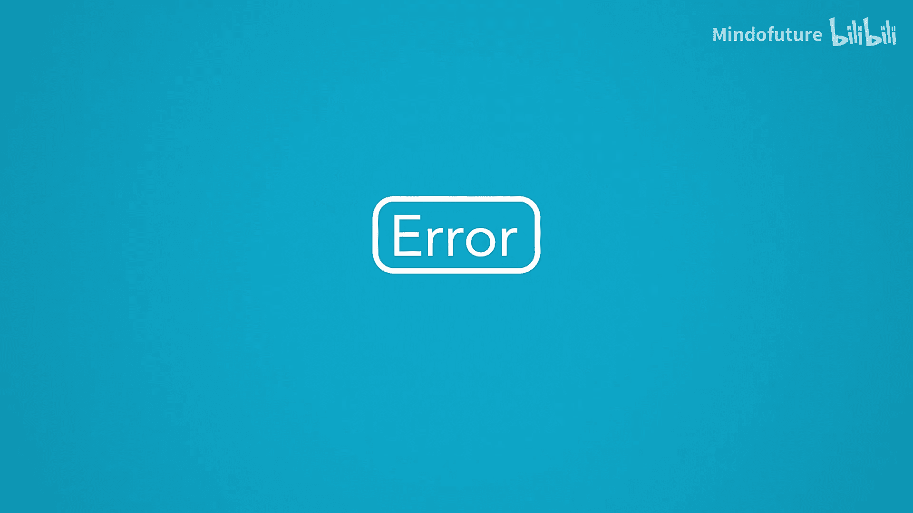
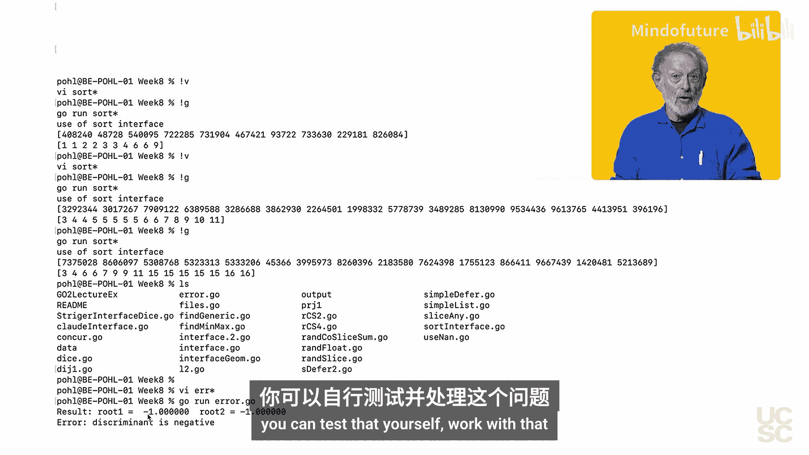

# Go语言编程：P15：错误处理




在本节课中，我们将要学习Go语言中一个非常重要的接口，它提供了Go语言进行错误检查的标准方式。这是Go社区采用的一种惯用风格。

## 错误接口概述

上一节我们介绍了接口的基本概念，本节中我们来看看Go语言中用于错误处理的核心接口。在C++等语言中，你可以使用中断来处理错误。但中断会使代码更复杂并增加开销，Go语言不希望提供这种机制。因此，Go语言避免了中断，转而使用一种基于错误接口的、更传统的错误检查方式。

这个接口定义了一个返回字符串的方法。当出现问题时，例如资源耗尽，错误信息可能是“机器资源耗尽，机器停止运行”。在某些情况下，Go语言会产生panic消息。但如果仅仅依赖Go操作系统来处理错误，你可能无法获得所需的全部信息。通过提供一个允许你写出明确问题描述的字符串的接口，你可以在运行时获得一种错误检查形式。

## 实际问题：求解二次方程

现在，让我们看一个可能产生错误的实际问题。这是一个经典的高中代数问题：求二次方程的根。

回忆一下，二次方程的形式是 **`A*x^2 + B*x + C = 0`**。求解该方程就是求其根。通常有两个根，求根公式是：

**`(-B ± √(B^2 - 4*A*C)) / (2*A)`**

这个公式给出两个根，正负号对应两个不同的根，除非根相同。当根相同时，判别式 **`B^2 - 4*A*C`** 必须等于0。

例如，简单的二次表达式 **`x^2 = 1`**，其根是+1和-1。

那么，我们在哪里会遇到错误呢？经典的错误情况是当判别式 **`B^2 - 4*A*C`** 为负数时。因为负数的平方根不是实数，它可以是虚数，但这里我们不处理虚数。因此，当我们看到平方根符号下的判别式为负数时，就遇到了错误。

-   正判别式表示二次方程有两个不同的实数解。
-   零判别式表示只有一个解。
-   负判别式将导致错误。

## 代码实现

让我们看看代码如何实现。二次方程表示为 **`a*x*x + b*x + c`**。判别式是 **`b*b - 4*a*c`**。然后我们计算：
-   **`root1 = (-b + √(discriminant)) / (2*a)`**
-   **`root2 = (-b - √(discriminant)) / (2*a)`**

如果判别式为负，我们将产生一个错误。

现在转向实际的函数。函数名为`roots`。注意，该函数返回三个值。Go语言与C语言不同，可以返回多个值。这里我们指定前两个返回值是`float64`类型，最后一个返回值是`error`类型，即错误接口中指定的类型。

我们将返回两个值作为根。如果没有错误，我们将返回一个名为`nil`的特殊值。

以下是函数逻辑：
1.  计算判别式。
2.  检查是否为负数。
3.  如果是负数，我们使用`errors.New`函数创建一个错误，字符串为“discriminant is negative”。
4.  如果判别式不小于零，我们计算判别式的平方根，然后返回两个根，第三个值为`nil`，表示没有错误。这同样是一种约定。

## 主函数调用

在我们的`main`函数中，我们调用`roots`函数：`root1, root2, err := roots(...)`。

然后检查错误是否为`nil`。如果错误不是`nil`，则抛出错误；否则，打印出结果。

这是一个非常简单的计算。我们通过导入`errors`包来使用那个接口。

以下是`roots`函数的定义：
```go
func roots(a, b, c float64) (float64, float64, error) {
    discriminant := b*b - 4*a*c
    if discriminant < 0 {
        return 0, 0, errors.New("discriminant is negative")
    }
    sqrtDiscriminant := math.Sqrt(discriminant)
    root1 := (-b + sqrtDiscriminant) / (2*a)
    root2 := (-b - sqrtDiscriminant) / (2*a)
    return root1, root2, nil
}
```

在`main`函数中，我们建立`root1`， `root2`， `err`变量来接收调用`roots`的结果。我们检查错误代码是否为`nil`。注意，这里使用`:=`，编译器能理解`err`是`error`类型。

检查逻辑如下：
-   如果错误不是`nil`，则存在错误，打印错误。
-   如果错误是`nil`，则执行else部分，打印出两个根。

我们测试了两个不同的方程：
1.  **`x^2 + 2x + 1 = 0`**
2.  **`x^2 + 2x + 4 = 0`**

我们将看到一种情况没有错误，另一种情况有错误。

运行代码后，在屏幕底部可以看到：
-   第一种情况得到了答案：`Root 1 was -1`， `Root 2 was -1`。这意味着在该特定情况下判别式为0。
-   第二种情况判别式确实为负，因此出现错误，无法在实数域内计算两个根。

你可以自己测试并验证。




## 总结


本节课中我们一起学习了Go语言中的错误处理接口。我们了解了Go语言如何通过`error`接口和返回多个值的函数，以简洁、明确的方式进行错误检查，而不是使用复杂的中断或异常机制。我们通过求解二次方程根的实际例子，演示了如何定义返回错误的函数，以及如何在调用处检查和处理错误。这种模式是Go语言编程中的核心惯用法之一。