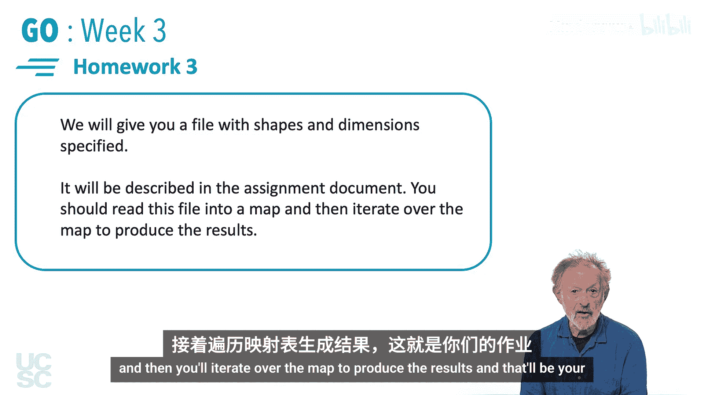

# 【加州大学】Go语言编程-｜-Go-Programming-Everyone-Part-2-p16-P16_第三周_同行评审作业_03_01_05--BV1GTe7z3Eqi_p16-

So here in Home three， we're going to write a go program that will calculate volumes of solids。

It should be able to compute the volume of different solids and the solids， for example。

 will be spheres， cubes and pyramids。And we're going to use。Interfaces。

That's been a major topic this week。And maps。That's a very specialized data structure， but very。

 very useful， it's also known as an associative array。

So the requirements in this homework are to define an interface。

 the interface will be as solid and the interface。We'll have to have the method volume where you're going to return a float 64。

Then you're going to create a map that'll store the different solids。

 So the key should be a string representing the solids name， and the value should be of type shape。

 So then we will calculate volumes， and you will write a function that iterates over the map and prints the name of each shape。

Along with its volume。Okay。So we're going to implement an interface。

 implement a solids interface for the following solids， a sphere。

 a sphere has a radius of type float 64， a cube， a cube has a field length of type float 64。

 and a pyramid which will have a field that has base and height both of type 54。

 and we will assume that the pyramid has a square base， so that's the kind of pyramid we're going to。

Use here。Now。What's that look like go code， length。

 the volume of a cube is length times length times length， basically length cubed。

Sear that's a volume four times pi， remember how to get a very good value for pi is to use the math package so you could have math dot pi and then radius times radius times radius so again it's radius cubed over three all over three and then finally for pyramid the volume is base times base because it's a square base。

Times height divided by three。Okay。Now we're going to give you。

A file and the shapes and the dimensions will be specified in the file。

 and we will describe in the homework document how all of that will be stored so that you can read it from a file and then you'll read the file into a map and then you'll iterate over the map。

To produce the results， and that'll be your homework。

