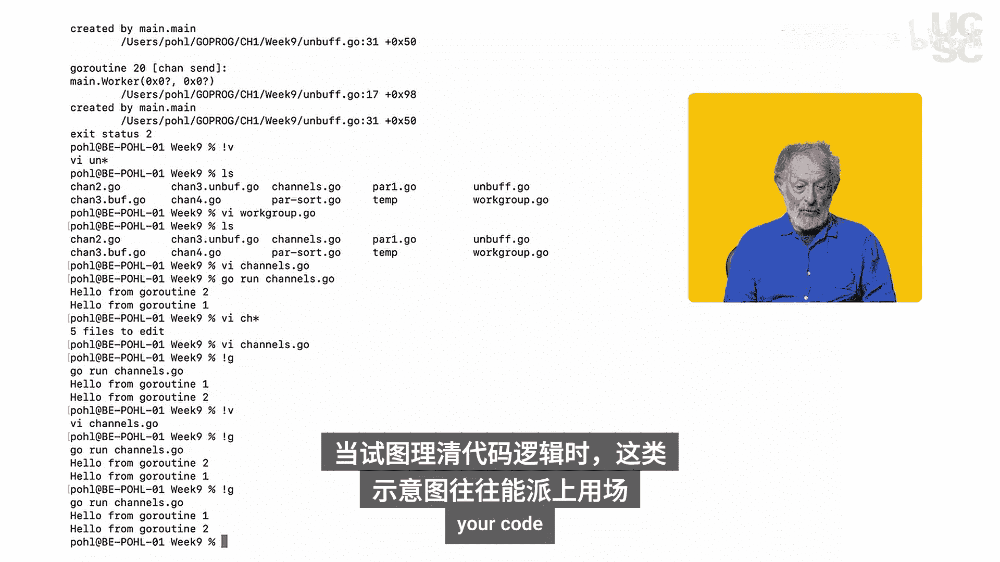

# 【加州大学】Go语言编程-｜-Go-Programming-Everyone-Part-2-p17-P17_通道和Go协程_04_01_01--BV1GTe7z3Eqi_p17-

Well， today we're starting a very big topic， channels and go routines。Both are not available。

In a language like C so the。Designers of the Go language。Realize that。In modern machines。

There's more and more possibilities for concurrency。

 for running either simultaneously or in parallel。And what they decided to do was to build concurrency into the language。

Now， if you try to do concurrency in a language like C。Where you can use。

Posit threads in the library or C plus plus， which add very extensive libraries。

 you generally have to。Learn a good deal of material that's outside the language and the language itself。

Doesn't provide the regular runtime and operations。To do normal concurrency。

But Go made a point of adding concurrency。And the two critical things in currency are the go routine and the go routine is。

When you launch a function using the keyword go next to the function name rather than just call the function normally。

 you start a new thread。Now， in go。You normally have a main program and the main program is where the starting thread is。

 so Maine is always there to start and end the thread。But when you introduce go routines。

 you add threads， in other words you add things that can run concurrently with Maine。And then。

This allows you to write way more efficient code， especially when the code can run on a number of processes。

 so if you have a modern machine。U， like my Mac。Typically， those machines now have on their。Chipps。

Several processors rather than a single CPU。So they can execute code。

Each processor can ask execute code independently and if you can harness those， you can in effect。

 run n times faster where n is the number of processes。

 so this become way more important because this is now way more available and it's a way to arbitrarily speed up your code when it's susceptible to writing in this form。

So a component piece of code can be started using a go routine and then you can coordinate that code by means of communication between the go routine that's provided by what will see to be a channel。

 so that's another thing， the channel will be a special pipe。

 a way to communicate between different threads of your program。Okay。So go routines。

 go routine is a function， so you write it just like any other function， including anonymously。

 and you just preface the call， the function call with go。

 so there's go fobar so main has started a thread and go Fubar will start a thread running concurrently with main。

All right。Now in order for these things to work properly。

Let us move on to the next slide in order to make these move properly。

 we have to have ability to communicate between the concurrent routines。So the go routines。

 this helps because。We have multiple cores on modern programming systems and that currency can have a very large speed up in running the code。

Also， some of the code that you might run might。Require some degree of asynchronous communication like one processor thread works。

 waits for another thread。To finish its job and then pass information to it so it can then。

For example， resume so some programming architectures are。

More easily expressed if you have concurrency。The downside to concurrency is a tricky。

 I mean it's hard enough to think of a linear piece of code， you know。

 A goes and then B goes and then C goes and we've been doing that forever remember。

Digital computers were invented in World War I and even。

Programs written for the early digital computers like the EnNIAC or the IBM 650。

 they were just a simple linear flow of control。Now when you have multiple。Threreads running around。

It can be very confusing， hard to follow and it can lead to problems that don't exist for normal linear code。

 so one thread may not be able to execute， maybe it doesn't have the resource to execute and it will block the program for the rest。

Of the。The program execution， so that's， for example， called Delock。

 another kind of condition that shows up again， very difficult and requires a lot of insight into getting these things right is sometimes something called a race condition where something runs too fast for another thing and then you produce an incorrect result because one thing is outrunning what you think it should be doing to help some other process。

So concurrency is tricky。But this kind of concurrency that you find in go was invented by Tony Hore。

 Tony Hore， very famous。Tururing Award winner。And one of his main contributions was something called CSP。

Cooperating sequential processes。So this was a well thought out。

 fairly simple way to write concurrent programs and make sure that they were well understood and easy to the bug and this goes back to the late 70s。

 so it's been around and tested for a long time， so thank Tony Hore for doing this。Okay。

Now we have yet another thing will actually in this part of the class be doing a fair amount with concurrency and parallelism。

 and we will introduce a number of novel things that you don't see， for example in。

More primitive programming language like C。あ。So channels。

They become very important because they enable。These threads to communicate with each other。

And they can be established in very simple ways。They typically are established by saying make。

And then in the make。You have a channel， you assign it to the channel identifier and then you make it with a particular type like an int。

 which means that that particular channel， think of it as a pipe that will pass information that are integer information and you can have channels that pass string information or float information or struck information。

 so the channel can be declared with whatever type you need for your communication。

And we'll see in one of the examples later。A use of astruct to communicate more than one item。

From one of the threads。Now the channel lets you。You can use。There's。Notation where you have。

The less than sign with a minus sign and you have。The channel passing information to an appropriate variable。

 so there's I getting information from a channel that's an int。And you can go the other way as well。

 you can pass information。From。The channel from an appropriate。

Variable into the channel so the channel provides two way communication and also you can just if you want discard。

 the last thing on on the slide is showing you how to discard the information that's sitting in the channel if it's unneeded because the channel is also an ability to coordinate。

Multiple threads and you may or may not need the information that's being passed in the channel。

 all you may need is a signal from the channel that the two processes should coordinate at that point in the program。

All right， let's move on， so let's see how a routine can use channels and let's see what happens。

We have Maine， we're going to use time， time is going to be used in this program instead of doing normal work。

 well just run the clock and let the work be simulated by running the clock for some number of seconds。

So in Maine， we're now creating a channel， we make the channel be a string and we just call the。

Declared variable C。So that's the colon equal because colon equal is when you have a declaration and you use make when you're establishing a channel。

Now。Let's get to the next slide。Now we're going to start our first go routine and this go routine is anonymous。

So we don't always have to have a name for the go routine you can of course have a go routine with a name。

 but we didn't need to， we're just starting something that will simulate some work and the work will be simulated by just holding。

嗯。The routine for two seconds， so time that sleep two times time that second means at that point in this。

Thread。This function is waiting two seconds。And then it sends a message to the channel and it just says。

And the channel was a type string， it says channel。Less than equal， less than minus。

Hello from Go routineout1， so this was go routine1。

 that's one thread and it's been enabled and now it would start running。 So go routine1。

 we have main running and now we have go routine one running let's move on to the next。

 So here's the second thread。We start the second go routine， it also does some work。

 in this case we're again simulating a work we're not using real work。

And we're just saying it sleeps for one second。 So the first go routine is。Heavavier duty。

 It's going to require two seconds to do its work。 The second go routine is going to require one second to do its work。

 and it also sends a message to the channel。 and it just says hello from go routine too。

 So mainine will see both messages Okay， so both things are started。 And here we are in mainine。

 And if you want， don't forget， there's now really three threads running。

 There's the main thread there's the first initial。

Anonymous go routine and the second initial anonymous go routine。 They're all running now。

 all three in some order。 Now， we don't care in the order。 That's up to the。Go runtime system。

 So the go runtime system internally as what you might call a scheduler。

 so it's just passing off the work。Depending on what kind of。Machine you have。

 there may be only a single processor there。 If there's a single processor。

 all three pieces of work have to share that single processor。 if there are three or more processors。

The the go operating system can say， a， more efficient， I'll just pass this work on till three。

Separate processes and will work more efficiently。 And then as you see。

 it's getting a message from the channel。 and that message will be whatever gets finished first will print there。

 right， We don't know what's coming through the channel。 Both go routines are using the channel。

 So message 1 is created and will get the channel will printed out to see which finishes first。

 and then message 2 will also get work from the channel。 and then it'll finished， and then finally。

 mainine will finish。 So all three threads will terminate and we'll see what order the work occurred。

 now hint hint。Remember how。The first。Anonymous function was written。

 it had work that was two seconds。Whereas the second go routine had worked， that was only one second。

 so if we're putting them on different processors， we could expect the one second。

 the second go routine。To finish before the first one again， as I say。

 it really depends on what resources are available and how go is assigning the work。All right。

 so let's see what's going on， we have two go routines writing to a channel。

So there's both go routines think of the little arrows as threats。

 and they're putting information into the channel and the channel is going to report back to Maine。

 which again is also a threat。So that's what's going on。

 we have the three threads and the' coordinating with the shut。

So now let's see what happens when we actually run this， so here's the program we talked about。

It's on my Mac。This Mac has a processor that I forget exactly how many I think it has over 10。呃。

Processes on the chip， so it's capable of doing a fair amount of work in parallel and later we'll see how that really can affect in a major way speed up of some serious work now here we're just doing what we just talked about and that was really artificial because we're just using the clock to sleep。

For the work。So again， in go， routines are lightweight threads managed by the go runtime they allow you to run。

Concurrent task efficiently and then channels are used to communicate between the go routines so you can send and receive values through the channels。

 which help synchronize and coordinate action between the different go routines and main。Okay。

 we've used time here because we're going to need sleep。Here's how we create a channel again， CH。

 colon equal make channel and the type of channel， in other words。

 what information are we going to place in the channel， in this case we're going to place a string。

Here we have an anonymous go routine。So。We're going to simulate some work。

 in this case we're doing a two second amount of work。And then we say hello from Go routineout1。

 the second routine， as mentioned in the earlier slide， was a one second amount of work。

 so the second go routine which is launched here is actually going to complete earlier than the first go routine and we should see that when we run the program and here's where the message is linked up so we get a message one from the channel we print it we see。

Which message is going to come first again， if our logic is right。

 we should receive a first message as hello from Go routineine 2。All right， let's try it。

Alo from go routine two，lo from go routine one。And you saw that there was。

 it didn't work that quickly because。Sleep kept the two routines to two seconds。

 so this program was going to take as a minimum two seconds。It might not take three seconds。

 it won't take two plus one because。They're both running concurrently。

 So the one second routine is off here on one processor。

 and the two second routine is here on another processor。 It's the dominant amount of work。

But you get speed up， why don't we try。To see， I'm going to change that a little bit。

 so I'm going to go back to that program。And now I'm going to。Now， this is not the right program。

I want。Channels that go。So now。Why don't I make this here， this is two seconds。

And let's make that five seconds。Now what should happen。Well， routine one should finish first。

And how long should the program take， well， it should take probably five seconds。Well。

 let's see if that works。And while it's a little hard to see that that was five seconds。You could。

Roughly tell that it was a longer one。 and you can see now go routine finish first。

 go routine one finished first because it was a faster one Now what would happen if。

We'll do one more。I'll try one more thing。What if we have both of them running for the same time？

Go routine two finish before Go routine1。Now that's because they were the same time and if they were the same time。

The go system is throwing the on processors randomly。And so。

You can't tell from time to time what gets done first。

So that's part of why it's a little more complicated to the bugg search program。

Because you have to make sure that it didn't matter who got finished first。

 I don't know if we'll see a different order by running it again， but let's try it again。Yeah。

 so this time I ran exactly the same program and the order in which the Go routines finished was Go routine one finish first and Go routineine two finished second。

So that's because they were an equal amount of work， the schedule to put them on processes。

 and then it was sort of random， which might finish first。All right。

So you should play with that yourself， especially for most of us， it's novel and it requires。

A real grasp， and it might help to also think about sketching out threads when you are。

In the old days， we used to write flow charts when we tried to understand our code and flow charts were where you had things like loops and decision points。

🎼And now you have to throw in these threading things to also see what's getting done。

 So that may so some of those diagrams can sometimes be helpful when you try to make sense out of out of your code。

Okay。

