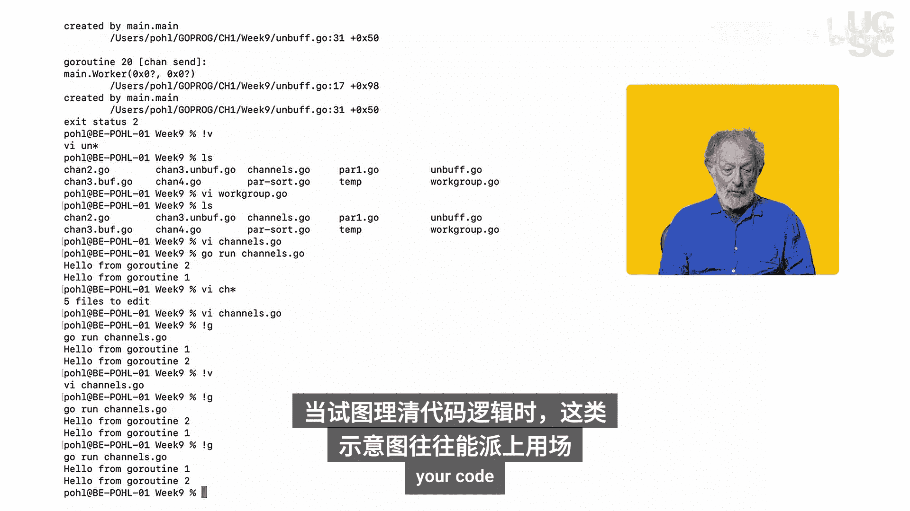

# Go语言编程：P17：通道和Go协程 🚀


在本节课中，我们将要学习Go语言中两个核心的并发概念：Go协程和通道。它们是Go语言内置的并发支持，使得编写并发程序变得更加简单和高效。

## 概述

Go语言的设计者认识到，在现代计算机硬件中，并发和并行执行的可能性越来越大。因此，他们决定将并发支持直接构建到语言中。这与C或C++等语言不同，在那些语言中，你需要依赖外部库（如POSIX线程）来实现并发，并且需要学习大量语言之外的知识。Go语言通过引入Go协程和通道，简化了并发编程。

## Go协程：轻量级线程

上一节我们介绍了并发编程的背景，本节中我们来看看Go协程。Go协程是Go语言中实现并发的基本单位。

一个Go协程本质上是一个函数。当你使用 `go` 关键字调用一个函数时，这个函数就会在一个新的、独立的线程中开始执行，这个线程与主程序（`main` 函数所在的线程）并发运行。

**代码示例：启动一个Go协程**
```go
go functionName()
```

例如，`main` 函数是程序的起始线程。当你执行 `go foo()` 时，就启动了一个与 `main` 并发运行的线程。这允许你编写效率更高的代码，尤其是在代码可以运行在多个处理器核心上时。现代计算机（如多核CPU的Mac）可以独立执行多个线程，从而可能将代码运行速度提升N倍（N是处理器核心数）。

## 通道：协程间的通信管道

仅仅启动并发任务是不够的，我们还需要一种方式来协调它们。这就是通道的用武之地。通道是一种特殊的管道，用于在不同Go协程之间安全地传递数据。

通道使用 `make` 函数创建，并指定其传递数据的类型。

**公式/代码：创建通道**
```go
ch := make(chan int) // 创建一个传递整型数据的通道
```

你可以创建传递任何类型数据的通道，例如 `string`、`float` 或自定义的 `struct`。通道支持两种基本操作：发送和接收。

**公式/代码：通道的发送与接收**
```go
ch <- value   // 发送值到通道
value := <-ch // 从通道接收值
```

通道不仅用于传递数据，还可以用于同步协程。有时，你可能不关心通道传递的具体值，而只是将其作为一个信号，表示某个协程已经完成了工作。

## 并发编程的优势与挑战

使用Go协程和通道进行并发编程主要有两大优势：
1.  **利用多核处理器**：可以显著加速计算密集型任务。
2.  **简化异步架构**：某些编程模型（如生产者-消费者、工作池）用并发来表达会更加自然。

然而，并发编程也带来了挑战。与传统的线性代码相比，多线程代码更难以理解和调试。常见的问题包括：
*   **死锁**：一个或多个协程因等待彼此持有的资源而永远阻塞。
*   **竞态条件**：多个协程以不可预测的顺序访问和修改共享数据，导致结果错误。

Go语言采用的并发模型基于托尼·霍尔提出的 **CSP（通信顺序进程）** 理论。这是一种经过深思熟虑、相对简单且易于推理的并发编程方式，有助于减少上述问题的发生。

## 实践示例：使用通道协调协程

理论介绍完毕，现在让我们通过一个具体的例子来看看Go协程和通道如何协同工作。

在这个程序中，`main` 函数将启动两个匿名Go协程，每个协程模拟执行一些“工作”（通过休眠来模拟），然后通过一个共享的通道发送消息。`main` 函数会从通道中接收这些消息。

**代码分析：**

1.  **创建通道**：`main` 函数首先创建一个传递字符串的通道。
    ```go
    ch := make(chan string)
    ```
2.  **启动第一个Go协程**：这个协程将“工作”（休眠）2秒，然后向通道发送消息。
    ```go
    go func() {
        time.Sleep(2 * time.Second)
        ch <- “Hello from Go routine 1”
    }()
    ```
3.  **启动第二个Go协程**：这个协程将“工作”（休眠）1秒，然后向通道发送消息。
    ```go
    go func() {
        time.Sleep(1 * time.Second)
        ch <- “Hello from Go routine 2”
    }()
    ```
4.  **主程序接收消息**：`main` 函数两次从通道接收消息并打印。由于通道操作是阻塞的，`main` 会等待消息到来。
    ```go
    fmt.Println(<-ch) // 接收第一个消息
    fmt.Println(<-ch) // 接收第二个消息
    ```

**运行逻辑与结果：**
程序启动后，三个线程（`main` 和两个Go协程）开始并发执行。Go运行时会负责将这些协程调度到可用的处理器核心上。

*   由于第二个协程只休眠1秒，它通常会先完成工作并向通道发送消息。
*   第一个协程休眠2秒，会稍晚发送消息。
*   因此，程序输出通常会是：
    ```
    Hello from Go routine 2
    Hello from Go routine 1
    ```
*   整个程序的最短运行时间约为2秒（由耗时最长的协程决定），而不是3秒（1秒+2秒），这体现了并发带来的效率提升。

**不确定性**：如果两个协程的工作时间相同（例如都休眠1秒），那么哪个消息先到达通道取决于Go运行时的调度，每次运行的结果可能不同。这正说明了并发程序的不确定性和调试的复杂性。

## 总结

本节课中我们一起学习了Go语言并发的两大基石：
1.  **Go协程**：使用 `go` 关键字启动的轻量级线程，是实现并发执行的基础。
2.  **通道**：使用 `make(chan Type)` 创建的类型化管道，是协程间进行**通信和同步**的安全方式。




通过“休眠-发送消息”的示例，我们看到了如何利用通道来协调多个并发协程的执行顺序，并观察了并发执行带来的效率提升和结果的不确定性。理解并掌握Go协程和通道，是编写高效、可靠Go并发程序的关键。建议你亲自动手修改示例中的休眠时间，观察不同的运行结果，以加深理解。在构思复杂并发逻辑时，绘制简单的线程执行顺序图也会非常有帮助。