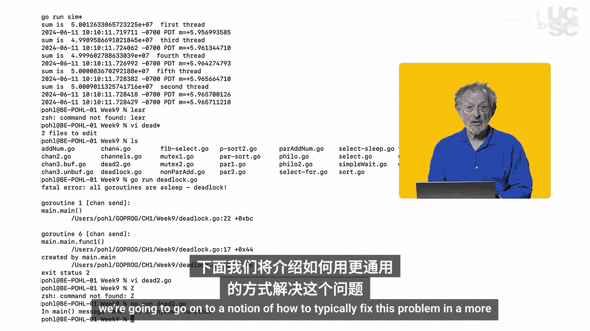

# 【加州大学】Go语言编程-｜-Go-Programming-Everyone-Part-2-p18-P18_死锁_04_01_02--BV1GTe7z3Eqi_p18-

So among the difficulties in writing concurrent programs is debugging them。Again。That makes sense。

 right， normally？In a nonconcurrent program where there's a single thread。

What I teach my students is to get out their pencil， follow the code。

Do some simple thing with some simple amount of data and just。Check at each step。What gets done。But。

When you have concurrency and you're launching threads that can run separately。

You don't know how they might interact。So you can't just。

 you might be able to check that a single thread。I's working correctly。

 but the interaction between the threads。Can also cause problems。One of the critical problems。

It's called deadadlock。So。These programs。Can have。Very tricky errors in them。Deadlock among them。

And it involves multiple threads waiting on each other。

 And you might imagine in the classic case of two Frenchmen waiting at the door being al polite。

 one says Charles says。Go after me， and Philippe says， no， go after me。

 and they end up in a deadlock。Neither one knows to go first。

So they're both contending with a resource of walking through the door。

 and only one of them can walk through the door at a time。But。Because they don't have a。

Definite pattern as to who would go first。There's deadlock。Now。In many cases。Go is smart enough。2。

Panic， you've probably written enough go code now that you've seen panic。

 panic is a classic runtime error saying something went badly wrong。 We stopped the program。

 I tell you what I think went wrong。 and so。With many cases of deadlock， the system will panic。

And we'll return with a runtime error that will help you further debug your problem。

But sometimes Dlock， just like the two Frenchmen waiting to go through the door。

They're just going to be there forever。So in some instances， all you'll see is。

The program looking like it's in an infinite loop， it's not exactly an infinite loop， it's really。

Two threads waiting on each other。And you're going to have to end the program externally。

 usually with。And a Uni system with control C from the keyboard okay。

 so this is very tricky and so you should be aware of it and now we're going to show a classic case of it。

Here is a simple program。Where we're going to have。A couple of threads。

It's going to be a main and it's going to have a channel。

 so remember channels get used for some degree of coordination。

We make a channel and the channel can have a string and we have an anonymous function。

We'll call one of the strings。Mess， and it'll say in anonymous function。呃。

I see that I'm missing on the slide a closing quote， but it'll be in the program。

 so don't worry about that now。Into channel one， we passed a message。So at this point in channel1。

 the message in anonymous function that string will be there and then。From a string。

 from another channel， we。Shove a message into a variable。And it's colon equal。

 so since the channel is a string， stress will be declared to be a string。

And then we print out format， print line， mess， and stress， which are both strings。

So that's our concurrent program， that's our go routine， that's our anonymous go routine。

 and then let's see what goes on in Maine in Maine， we say。The mess。

So we have another variable called mess local to Ma， so main is the other thread。

And that message is in Maine message。And then the channel， which we created gets that message。

And then the stress message。Gets what's in C1。And then we print mess and stress again。

 but this time for Maine。So in principle， we have two threads that are going to be running。

 the anonymous one and the one in Ma and we're going to see。What shows up？

What will happen is this program will deadlock， the program compiles。And then we'll deadlock。

 We'll see it with a fatal error that all go routines are asleep， deadlock。

So that's actually a good thing。But we want to see that in principle。

 so let's go ahead and run that program。Okay， so here we see the function I just described。Again。

C1 colon equal， that means that we're declaring C1。To be a simple channel。

What we call an unbuffffered channel that can take strings。As their messages。

C2 is a similar kind of channel， so we have those two declarations， so we have two channels。

 normally channels can be used to coordinate things。But as we'll see in this case。The order is wrong。

We have messages in the anonymous function， which should print out as an anonymous function。

And then we have messages in the main function， which would print out in the main message。And then。

Here are the channels and the channels， of course。Are used to try and coordinate？呃。The threading。

 but in this case。The leave。Gotten the order of the channels wrong。

 so we don't know who wants to go first。So it's， as I described before。

 the problem of the two Frenchmen not both being too polite to go first。

I'm going to run my Dlock program。And as I said， of course I copied it onto the notes， fatal error。

 all go routines are asleep， they're waiting on each other。

And there's other stuff that would tell you where in the program that would aid in a significant way if you knew how to mess with it。

 how to get at where things went wrong。But that's deadlock and that's going to incur as you engage yourself。

In writing code like this now。I can fix this in a very simple way。

And I think I did in a second version of this program， so let's look at the second version。

Give you a second to think about what's different， concentrate here。

What's different in the second version of the program over the first？Okay， so what's different is。

And this one。C，1 goes first。And then C2 goes first， just like in。The go routine。

 So Maine is aligned with。The additional threaded， anonymous function。

Let me run that and see what happens。Oh， that ran。And you only saw in main message and an anonymous function。

So that's what you saw。 and that means that what happened was。

You didn't get the print out from the anonymous function。You only got it from Maine again。

If we think back to our last program with the weight group， there was no waiting。

So the the main thread。Because it wasn't held up by having the wrong order of who went first just when it ahead't executed its version of the。

 of the print statement。And complete it。So。Here you did not get deadlock， but you didn't get。

The extra work that was being done in the thread。That could have been done using a work group， okay？

So you've seen some deadlock。 I am sure you'll see more of it in your own work。

 You might play again with this idea。But we're going to go on to a notion of how to typically fix this problem in a more general way。

