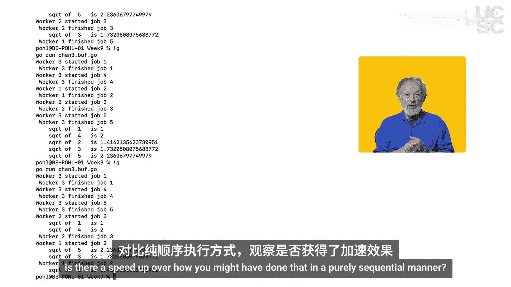

# 【加州大学】Go语言编程-｜-Go-Programming-Everyone-Part-2-p19-P19_工作者_04_01_03--BV1GTe7z3Eqi_p19-

So we're going to do quite a bit with concurrency and parallelism。

And each time we're going to try and do something more sophisticated。So in this case。

We're going to run a thread that does real work and you can think of the thread as being asked to work on a particular problem and we're going to have。

A number of threads。That'll be called to do the work。And then we'll also have。

A number of jobs for the threads to work on。 So our concurrent architecture will be here are。

Go routines。Workers。Here are jobs。They need to be computed。

And we have to make sure that jobs can be handled by the workers。

It turns out what we will need in this case is a little more complicated version of a channel。

 we're going to use what's called a buffer channel and in a buffer channel we know how many jobs we want to run concurrently。

And what this ends up doing and a little hard to describe， but you know， if you play around enough。

With concurrency and parallelism， you will find that you write programs that deadlock。

 They all of a sudden don't know who goes next and nobody knows。

Went to start running and they just stopped。Essentially。

 the go system typically panics and reports deadlock to you， so that's good。呃。And here。

If we were to use an unbffered channel and we had more。Jobs， then。Workers。

 we would find that we would get deadlock， the number of jobs would overwhelm the number of workers。

Anyway， there wouldn't be a worker available for a next job and that would be it the program would stop so to avoid this and because we know how many jobs we want to run concurrently。

 we can express in making the channel，What the size of the buffer is in the channel。

 how many messages can be put in that channel， okay， so let's go on， let's see how that works。

We're going to write a program that basically does a little bit of work rather than use sleep and the work is going to be find the square root of a number and the number will be an integer the square root will be afloat so we're going to。

Also have to do some things with casting。呃。Now。The type that we're going to stuff into the channel is going to be this square root result remember I think what I said earlier was you can have any type in the channel and if you want you can write your own struck that can have multiple fields and therefore you can pass back more than one piece of information。

Okay， so here we're passing back the number we're computing the square root of and the square root the result。

And we have a worker， so the worker is going to have。An identification number it's going to have。

A job that it gets from the channel， the job is going to be an integer。Why。

 because that's what we're computing， we're computing the square root of an integer。

And then we're going to get a result， and the result also will come from a channel。

 the result will be taken from a channel。Okay， and that will be the square root result。So。We start。

And we say4 J over the range of jobs。We're going to see what worker。

 what the worker idea is and what job is started。And then we'll see what the results are and the results are going to be a square root。

Where we will report。The number J and the square root of J and square root of J is taken from the math library and we can use math by square root float 64 why because you can't just compute square root。

Is computed over float numbers， not over integer numbers。 So we have to do a conversion there。

 And then we put。呃。That the worker has finished a job， so we initiate the job。We compute the job。

 we stuff it into the results channel。And then we print out that the worker is exiting from the routine。

Now let's go on， that's our function， and in Maine we have a certain number of jobs we're going to have five jobs。

Notice that we have a make of the channel with that number of jobs so we can。Process that many jobs。

As I said earlier without deadlock and then the results are going to be in a channel called make channelnel square root Re and it also will allow for a number of jobs we can have。

N jobs or five jobs， five results。And then we launch each thread。

And we only had specified three workers。So we launch each thread with that for loop。

We go from one to three number of workers。And each thread is its own worker， so we just say go。

 worker， go makes it a thread。And then we pass in W the jobs and the results。

 and that's what we get out， we'll get out the results and let's see the last slide。

We've sent in the number of jobs。We've received the number of results and then format our print line square root of。

Result of the number is the result of the square root and then we close everything。

Important point we frequently have。Channels。That should be closed。

 so it is your responsibility when you are using channels。To and good。

 clean code to write when you are done with the channel to close。Okay， go。Three threads are launched。

Concurrently， and they do five pieces of work。We will see that different workers will get different jobs。

 we'll see that in the output because we're going to say workers so and so got this job。

 workers so and so got this job and here's the answer。And it's possible if we have the right。

Number of processors on our chip that we have a speed up of five。Well， probably not， maybe three。

 not sure how much of the speedup will be。Between three and five。

There are our three go routines reading the job from the input channel。

And they're working on a result and they're all putting their results into the output channel and you can see how we've drawn。

Are threads。Our three workers。And then， how。Out in Maine， we get the results。Okay。So， that's。

Sort of our messy。Threadating logicdric。And now we're going to turn to the program and see how it actually runs Okay。

 let's see how that program we just described would run。呃。

We have math imported because we need the square root routine。

And here we've created a special type called square root Re where we have both the number we're finding the square root from and that's going to be an integer and we're also。

'Going to put out the result， which will be afloat。And。Here's a worker。

So it's got an integer for what worker number it is。It's got something that gets its job。

And then it's got something where it produces its result。And then its result is just going to be。

The number it's being asked to find the square root of。And then the square root of that number of J。

 and then that's going to be outputted into results。

So the output of a worker is that type square root result。It's going to go in a channel。And we have。

Buffford channel where we've made a certain number of jobs。We have fewer workers than jobs。

 so the workers are going to have to do more than one job。And then we launch。Go routines。Where。

We're giving a worker。A job。And then we send jobs and receive results。

 so here's the number of jobs each job is some integer J。And then。

Each result comes back and gets printed in the channel。 That's the result channel。

 So we get result do nu and result that square root as our answer。 And then finally， we are going to。

Close the channel。呃。Again， that's appropriate to return the channel resource to the operating system。

Okay， so let's see if this is all going to work and how that's going to look。All right。

 it went pretty quickly， it square root takes almost no time， so here look。

The first thing that you see on the screen is worker3 started job  one and worker3 finished job 1。

 worker3 started job 4， so after worker 3 started job one and finished。

 it was given another job job 4， then worker1 started job 2。And then the results get reported。

 the square root of one is one。 The square root of4 is 2。 Notice worker3 did。Job4 and worker。Three。

 the job one。And now worker one finishes job two and worker one starts job five and worker three finishes job four。

And the square root of two， which has been finished by worker 1， is 1。414， et ceter。

 and then the square root of 5 is 2。23。 all looks right。 Worker2 just started job three finally。

Worker two finishes a job and then the square root of three is 1。732。

 and then worker one finally finishes job five。So。That looks like a mess。

 looks like piece of spaghetti。But the critical point is。It didn't really matter。

It was up to the go operating system。To assign tasks to jobs， you add a pool of workers。

They were going to run concurrently。And pass back their results。And hopefully。

 there's some efficient。Scheduller in the go system that lets it know how to run on this computer and assign the job so that there can be some degree of speedup。

Now， in fact， why don't I try running that again？And I think we'll find that it doesn't。

Always come up。With the same sequence notice， this is quite different here。

 all the workers complete and before they。They've all completed and then they're all printing their answers。

So the threading where main is printinging the answers and the threading where the workers complete is such that here。

The workers all ran so quickly that they could just ship their results into the channel。

 Maine ends up printing them， but nothing is shown before that。

 notice job three is started with worker three， job three， worker three start shop four。

 worker one start Shop two， worker two starts job three。

And the assignments aren't necessarily the same as existed before。 If we do it again。

 we would see yet another scheduling。So here there are some things that are intermingled with when the jobs are finished and who finishes when。

 and， for example， the square root of2 in this case is done last， right in the previous case。

 you had square root of one done square root of four done square root of two done square root of three done square root of five done。

So it's not what you think it's not you would have thought with the way the jobs are going in an or sequential program。

You would do things one to five。Here， because the operating system is passing things on to independent processes。

 they don't necessarily show up in the same order。They're all taking a very short time and so the actual operating system。

Looks around and sees who's finished first。And that can happen in effect randomly。Okay。

 so go on and play with this， one of the things you can do with this is change the number of workers。

 change the number of tasks。Another thing you could do is make the tasks harder than just square root do some more elaborate computation。

And then you can also check and see if you do something more elaborately。On your home computer。

 is there a speed up over how you might have done that in a purely sequential manner？

Okay。

